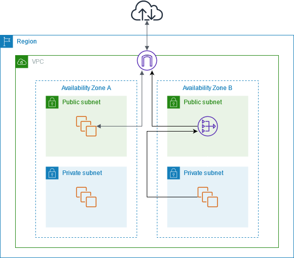

# Cleaning up AWS resources: The costs that continue after you "turn things off"

**AWS Study Group post:** [View the original post on Facebook](https://www.facebook.com/groups/awsstudygroupfcj/posts/2336113367153622)

**Posted on:** November 13, 2026.

> The original post is written in Vietnamese for the AWS Study Group community. This page is the English version for my internship report.

---

After practicing on AWS, many people stop their EC2 instances or finish a lab and assume the costs stop too. In reality, AWS charges for each resource that still exists in the account, not only for whether a machine is running. This post summarizes the costs that are easy to miss, how AWS charges for each of them, and the clean-up order to follow.

## Why "stopped" is not the same as "no charge"

When an EC2 instance is stopped, AWS does not charge for instance usage. However, attached EBS volumes are still charged for storage, and Elastic IP addresses still incur charges regardless of the instance state.

In other words, the instance is only the compute part. Disks, IP addresses, and snapshots are separate resources with their own costs.

## AWS Budgets: an alert, not a limit

AWS Budgets tracks costs and sends notifications by email or Amazon SNS when a threshold is crossed. Two points are worth noting:

* Budgets information is updated up to three times a day, so there is a delay between incurring a charge and receiving the alert.
* Budgets does not delete resources. To block spending automatically, you can configure a budget action that applies an IAM policy denying the creation of new resources once the threshold is reached.

## Costs that are easy to miss

### 1. NAT Gateway

A NAT gateway is usually placed in a public subnet so that EC2 instances in a private subnet can reach the internet.

*Source: AWS Documentation – [NAT gateway use cases](https://docs.aws.amazon.com/vpc/latest/userguide/nat-gateway-scenarios.html).*

* It is charged for every hour the NAT gateway is provisioned and available; a partial hour is billed as a full hour.
* There is also a data processing charge for each GB that passes through it.
* The pricing page example for US East (Ohio) is 0.045 USD per hour, or about 32.4 USD for 30 days, even with no traffic.

If EC2 instances only need Amazon S3, a gateway VPC endpoint is the cheaper option because it has no hourly charge and no data processing charge.

### 2. Public IPv4 and Elastic IP

* Each public IPv4 address costs 0.005 USD per hour, the same whether it is attached to a resource or idle in the account; that is about 3.6 USD for 30 days.
* After deleting a NAT gateway or an EC2 instance, release the Elastic IP if it is no longer needed.
* Public IP Insights in Amazon VPC IP Address Manager shows the public IPv4 addresses the account holds.

### 3. EBS volumes, snapshots, and AMIs

* Deregistering an AMI does not delete its snapshots unless you choose to delete them at the same time. The remaining snapshots continue to incur storage charges.
* Clean-up order: terminate the instance, delete EBS volumes in the available state, deregister the AMI, then delete the snapshots.

### 4. AWS DMS replication instances

* A replication instance is charged by the hour, even after the migration task has finished.
* T3 replication instances run in unlimited mode: if average CPU utilization over 24 hours exceeds the baseline, extra CPU credit charges apply.

### 5. AWS Quick Sight

* Quick Sight (formerly Amazon QuickSight) is charged per user: an Author costs 24 USD per user per month.
* When it is no longer needed, cancel the subscription. This permanently deletes every dashboard, analysis, and dataset in all Regions, so do it only when the data does not need to be kept.

### 6. Amazon Athena and query results in S3

* SQL queries are charged by the amount of data scanned. In the AWS example, a 3 TB uncompressed text table costs 15 USD per query (5 USD per TB); GZIP compression at 3:1 brings it down to 5 USD; converting to Parquet lets Athena read only the columns it needs, which lowers the cost further.
* Query results are stored in Amazon S3 and billed at S3 rates, so clean up the results bucket after practicing.

## Clean-up process after practicing

1. Delete resources in dependency order: stop tasks or jobs first, then delete the underlying resources.
2. Networking: delete the NAT gateway, release the Elastic IP, and delete VPC endpoints and VPN resources if any.
3. Compute and storage: terminate EC2 instances, delete leftover EBS volumes, deregister AMIs, and delete snapshots.
4. Data and analytics: delete databases and replication instances, cancel Quick Sight if unused, and clean up the S3 buckets that hold data and Athena results.
5. Use AWS Resource Explorer with cross-Region search to find leftover resources in other Regions; searching is free of charge.
6. Check Billing again the next day, because cost data is delayed.

Applying consistent tags when creating resources, for example `Project=lab-vpc`, makes filtering and cleaning up faster.

## A note on pricing

Prices in this post come from the official AWS pricing pages at the time of writing (November 2026); some examples use the US East (Ohio) Region as shown on the pricing pages. Prices vary by Region and over time, so check them with AWS Pricing Calculator for the Region you use.

## References

1. Amazon EC2 Documentation — [Amazon EC2 instance state changes](https://docs.aws.amazon.com/AWSEC2/latest/UserGuide/ec2-instance-lifecycle.html)
2. AWS Cost Management Documentation — [Managing your costs with AWS Budgets](https://docs.aws.amazon.com/cost-management/latest/userguide/budgets-managing-costs.html)
3. [Amazon VPC Pricing](https://aws.amazon.com/vpc/pricing/)
4. Amazon VPC Documentation — [NAT gateway use cases](https://docs.aws.amazon.com/vpc/latest/userguide/nat-gateway-scenarios.html)
5. Amazon EC2 Documentation — [Deregister an Amazon EC2 AMI](https://docs.aws.amazon.com/AWSEC2/latest/UserGuide/deregister-ami.html)
6. [AWS DMS Pricing](https://aws.amazon.com/dms/pricing/)
7. [AWS Quick Sight Pricing](https://aws.amazon.com/quick/quicksight/pricing/)
8. AWS Quick Documentation — [Account details in AWS Quick](https://docs.aws.amazon.com/quick/latest/userguide/manage-qs-account-settings.html)
9. [Amazon Athena Pricing](https://aws.amazon.com/athena/pricing/)
10. AWS Resource Explorer Documentation — [What is AWS Resource Explorer?](https://docs.aws.amazon.com/resource-explorer/latest/userguide/welcome.html)

`#AWS` `#CostOptimization` `#AWSBudgets` `#AmazonVPC` `#AmazonEC2` `#AmazonAthena` `#AWSStudyGroup` `#FirstCloudJourney`
