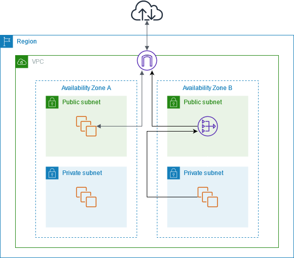

# Dọn dẹp tài nguyên AWS: Những khoản phí vẫn phát sinh sau khi đã "tắt"

**Bài đăng trên AWS Study Group:** chờ cập nhật link sau khi đăng.

**Ngày đăng:** chờ cập nhật.

---

Sau khi thực hành trên AWS, nhiều người dừng EC2 hoặc hoàn thành bài lab và nghĩ rằng chi phí cũng dừng lại. Thực tế, AWS tính phí theo từng tài nguyên còn tồn tại trong tài khoản, không chỉ theo việc máy có đang chạy hay không. Bài viết tổng hợp các khoản phí dễ bị bỏ sót, cách AWS tính phí cho từng khoản và thứ tự dọn dẹp nên áp dụng.

## Vì sao "tắt" chưa phải là "hết phí"?

Khi một EC2 instance ở trạng thái stopped, AWS không tính phí sử dụng instance. Tuy nhiên, EBS volume gắn với instance vẫn bị tính phí lưu trữ, và Elastic IP vẫn phát sinh phí bất kể trạng thái của instance.

Nói cách khác, instance chỉ là phần tính toán. Ổ đĩa, địa chỉ IP và snapshot là các tài nguyên riêng, có chi phí riêng.

## AWS Budgets: cảnh báo, không phải giới hạn

AWS Budgets theo dõi chi phí và gửi thông báo qua email hoặc Amazon SNS khi vượt ngưỡng. Có hai điểm cần lưu ý:

* Dữ liệu Budgets được cập nhật tối đa ba lần mỗi ngày, nên có độ trễ giữa lúc phát sinh phí và lúc nhận cảnh báo.
* Budgets không tự xóa tài nguyên. Nếu cần chặn tự động, có thể cấu hình budget action để áp một IAM policy từ chối tạo thêm tài nguyên khi vượt ngưỡng.

## Các khoản phí dễ bỏ sót

### 1. NAT Gateway

NAT gateway thường được đặt ở public subnet để EC2 trong private subnet truy cập internet.

*Nguồn: AWS Documentation – [NAT gateway use cases](https://docs.aws.amazon.com/vpc/latest/userguide/nat-gateway-scenarios.html).*

* Tính phí cho mỗi giờ NAT gateway được tạo và sẵn sàng; một phần giờ được tính tròn thành một giờ.
* Cộng thêm phí xử lý cho mỗi GB dữ liệu đi qua.
* Ví dụ trên trang pricing tại US East (Ohio): 0,045 USD/giờ, tức khoảng 32,4 USD nếu để 30 ngày, kể cả khi không có traffic.

Nếu EC2 chỉ cần truy cập Amazon S3, gateway VPC endpoint là lựa chọn rẻ hơn vì không tính phí theo giờ và không tính phí xử lý dữ liệu.

### 2. Public IPv4 và Elastic IP

* Mỗi địa chỉ public IPv4 tính 0,005 USD/giờ, như nhau dù đang gắn vào tài nguyên hay để không trong tài khoản; khoảng 3,6 USD cho 30 ngày.
* Sau khi xóa NAT gateway hoặc EC2, cần release Elastic IP nếu không còn dùng.
* Có thể theo dõi các địa chỉ public IPv4 đang giữ bằng Public IP Insights trong Amazon VPC IP Address Manager.

### 3. EBS volume, snapshot và AMI

* Deregister AMI không tự xóa snapshot liên quan, trừ khi chọn xóa snapshot cùng lúc. Snapshot còn lại tiếp tục bị tính phí lưu trữ.
* Thứ tự dọn dẹp: terminate instance, xóa EBS volume ở trạng thái available, deregister AMI, rồi xóa snapshot.

### 4. AWS DMS replication instance

* Replication instance tính phí theo giờ, kể cả khi migration task đã hoàn tất.
* Replication instance dòng T3 chạy ở chế độ unlimited: nếu CPU trung bình trong 24 giờ vượt baseline, sẽ phát sinh thêm phí CPU credit.

### 5. AWS Quick Sight

* Quick Sight (trước đây là Amazon QuickSight) tính phí theo người dùng: tài khoản Author là 24 USD/người dùng/tháng.
* Khi không còn sử dụng, cần hủy subscription. Thao tác này xóa vĩnh viễn toàn bộ dashboard, analysis và dataset ở mọi Region, nên chỉ thực hiện khi không cần giữ dữ liệu.

### 6. Amazon Athena và kết quả truy vấn trên S3

* Truy vấn SQL tính phí theo lượng dữ liệu quét. Trong ví dụ của AWS, bảng 3 TB dạng text chưa nén tốn 15 USD cho một truy vấn (5 USD/TB); nén GZIP tỷ lệ 3:1 giảm còn 5 USD; chuyển sang Parquet giúp Athena chỉ đọc cột cần thiết nên chi phí giảm thêm.
* Kết quả truy vấn được lưu trên Amazon S3 và tính theo giá S3, nên cần dọn bucket chứa kết quả sau khi thực hành.

## Quy trình dọn dẹp sau khi thực hành

1. Xóa tài nguyên theo thứ tự phụ thuộc: dừng task hoặc job trước, sau đó mới xóa tài nguyên nền.
2. Mạng: xóa NAT gateway, release Elastic IP, xóa VPC endpoint và VPN nếu có.
3. Compute và lưu trữ: terminate EC2, xóa EBS volume còn sót, deregister AMI, xóa snapshot.
4. Dữ liệu và phân tích: xóa database và replication instance, hủy Quick Sight nếu không dùng, dọn bucket S3 chứa dữ liệu và kết quả Athena.
5. Dùng AWS Resource Explorer với tìm kiếm cross-Region để tìm tài nguyên còn sót ở các Region khác; việc tìm kiếm không tính phí.
6. Kiểm tra lại Billing vào ngày hôm sau, vì dữ liệu chi phí có độ trễ.

Gắn tag thống nhất cho tài nguyên ngay từ lúc tạo, ví dụ `Project=lab-vpc`, giúp lọc và dọn dẹp nhanh hơn.

## Lưu ý về giá

Giá trong bài lấy từ trang pricing chính thức của AWS tại thời điểm viết (11/2026); một số ví dụ dùng Region US East (Ohio) theo trang pricing. Giá thay đổi theo Region và theo thời gian, nên cần kiểm tra lại bằng AWS Pricing Calculator cho Region đang sử dụng.

## Nguồn tham khảo

1. Amazon EC2 Documentation — [Amazon EC2 instance state changes](https://docs.aws.amazon.com/AWSEC2/latest/UserGuide/ec2-instance-lifecycle.html)
2. AWS Cost Management Documentation — [Managing your costs with AWS Budgets](https://docs.aws.amazon.com/cost-management/latest/userguide/budgets-managing-costs.html)
3. [Amazon VPC Pricing](https://aws.amazon.com/vpc/pricing/)
4. Amazon VPC Documentation — [NAT gateway use cases](https://docs.aws.amazon.com/vpc/latest/userguide/nat-gateway-scenarios.html)
5. Amazon EC2 Documentation — [Deregister an Amazon EC2 AMI](https://docs.aws.amazon.com/AWSEC2/latest/UserGuide/deregister-ami.html)
6. [AWS DMS Pricing](https://aws.amazon.com/dms/pricing/)
7. [AWS Quick Sight Pricing](https://aws.amazon.com/quick/quicksight/pricing/)
8. AWS Quick Documentation — [Account details in AWS Quick](https://docs.aws.amazon.com/quick/latest/userguide/manage-qs-account-settings.html)
9. [Amazon Athena Pricing](https://aws.amazon.com/athena/pricing/)
10. AWS Resource Explorer Documentation — [What is AWS Resource Explorer?](https://docs.aws.amazon.com/resource-explorer/latest/userguide/welcome.html)
