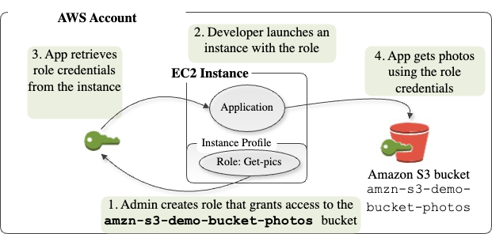

# IAM roles on EC2 and IMDSv2: Where does your application get its credentials?

Applications running on EC2 often need to call AWS services such as Amazon S3 or DynamoDB. The quickest approach is to put an access key in the code or a configuration file, but an access key is a **long-term credential**. AWS recommends that workloads running on AWS use the **temporary credentials of an IAM role**, so there is no need to distribute long-lived access keys.

This post explains how EC2 receives IAM role credentials, how IMDSv2 works, and the configuration mistakes that are easy to make.

## Instance profiles: the link between EC2 and an IAM role

EC2 does not attach an IAM role directly. It uses an **instance profile** as a container for the role.



*Source: AWS IAM User Guide – [Use an IAM role to grant permissions to applications running on Amazon EC2 instances](https://docs.aws.amazon.com/IAM/latest/UserGuide/id_roles_use_switch-role-ec2.html).*

* When you create a role in the IAM console, an instance profile with the same name is created automatically. With the AWS CLI or an SDK, you create the role and the instance profile separately.
* An instance profile contains only **one** IAM role; a role can be included in multiple instance profiles.
* To change an instance's permissions, **replace its instance profile**. Removing a role from an instance profile can take **up to one hour** to take effect.

The flow has four steps:

1. An admin creates an IAM role with the required permissions (for example, read access to an S3 bucket).
2. A developer launches an EC2 instance with that role.
3. The application retrieves the role credentials from inside the instance.
4. The application uses those credentials to call S3.

## Where do the credentials come from?

Credentials are provided by the **Instance Metadata Service (IMDS)** at the link-local address `169.254.169.254`, called from inside the instance:

```text
/latest/meta-data/iam/security-credentials/<role-name>
```

The response contains `AccessKeyId`, `SecretAccessKey`, `Token`, and `Expiration`. Key points:

* The credentials are **temporary** and **rotated automatically** by AWS; new credentials are available **at least five minutes** before the old ones expire.
* The AWS SDKs and AWS CLI retrieve these credentials automatically, so the application code does not need to contain an access key.
* IMDS queries are throttled per instance. **Cache the credentials** until they approach expiry instead of calling IMDS on every request.

## How does IMDSv2 work?

By default, an instance accepts both **IMDSv1** (a simple request/response method) and **IMDSv2** (session-oriented, requires a token). IMDSv2 has two steps:

**Step 1 – Get a token with PUT**, specifying the token lifetime (from one second to six hours):

```bash
TOKEN=$(curl -sf -X PUT "http://169.254.169.254/latest/api/token" \
  -H "X-aws-ec2-metadata-token-ttl-seconds: 21600")
```

**Step 2 – Send GET requests with the token in a header:**

```bash
curl -sf -H "X-aws-ec2-metadata-token: $TOKEN" \
  http://169.254.169.254/latest/meta-data/iam/security-credentials/
```

Token rules:

* A token is bound to the instance that created it and does not work anywhere else.
* A token can be reused until it expires; after that, send another PUT to get a new one.
* A GET with an invalid or expired token returns **401 Unauthorized**.

## Why is IMDSv2 more secure?

According to the AWS Security Blog, IMDSv2 adds protection for scenarios where requests are relayed to IMDS from outside:

* **Open WAFs:** most WAFs do not pass PUT requests, so they cannot open an IMDSv2 session.
* **Open reverse proxies:** proxies usually add the `X-Forwarded-For` header; IMDSv2 **rejects PUT requests that contain it**.
* **SSRF:** the attacker must both send a PUT and include the secret token in the headers of later GET requests; most SSRF vulnerabilities cannot do both.
* **Open firewalls, NATs, routers, and VPNs:** the token response has an IP **hop limit (TTL) of 1**, so it is discarded before it leaves the instance.

A limit to keep in mind: requests made from the instance itself can still get a token. IMDSv2 does not replace **least privilege** for the IAM role, because code running on the instance can still use the role's permissions.

## Common configuration mistakes

### 1. Containers cannot get a token

The default hop limit for the PUT response is **1**. A container running on EC2 adds a network hop, so it may not receive the token. Some AWS SDKs retry and then fall back to IMDSv1, which causes delays. AWS recommends raising the hop limit to **2** in container environments.

### 2. A curl script "succeeds" but the token is an error message

When IMDS returns an error, curl still returns a success status and stores the error message in the `TOKEN` variable. Use the `-f` option so that curl returns an error status and the script stops at the right point.

### 3. Services that make HTTP calls on the application's behalf

HTTP proxies, HTML/CSS validator services, and XML processors that support XML inclusion can **expose credentials** if they make HTTP requests on behalf of the application.

### 4. An account-level default is set, but older instances still use IMDSv1

Setting IMDSv2 as the account-level default **does not change existing instances**; each instance must be updated.

## Requiring IMDSv2

* **At launch:** in the console, choose *Metadata version = V2 only (token required)*; with the AWS CLI, set `HttpTokens=required` and `HttpEndpoint=enabled`:

  ```bash
  aws ec2 run-instances ... \
    --metadata-options "HttpEndpoint=enabled,HttpTokens=required,HttpPutResponseHopLimit=2"
  ```

* **Account level (per Region):** set V2 only as the default for new instances, and optionally turn on *Enforce IMDSv2* to block launching instances that do not require IMDSv2.
* **Before switching:** make sure applications no longer depend on IMDSv1 and that SDK/CLI versions support IMDSv2.

## Key takeaways

* Use an **IAM role and instance profile** instead of access keys on EC2.
* Role credentials are temporary, rotated automatically, and retrieved through IMDS.
* IMDSv2 uses session tokens: **PUT to get a token, GET with the token**.
* Require IMDSv2, set the hop limit to 2 for containers, and keep the role's permissions to a minimum.

## AWS Study Group post

**Link:** [View the original post on Facebook](https://www.facebook.com/groups/awsstudygroupfcj/posts/2340606156704343)

**Posted on:** November 17, 2026.

## References

1. AWS IAM User Guide — [Security best practices in IAM](https://docs.aws.amazon.com/IAM/latest/UserGuide/best-practices.html)
2. AWS IAM User Guide — [Use an IAM role to grant permissions to applications running on Amazon EC2 instances](https://docs.aws.amazon.com/IAM/latest/UserGuide/id_roles_use_switch-role-ec2.html) (diagram source)
3. Amazon EC2 User Guide — [IAM roles for Amazon EC2](https://docs.aws.amazon.com/AWSEC2/latest/UserGuide/iam-roles-for-amazon-ec2.html)
4. Amazon EC2 User Guide — [Retrieve security credentials from instance metadata](https://docs.aws.amazon.com/AWSEC2/latest/UserGuide/instance-metadata-security-credentials.html)
5. Amazon EC2 User Guide — [Use the Instance Metadata Service to access instance metadata](https://docs.aws.amazon.com/AWSEC2/latest/UserGuide/configuring-instance-metadata-service.html)
6. Amazon EC2 User Guide — [Access instance metadata for an EC2 instance](https://docs.aws.amazon.com/AWSEC2/latest/UserGuide/instancedata-data-retrieval.html)
7. Amazon EC2 User Guide — [Configure instance metadata options for new instances](https://docs.aws.amazon.com/AWSEC2/latest/UserGuide/configuring-IMDS-new-instances.html)
8. AWS Security Blog — [Add defense in depth against open firewalls, reverse proxies, and SSRF vulnerabilities with enhancements to the EC2 Instance Metadata Service](https://aws.amazon.com/blogs/security/defense-in-depth-open-firewalls-reverse-proxies-ssrf-vulnerabilities-ec2-instance-metadata-service/)

`#AWS` `#AmazonEC2` `#AWSIAM` `#IMDSv2` `#CloudSecurity` `#AWSStudyGroup` `#FirstCloudJourney`
