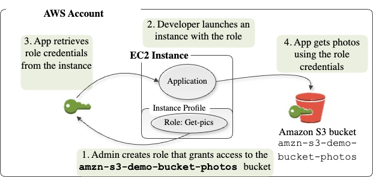

# IAM role trên EC2 và IMDSv2: Ứng dụng lấy credentials từ đâu?

**Bài đăng trên AWS Study Group:** [Xem bài gốc trên Facebook](https://www.facebook.com/groups/awsstudygroupfcj/posts/2340606156704343)

**Ngày đăng:** 17/11/2026.

---

Ứng dụng chạy trên EC2 thường cần gọi các dịch vụ AWS như Amazon S3 hay DynamoDB. Cách nhanh nhất là đặt access key vào code hoặc file cấu hình, nhưng access key là **long-term credentials**. AWS khuyến nghị workload chạy trên AWS dùng **credentials tạm thời của IAM role**, không cần phân phối access key dài hạn.

Bài viết giải thích EC2 nhận credentials của IAM role như thế nào, IMDSv2 hoạt động ra sao và những lỗi cấu hình thường gặp.

## Instance profile: cầu nối giữa EC2 và IAM role

EC2 không gắn trực tiếp IAM role mà dùng **instance profile** làm "vỏ chứa" cho role.



*Nguồn: AWS IAM User Guide – [Use an IAM role to grant permissions to applications running on Amazon EC2 instances](https://docs.aws.amazon.com/IAM/latest/UserGuide/id_roles_use_switch-role-ec2.html).*

* Tạo role trên IAM console thì instance profile cùng tên được tạo tự động. Tạo bằng AWS CLI hoặc SDK thì phải tạo role và instance profile riêng.
* Mỗi instance profile chỉ chứa **một** IAM role; một role có thể nằm trong nhiều instance profile.
* Muốn đổi quyền của instance, nên **thay instance profile**. Gỡ role khỏi instance profile có thể mất **tới 1 giờ** mới có hiệu lực.

Luồng hoạt động gồm 4 bước:

1. Admin tạo IAM role với quyền cần thiết (ví dụ đọc một S3 bucket).
2. Developer launch EC2 instance kèm role đó.
3. Ứng dụng lấy credentials của role từ bên trong instance.
4. Ứng dụng dùng credentials đó để gọi S3.

## Credentials đến từ đâu?

Credentials được cung cấp qua **Instance Metadata Service (IMDS)** tại địa chỉ link-local `169.254.169.254`, gọi từ bên trong instance:

```text
/latest/meta-data/iam/security-credentials/<tên-role>
```

Kết quả trả về gồm `AccessKeyId`, `SecretAccessKey`, `Token` và `Expiration`. Một số đặc điểm quan trọng:

* Credentials là **tạm thời** và được AWS **tự động xoay vòng**; bộ mới có sẵn **ít nhất 5 phút** trước khi bộ cũ hết hạn.
* AWS SDK và AWS CLI tự lấy credentials này, nên code ứng dụng không cần chứa access key.
* IMDS có giới hạn tần suất truy vấn theo từng instance. Nên **cache credentials** đến gần lúc hết hạn thay vì gọi IMDS ở mọi request.

## IMDSv2 hoạt động như thế nào?

Mặc định, instance chấp nhận cả **IMDSv1** (request/response đơn giản) và **IMDSv2** (theo phiên, cần token). IMDSv2 gồm 2 bước:

**Bước 1 – Lấy token bằng PUT**, kèm thời gian sống của token (từ 1 giây đến 6 giờ):

```bash
TOKEN=$(curl -sf -X PUT "http://169.254.169.254/latest/api/token" \
  -H "X-aws-ec2-metadata-token-ttl-seconds: 21600")
```

**Bước 2 – Gửi GET kèm token trong header:**

```bash
curl -sf -H "X-aws-ec2-metadata-token: $TOKEN" \
  http://169.254.169.254/latest/meta-data/iam/security-credentials/
```

Quy tắc của token:

* Token gắn với instance đã tạo ra nó, không dùng được ở máy khác.
* Có thể dùng lại token đến khi hết hạn; hết hạn thì gửi PUT để lấy token mới.
* GET dùng token sai hoặc hết hạn sẽ nhận lỗi **401 Unauthorized**.

## Vì sao IMDSv2 an toàn hơn?

Theo AWS Security Blog, IMDSv2 bổ sung các lớp bảo vệ cho những kịch bản request bị chuyển tiếp tới IMDS từ bên ngoài:

* **WAF cấu hình mở:** phần lớn WAF không chuyển tiếp request PUT, nên không mở được phiên IMDSv2.
* **Reverse proxy mở:** proxy thường thêm header `X-Forwarded-For`; IMDSv2 **từ chối PUT có header này**.
* **SSRF:** kẻ tấn công phải vừa gửi được PUT, vừa đưa token bí mật vào header của các GET tiếp theo; phần lớn lỗ hổng SSRF không làm được cả hai.
* **Firewall, NAT, router, VPN cấu hình mở:** gói tin trả token có **hop limit (TTL) = 1** ở tầng IP, nên bị loại bỏ trước khi rời khỏi instance.

Giới hạn cần hiểu: request xuất phát từ chính instance vẫn lấy được token. IMDSv2 không thay thế nguyên tắc **least privilege** cho IAM role, vì code chạy trên instance vẫn dùng được quyền của role.

## Những lỗi cấu hình thường gặp

### 1. Container không lấy được token

Hop limit mặc định của response PUT là **1**. Container chạy trên EC2 thêm một hop mạng, nên có thể không nhận được token. Một số AWS SDK sẽ thử lại rồi quay về IMDSv1, gây chậm. AWS khuyến nghị tăng hop limit lên **2** trong môi trường container.

### 2. Script curl "thành công" nhưng token là thông báo lỗi

Khi IMDS trả lỗi, curl vẫn trả mã thành công và lưu thông báo lỗi vào biến `TOKEN`. Dùng tùy chọn `-f` để curl trả mã lỗi và script dừng đúng lúc.

### 3. Dịch vụ gọi HTTP thay mặt ứng dụng

HTTP proxy, dịch vụ validate HTML/CSS hoặc XML processor hỗ trợ XML inclusion có thể làm **lộ credentials** nếu chúng gửi request HTTP thay cho ứng dụng.

### 4. Đặt mặc định ở cấp tài khoản nhưng instance cũ vẫn dùng IMDSv1

Thiết lập mặc định IMDSv2 ở cấp tài khoản **không thay đổi instance đang chạy**; phải cập nhật từng instance.

## Bắt buộc dùng IMDSv2

* **Khi launch instance:** console chọn *Metadata version = V2 only (token required)*; AWS CLI đặt `HttpTokens=required` và `HttpEndpoint=enabled`:

  ```bash
  aws ec2 run-instances ... \
    --metadata-options "HttpEndpoint=enabled,HttpTokens=required,HttpPutResponseHopLimit=2"
  ```

* **Cấp tài khoản (theo từng Region):** đặt mặc định V2 only cho instance mới, có thể bật *Enforce IMDSv2* để chặn launch instance không yêu cầu IMDSv2.
* **Trước khi chuyển:** kiểm tra ứng dụng không còn phụ thuộc IMDSv1 và phiên bản SDK/CLI đã hỗ trợ IMDSv2.

## Điều cần nhớ

* Dùng **IAM role + instance profile** thay cho access key trên EC2.
* Credentials của role là tạm thời, được xoay vòng tự động và lấy qua IMDS.
* IMDSv2 dùng token theo phiên: **PUT để lấy token, GET kèm token**.
* Bắt buộc IMDSv2, đặt hop limit 2 nếu chạy container, và vẫn giữ quyền của role ở mức tối thiểu.

## Nguồn tham khảo

1. AWS IAM User Guide — [Security best practices in IAM](https://docs.aws.amazon.com/IAM/latest/UserGuide/best-practices.html)
2. AWS IAM User Guide — [Use an IAM role to grant permissions to applications running on Amazon EC2 instances](https://docs.aws.amazon.com/IAM/latest/UserGuide/id_roles_use_switch-role-ec2.html) (nguồn sơ đồ)
3. Amazon EC2 User Guide — [IAM roles for Amazon EC2](https://docs.aws.amazon.com/AWSEC2/latest/UserGuide/iam-roles-for-amazon-ec2.html)
4. Amazon EC2 User Guide — [Retrieve security credentials from instance metadata](https://docs.aws.amazon.com/AWSEC2/latest/UserGuide/instance-metadata-security-credentials.html)
5. Amazon EC2 User Guide — [Use the Instance Metadata Service to access instance metadata](https://docs.aws.amazon.com/AWSEC2/latest/UserGuide/configuring-instance-metadata-service.html)
6. Amazon EC2 User Guide — [Access instance metadata for an EC2 instance](https://docs.aws.amazon.com/AWSEC2/latest/UserGuide/instancedata-data-retrieval.html)
7. Amazon EC2 User Guide — [Configure instance metadata options for new instances](https://docs.aws.amazon.com/AWSEC2/latest/UserGuide/configuring-IMDS-new-instances.html)
8. AWS Security Blog — [Add defense in depth against open firewalls, reverse proxies, and SSRF vulnerabilities with enhancements to the EC2 Instance Metadata Service](https://aws.amazon.com/blogs/security/defense-in-depth-open-firewalls-reverse-proxies-ssrf-vulnerabilities-ec2-instance-metadata-service/)

`#AWS` `#AmazonEC2` `#AWSIAM` `#IMDSv2` `#CloudSecurity` `#AWSStudyGroup` `#FirstCloudJourney`
