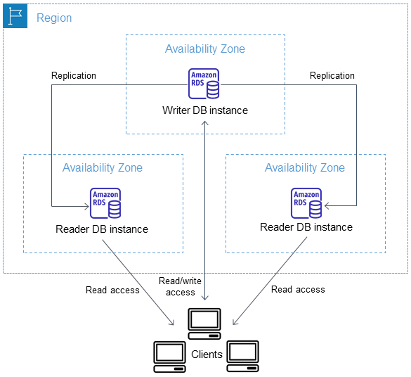
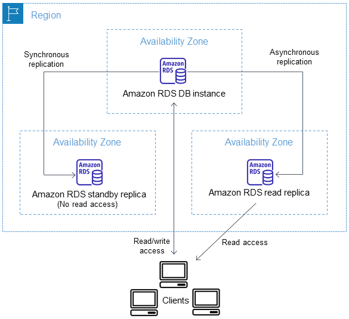

# Amazon RDS: Multi-AZ or read replica? Choosing between high availability and read scaling

**AWS Study Group post:** [View the original post on Facebook](https://www.facebook.com/groups/awsstudygroupfcj/posts/2347065196058439)

**Posted on:** November 23, 2026.

> The original post is written in Vietnamese for the AWS Study Group community. This page is the English version for my internship report.

---

Amazon RDS offers three deployment options that keep a replica of the data in another Availability Zone (AZ): **Multi-AZ DB instance**, **Multi-AZ DB cluster**, and **read replica**. They serve two different goals:

* **High availability (HA):** when the primary instance fails, the application switches to the copy and keeps running.
* **Read scaling:** move read queries off the primary instance to reduce its load.

The differences come down to three points: the replication mode, the failover mechanism, and whether the copy serves read traffic.

## The three options at a glance

| | Multi-AZ DB instance | Multi-AZ DB cluster | Read replica |
| --- | --- | --- | --- |
| Main purpose | High availability | High availability + reads | Read scaling |
| Replication | Synchronous | Semisynchronous | Asynchronous |
| Copy serves reads | No | Yes (2 readers) | Yes |
| Failover | Automatic, typically 60–120 seconds | Automatic, typically under 35 seconds | Manual (promote) |
| Placement | 2 AZs in one Region | 3 AZs in one Region | Same AZ, another AZ, or another Region |
| Engines | MariaDB, MySQL, Oracle, PostgreSQL, SQL Server | MySQL, PostgreSQL | MySQL, MariaDB, PostgreSQL, Oracle, SQL Server, Db2 |

## Multi-AZ DB instance: one standby, for failover only

RDS automatically provisions and maintains a **synchronous standby replica** in another AZ. Each change on the primary is written to the standby before it is acknowledged.

* **The standby does not serve reads.** According to the AWS documentation, this is not a read scaling solution; to read from a copy, use a Multi-AZ DB cluster or a read replica.
* **Failover through DNS:** RDS changes the DNS record of the endpoint to point to the standby. Failover typically takes **60–120 seconds**, and can take longer with large transactions or a lengthy recovery. The application must **reconnect** after failover.
* **When automatic failover happens:** OS patching during the maintenance window, an unhealthy or unreachable primary host, a busy and unresponsive primary, a failed storage volume, or *Reboot with failover*.
* **Backups are taken from the standby**, which avoids the brief I/O suspension on the primary when a snapshot starts.
* **Trade-off:** synchronous replication **increases write and commit latency** compared with Single-AZ. AWS recommends Provisioned IOPS for production.
* MariaDB, MySQL, Oracle, and PostgreSQL use Amazon failover technology; SQL Server uses Database Mirroring or Always On Availability Groups.

You can convert a running Single-AZ instance to Multi-AZ by modifying the instance and enabling the Multi-AZ option.

## Multi-AZ DB cluster: two readable standbys

A Multi-AZ DB cluster has **one writer and two readers in three separate AZs** in the same Region. It is not the same as an Aurora DB cluster.

*Source: Amazon RDS User Guide – [Multi-AZ DB cluster deployments for Amazon RDS](https://docs.aws.amazon.com/AmazonRDS/latest/UserGuide/multi-az-db-clusters-concepts.html).*

* **Semisynchronous replication:** a change is committed once **at least one reader** acknowledges it; it does not wait for every reader to apply it.
* **Readers serve reads and are failover targets.** When the writer fails, RDS promotes the reader with the most recent change record. Failover typically takes **under 35 seconds**.
* **Three kinds of endpoint:**
  * **Cluster (writer) endpoint:** connects to the writer and is the only endpoint for write statements (DML, DDL).
  * **Reader endpoint** (its name contains `-ro`): spreads connections across the readers and allows only read statements.
  * **Instance endpoints:** point to each instance, mainly for diagnosis.
* **Replica lag affects failover time:** RDS must resolve the lag before it promotes a new writer. Lag usually grows with high write concurrency, heavy reads on the readers, or large transactions and DDL. Monitor it with the CloudWatch metric `ReplicaLag`.
* **Limits to know:** only MySQL and PostgreSQL, and only certain instance classes (for example db.m6gd, db.r6gd, db.c6gd); no stopping or starting the cluster, storage autoscaling, option groups, Kerberos, IPv6 dual-stack, or cross-Region automated backups.

## Read replica: an asynchronous copy for read scaling

RDS creates a read replica from a snapshot of the source instance, then uses the **engine's built-in asynchronous replication** to apply changes.

*Source: Amazon RDS User Guide – [Working with DB instance read replicas](https://docs.aws.amazon.com/AmazonRDS/latest/UserGuide/USER_ReadRepl.html).*

* **How many:** up to **15** read replicas per MySQL, MariaDB, PostgreSQL, or SQL Server instance; up to **5** for Oracle. Autoscaling the number of replicas is not supported.
* **Read-only:** a replica accepts only read-only connections. MySQL and MariaDB replicas can be made writable, but writing to a replica is not recommended.
* **Lag:** because replication is asynchronous, data on the replica can be behind the source. Monitor `ReplicaLag`; for MySQL and MariaDB, a value of `-1` means replication is not active.
* **Cross-Region:** a replica can live in another Region, to serve reads close to users or as a disaster recovery option.
* **Manual promotion:** promoting turns the replica into a **standalone, writable DB instance**. RDS stops replication and reboots the replica, which takes several minutes or longer depending on size. After promotion it cannot become a replica again.
* **Requirement:** the source instance must have automated backups enabled (a retention period other than 0).
* **Cost:** a replica is billed as a standard DB instance at its instance class rate. There is no charge for data transfer between the source and the replica within the same Region.

A read replica can **enable Multi-AZ itself** to get its own standby, independent of whether the source is Multi-AZ.

## Combining Multi-AZ and read replicas

The two mechanisms are not mutually exclusive. A common architecture:

* The source instance uses **Multi-AZ** to survive an AZ failure: a synchronous standby with automatic failover.
* Add **read replicas** for dashboards, reports, and heavy queries, so they do not affect the write path.
* Add a **cross-Region read replica** (with Multi-AZ on the replica if needed) for a Region-wide outage, accepting manual promotion.

## Application requirements

1. **Connect through endpoints, not IP addresses.** The IP behind an endpoint changes on failover.
2. **Keep the DNS cache short.** AWS recommends a JVM DNS TTL of **no more than 60 seconds** (`networkaddress.cache.ttl=60`). Connection pools should drop old connections after failover.
3. **Reconnect and retry**, because existing connections are dropped during failover.
4. **Separate reads from writes:** always write through the writer endpoint; queries that need the latest data should also read from the writer; only queries that tolerate lag (reports, statistics) should read from readers or replicas.
5. **Monitor `ReplicaLag`** and set a CloudWatch alarm when it crosses a threshold.
6. **Test failover before you need it:** *Reboot with failover* for a Multi-AZ DB instance, or `aws rds failover-db-cluster` for a Multi-AZ DB cluster. The *Multi-AZ instance failover completed* event is the authoritative sign that failover is done.

## Choosing by requirement

* **The database just needs to survive an AZ failure:** Multi-AZ DB instance.
* **You need faster failover, lower write latency, and reads from the standbys**, on MySQL or PostgreSQL: Multi-AZ DB cluster.
* **Read queries overload the primary** and can tolerate data a few seconds old: read replicas.
* **You need a plan for a Region-wide outage:** a cross-Region read replica, accepting manual promotion.
* **Important production workloads:** combine Multi-AZ for HA with read replicas for reads.

## Summary

* **Multi-AZ is for surviving failures; read replicas are for sharing load.**
* Multi-AZ DB instance: synchronous standby, not readable, automatic failover in 60–120 seconds.
* Multi-AZ DB cluster: 1 writer + 2 readers in 3 AZs, semisynchronous, failover typically under 35 seconds.
* Read replica: asynchronous, can lag, promoted manually, can be in another Region.
* The application must use endpoints, keep a short DNS TTL, reconnect, and monitor `ReplicaLag`.

## References

1. Amazon RDS User Guide — [Configuring and managing a Multi-AZ deployment for Amazon RDS](https://docs.aws.amazon.com/AmazonRDS/latest/UserGuide/Concepts.MultiAZ.html)
2. Amazon RDS User Guide — [Multi-AZ DB instance deployments for Amazon RDS](https://docs.aws.amazon.com/AmazonRDS/latest/UserGuide/Concepts.MultiAZSingleStandby.html)
3. Amazon RDS User Guide — [Failing over a Multi-AZ DB instance for Amazon RDS](https://docs.aws.amazon.com/AmazonRDS/latest/UserGuide/Concepts.MultiAZ.Failover.html)
4. Amazon RDS User Guide — [Multi-AZ DB cluster deployments for Amazon RDS](https://docs.aws.amazon.com/AmazonRDS/latest/UserGuide/multi-az-db-clusters-concepts.html) (source of the Multi-AZ DB cluster diagram)
5. Amazon RDS User Guide — [Connecting to a Multi-AZ DB cluster for Amazon RDS](https://docs.aws.amazon.com/AmazonRDS/latest/UserGuide/multi-az-db-clusters-concepts-connection-management.html)
6. Amazon RDS User Guide — [Failing over a Multi-AZ DB cluster for Amazon RDS](https://docs.aws.amazon.com/AmazonRDS/latest/UserGuide/multi-az-db-clusters-concepts-failover.html)
7. Amazon RDS User Guide — [Limitations of Multi-AZ DB clusters for Amazon RDS](https://docs.aws.amazon.com/AmazonRDS/latest/UserGuide/multi-az-db-clusters-concepts.Limitations.html)
8. Amazon RDS User Guide — [Working with DB instance read replicas](https://docs.aws.amazon.com/AmazonRDS/latest/UserGuide/USER_ReadRepl.html) (source of the read replica and standby diagram)
9. Amazon RDS User Guide — [Promoting a read replica to be a standalone DB instance](https://docs.aws.amazon.com/AmazonRDS/latest/UserGuide/USER_ReadRepl.Promote.html)
10. Amazon RDS User Guide — [Monitoring read replication](https://docs.aws.amazon.com/AmazonRDS/latest/UserGuide/USER_ReadRepl.Monitoring.html)
11. [Amazon RDS Read Replicas](https://aws.amazon.com/rds/features/read-replicas/)

`#AWS` `#AmazonRDS` `#HighAvailability` `#MultiAZ` `#ReadReplica` `#CloudArchitecture` `#AWSStudyGroup` `#FirstCloudJourney`
