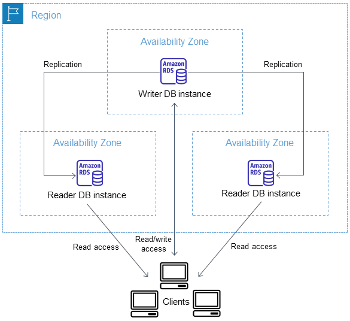
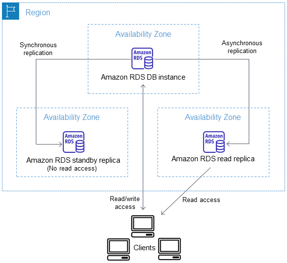

# Amazon RDS: Multi-AZ hay Read Replica? Chọn đúng giữa high availability và read scaling

**Bài đăng trên AWS Study Group:** [Xem bài gốc trên Facebook](https://www.facebook.com/groups/awsstudygroupfcj/posts/2347065196058439)

**Ngày đăng:** 23/11/2026.

---

Amazon RDS có ba deployment option cùng tạo replica của dữ liệu ở Availability Zone (AZ) khác: **Multi-AZ DB instance**, **Multi-AZ DB cluster** và **read replica**. Ba option này phục vụ hai mục tiêu khác nhau:

* **High availability (HA):** khi primary instance gặp sự cố, ứng dụng chuyển sang replica và tiếp tục chạy.
* **Read scaling:** chuyển bớt read query khỏi primary instance để giảm tải.

Khác biệt nằm ở ba điểm: replication mode, cơ chế failover và replica có phục vụ read traffic hay không.

## Tổng quan ba lựa chọn

| | Multi-AZ DB instance | Multi-AZ DB cluster | Read replica |
| --- | --- | --- | --- |
| Mục đích chính | High availability | High availability + read scaling | Read scaling |
| Replication | Synchronous | Semisynchronous | Asynchronous |
| Phục vụ read traffic | Không | Có (2 reader) | Có |
| Failover | Tự động, thường 60–120 giây | Tự động, thường dưới 35 giây | Thủ công (promote) |
| Phạm vi | 2 AZ trong một Region | 3 AZ trong một Region | Cùng AZ, khác AZ hoặc khác Region |
| Engine | MariaDB, MySQL, Oracle, PostgreSQL, SQL Server | MySQL, PostgreSQL | MySQL, MariaDB, PostgreSQL, Oracle, SQL Server, Db2 |

## Multi-AZ DB instance: một standby chỉ để failover

RDS tự tạo và duy trì một **standby replica** ở AZ khác bằng **synchronous replication**: mỗi thay đổi trên primary được ghi sang standby trước khi được xác nhận.

* **Standby không phục vụ read traffic.** Theo tài liệu AWS, đây không phải giải pháp read scaling; muốn đọc từ replica thì dùng Multi-AZ DB cluster hoặc read replica.
* **Failover qua DNS:** RDS đổi DNS record của endpoint sang standby. Failover thường mất **60–120 giây**, có thể lâu hơn nếu có transaction lớn hoặc quá trình recovery dài. Ứng dụng phải **reconnect** sau failover.
* **Các trường hợp failover tự động:** OS patching trong maintenance window, primary host unhealthy hoặc mất kết nối mạng, primary bận không phản hồi, storage volume bị lỗi, hoặc khi chạy *Reboot with failover*.
* **Automated backup được lấy từ standby**, nên tránh được I/O suspension ngắn trên primary khi bắt đầu snapshot.
* **Đánh đổi:** synchronous replication làm **write latency và commit latency tăng** so với Single-AZ. AWS khuyến nghị dùng Provisioned IOPS cho production.
* MariaDB, MySQL, Oracle và PostgreSQL dùng failover technology của Amazon; SQL Server dùng Database Mirroring hoặc Always On Availability Groups.

Có thể chuyển một instance Single-AZ đang chạy sang Multi-AZ bằng cách modify instance và bật tùy chọn Multi-AZ.

## Multi-AZ DB cluster: hai standby phục vụ được read traffic

Multi-AZ DB cluster gồm **một writer instance và hai reader instance ở ba AZ khác nhau** trong cùng Region. Đây không phải Aurora DB cluster.

*Nguồn: Amazon RDS User Guide – [Multi-AZ DB cluster deployments for Amazon RDS](https://docs.aws.amazon.com/AmazonRDS/latest/UserGuide/multi-az-db-clusters-concepts.html).*

* **Semisynchronous replication:** một thay đổi được commit khi **ít nhất một reader** xác nhận, không cần chờ mọi reader apply xong.
* **Reader vừa phục vụ read traffic, vừa là failover target.** Khi writer lỗi, RDS promote reader có change record mới nhất. Failover thường mất **dưới 35 giây**.
* **Ba loại endpoint:**
  * **Cluster endpoint (writer endpoint):** kết nối tới writer, là endpoint duy nhất cho write statement (DML, DDL).
  * **Reader endpoint** (tên có `-ro`): phân phối connection tới các reader, chỉ cho phép read statement.
  * **Instance endpoint:** trỏ tới từng instance, chủ yếu dùng để chẩn đoán.
* **Replica lag ảnh hưởng thời gian failover:** RDS phải xử lý hết replica lag trước khi promote writer mới. Replica lag thường tăng khi write concurrency cao, reader chịu read workload nặng, hoặc có transaction/DDL lớn. Theo dõi qua CloudWatch metric `ReplicaLag`.
* **Giới hạn cần biết:** chỉ hỗ trợ MySQL và PostgreSQL, một số instance class nhất định (ví dụ db.m6gd, db.r6gd, db.c6gd); không hỗ trợ stop/start cluster, storage autoscaling, option group, Kerberos authentication, IPv6 dual-stack, cross-Region automated backup.

## Read replica: asynchronous replication cho read scaling

RDS tạo read replica từ snapshot của source instance, sau đó dùng **native asynchronous replication của engine** để cập nhật các thay đổi.

*Nguồn: Amazon RDS User Guide – [Working with DB instance read replicas](https://docs.aws.amazon.com/AmazonRDS/latest/UserGuide/USER_ReadRepl.html).*

* **Số lượng:** tối đa **15** read replica cho mỗi instance MySQL, MariaDB, PostgreSQL, SQL Server; tối đa **5** với Oracle. Không hỗ trợ autoscaling số lượng replica.
* **Read-only:** replica chỉ nhận read-only connection. Với MySQL/MariaDB có thể cho phép ghi, nhưng không nên ghi vào replica.
* **Replica lag:** vì replication là asynchronous, dữ liệu trên replica có thể chậm hơn source. Theo dõi metric `ReplicaLag`; giá trị `-1` với MySQL/MariaDB nghĩa là replication không hoạt động.
* **Cross-Region read replica:** replica có thể đặt ở Region khác, phục vụ read traffic gần người dùng hoặc làm phương án disaster recovery.
* **Promote thủ công:** promote biến replica thành **standalone DB instance** cho phép ghi. RDS dừng replication và reboot replica, quá trình mất vài phút hoặc lâu hơn tùy kích thước. Sau khi promote, instance không thể trở lại làm replica.
* **Điều kiện:** source instance phải bật automated backup (backup retention period khác 0).
* **Chi phí:** replica được tính phí như một DB instance thông thường theo instance class. Không tính phí data transfer giữa source và replica trong cùng Region.

Read replica có thể **tự bật Multi-AZ** để có standby riêng, độc lập với việc source instance có bật Multi-AZ hay không.

## Kết hợp Multi-AZ và read replica

Hai cơ chế không loại trừ nhau. Một kiến trúc thường gặp:

* Source instance bật **Multi-AZ** để chịu được AZ failure: standby synchronous, failover tự động.
* Thêm **read replica** cho dashboard, reporting và các query nặng, để không ảnh hưởng write path.
* Thêm **cross-Region read replica** (bật Multi-AZ cho replica nếu cần) làm phương án khi xảy ra Region outage, chấp nhận promote thủ công.

## Yêu cầu phía ứng dụng

1. **Kết nối qua endpoint, không dùng IP.** IP phía sau endpoint thay đổi khi failover.
2. **Giữ DNS TTL ngắn.** AWS khuyến nghị đặt DNS TTL của JVM **không quá 60 giây** (`networkaddress.cache.ttl=60`). Connection pool cần loại bỏ connection cũ sau failover.
3. **Có cơ chế reconnect và retry**, vì các connection hiện có bị ngắt khi failover.
4. **Tách read và write:** write luôn đi qua writer endpoint; query cần dữ liệu mới nhất (strong read consistency) cũng nên đọc từ writer; chỉ các query chấp nhận replica lag (reporting, thống kê) mới đọc từ reader hoặc read replica.
5. **Theo dõi `ReplicaLag`** và đặt CloudWatch alarm khi lag vượt ngưỡng.
6. **Kiểm thử failover trước khi cần:** *Reboot with failover* với Multi-AZ DB instance, hoặc `aws rds failover-db-cluster` với Multi-AZ DB cluster. Event *Multi-AZ instance failover completed* là dấu hiệu chính xác cho biết failover đã hoàn tất.

## Lựa chọn theo yêu cầu

* **Chỉ cần database tiếp tục hoạt động khi một AZ gặp sự cố:** Multi-AZ DB instance.
* **Cần failover nhanh hơn, write latency thấp hơn và muốn đọc từ standby**, dùng MySQL hoặc PostgreSQL: Multi-AZ DB cluster.
* **Read query làm quá tải primary**, chấp nhận dữ liệu chậm vài giây: read replica.
* **Cần phương án disaster recovery cho Region outage:** cross-Region read replica, chấp nhận promote thủ công.
* **Workload production quan trọng:** kết hợp Multi-AZ cho high availability và read replica cho read scaling.

## Tóm tắt

* **Multi-AZ dùng cho high availability, read replica dùng cho read scaling.**
* Multi-AZ DB instance: standby synchronous, không phục vụ read traffic, failover tự động trong 60–120 giây.
* Multi-AZ DB cluster: 1 writer + 2 reader ở 3 AZ, semisynchronous replication, failover thường dưới 35 giây.
* Read replica: asynchronous replication, có replica lag, promote thủ công, có thể đặt ở Region khác.
* Ứng dụng phải kết nối qua endpoint, giữ DNS TTL ngắn, có cơ chế reconnect và theo dõi `ReplicaLag`.

## Nguồn tham khảo

1. Amazon RDS User Guide — [Configuring and managing a Multi-AZ deployment for Amazon RDS](https://docs.aws.amazon.com/AmazonRDS/latest/UserGuide/Concepts.MultiAZ.html)
2. Amazon RDS User Guide — [Multi-AZ DB instance deployments for Amazon RDS](https://docs.aws.amazon.com/AmazonRDS/latest/UserGuide/Concepts.MultiAZSingleStandby.html)
3. Amazon RDS User Guide — [Failing over a Multi-AZ DB instance for Amazon RDS](https://docs.aws.amazon.com/AmazonRDS/latest/UserGuide/Concepts.MultiAZ.Failover.html)
4. Amazon RDS User Guide — [Multi-AZ DB cluster deployments for Amazon RDS](https://docs.aws.amazon.com/AmazonRDS/latest/UserGuide/multi-az-db-clusters-concepts.html) (nguồn sơ đồ Multi-AZ DB cluster)
5. Amazon RDS User Guide — [Connecting to a Multi-AZ DB cluster for Amazon RDS](https://docs.aws.amazon.com/AmazonRDS/latest/UserGuide/multi-az-db-clusters-concepts-connection-management.html)
6. Amazon RDS User Guide — [Failing over a Multi-AZ DB cluster for Amazon RDS](https://docs.aws.amazon.com/AmazonRDS/latest/UserGuide/multi-az-db-clusters-concepts-failover.html)
7. Amazon RDS User Guide — [Limitations of Multi-AZ DB clusters for Amazon RDS](https://docs.aws.amazon.com/AmazonRDS/latest/UserGuide/multi-az-db-clusters-concepts.Limitations.html)
8. Amazon RDS User Guide — [Working with DB instance read replicas](https://docs.aws.amazon.com/AmazonRDS/latest/UserGuide/USER_ReadRepl.html) (nguồn sơ đồ read replica và standby replica)
9. Amazon RDS User Guide — [Promoting a read replica to be a standalone DB instance](https://docs.aws.amazon.com/AmazonRDS/latest/UserGuide/USER_ReadRepl.Promote.html)
10. Amazon RDS User Guide — [Monitoring read replication](https://docs.aws.amazon.com/AmazonRDS/latest/UserGuide/USER_ReadRepl.Monitoring.html)
11. [Amazon RDS Read Replicas](https://aws.amazon.com/rds/features/read-replicas/)

`#AWS` `#AmazonRDS` `#HighAvailability` `#MultiAZ` `#ReadReplica` `#CloudArchitecture` `#AWSStudyGroup` `#FirstCloudJourney`
