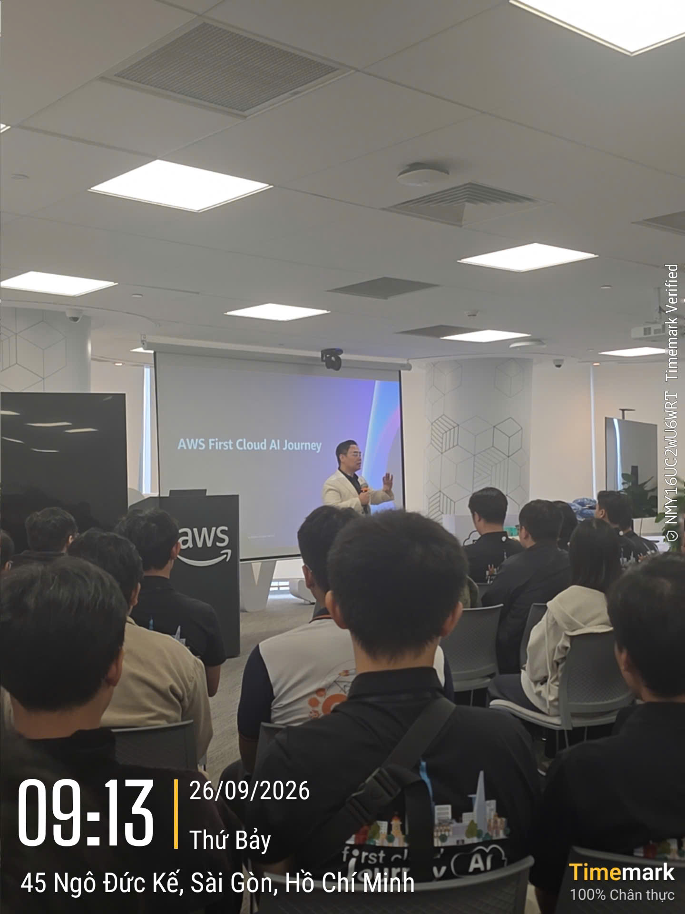
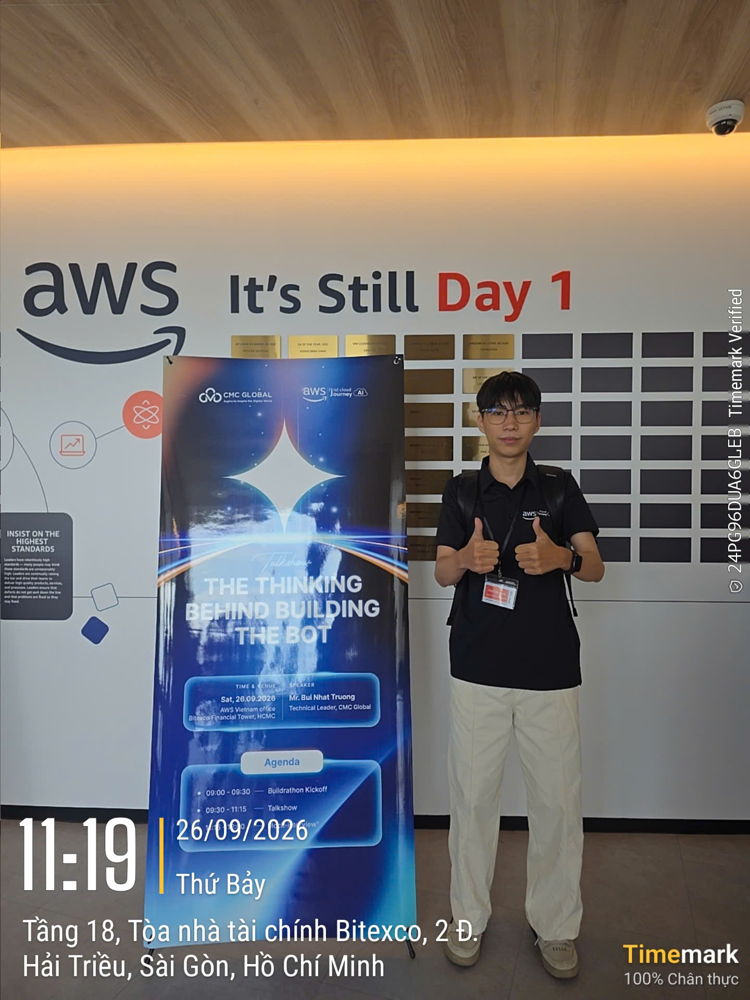
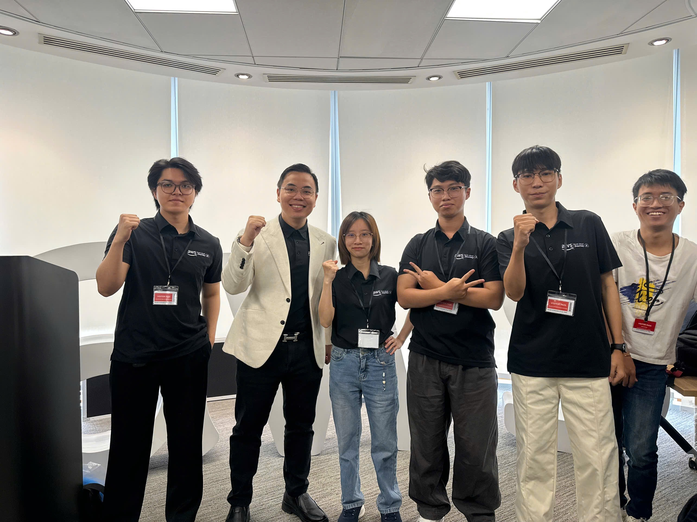

### Event information

&emsp; **Event Name:** Buildrathon Kickoff: Code the Future with CMC Global

&emsp; **Date & Time:** 09:00 a.m., September 26, 2026 (UTC+7)

&emsp; **Location:** Bitexco Financial Tower, Ho Chi Minh City

&emsp; **Role:** Attendee

&emsp; **Event Page:** [Buildrathon Kickoff on Luma](https://luma.com/8fe9vvps)

### Event objectives

- Introduce Buildrathon, its objectives, and the direction for participants.
- Connect AWS Cloud and AI learning with practical perspectives from industry practitioners.
- Discuss the thinking behind AI applications through the talkshow *The Thinking Behind Building the Bot*.
- Give students opportunities to meet the community, hear from practitioners, and explore learning and career directions in Cloud and AI.

### Speakers

| Order | Speaker | Position | Contribution to the event |
| --- | --- | --- | --- |
| 1 | [Hung Gia Nguyen](https://www.linkedin.com/in/jotaguy/) | Head of Solutions Architect, AWS Vietnam and Cambodia | Delivered the opening and introduced Buildrathon's purpose and direction for participants. |
| 2 | [Truong Nhat Bui](https://www.linkedin.com/in/dominicbui0000/) | Tech Lead, CMC Global | Presented technical topics, including an AI-enabled Slack bot architecture, and responded to questions. |
| 3 | [Thien Lu](https://www.linkedin.com/in/thienluhoan/) | Program Manager, FCAJ | Participated as a speaker representing the FCAJ program. |

The introduction helped me understand the context of Buildrathon. The technical session then connected the discussion to an application example, making it easier to relate the event to my studies.

### Key highlights

#### Program introduction and Buildrathon orientation

- Hung Gia Nguyen opened the program and explained the purpose of Buildrathon.
- The introduction helped attendees see how Cloud and AI learning can connect with building a product.
- For me, this raised a question to answer before choosing an internship project, namely who the product will help and which need it will address.

#### The Thinking Behind Building the Bot talkshow

- Truong Nhat Bui shared technical perspectives and introduced an architecture example for a Slack bot with AI capabilities.
- The example gave me a concrete reference for thinking about application structure, from receiving a request to processing it and returning a result.
- I want to explore each component's responsibilities and how the components work together before trying to build a bot myself.

#### Discussion with the speaker

- The question-and-answer discussion gave attendees an opportunity to clarify points from the presentation.
- I participated as a listener, followed the discussion, and related the topics to my AWS learning.
- Areas that require more study will guide my further reading and the questions I prepare for conversations with my mentor.

### Key takeaways

#### Product thinking

- Identify the intended users and their needs before selecting technology.
- Keep the scope appropriate for the available time and my ability to implement it.
- Define verifiable outcomes so that I can assess whether an exercise meets its objectives.

#### Approaching architecture

- Break a system into components with clear responsibilities.
- Follow the data flow to understand how those components work together.
- Practice explaining design choices and how to check each step in a workflow.

#### Learning skills

- Record interesting points and unresolved questions after a presentation.
- Combine reading with a small exercise that has a clear objective.
- Participate in the community to encounter different perspectives on work and technology.

### Applying to work

- **Prepare my personal workshop.** I plan to choose a small problem, describe its users, and identify its main functionality.
- **Outline the architecture.** I will define the inputs, outputs, and workflow before considering AWS services.
- **Explore AI applications.** I want to study how to provide context and evaluate a bot's answers.
- **Update my worklog.** I will record technical decisions, experiment results, and errors encountered during my studies.

### Event experience

The kickoff was a memorable experience early in my internship. Hearing the presentations in person at the AWS office motivated me to explore Cloud and AI and think more concretely about my own practical learning.

#### Learning from industry practitioners

- Heard the program's direction from AWS and FCAJ representatives.
- Followed the technical presentation from the CMC Global representative.
- Connected the topics with choosing a project and planning my learning during the internship.

#### Participating with the community

- Attended the event and kept a check-in photo.
- Took a group photo with others.
- Experienced a learning environment connecting students, the community, and industry practitioners.

The hands-on AI Agent Challenge listed in the published agenda did not take place during this event. My participation focused on listening to the presentations and following the discussion.

#### Some event photos

*Figure 1. The opening session on September 26, 2026, featuring AWS First Cloud AI Journey.*

*Figure 2. My check-in photo beside the talkshow standee at the AWS office. The standee displays the topic, speaker, and event date.*

*Figure 3. A group photo with others at the event. All images in this article come from my personal event photo collection.*
