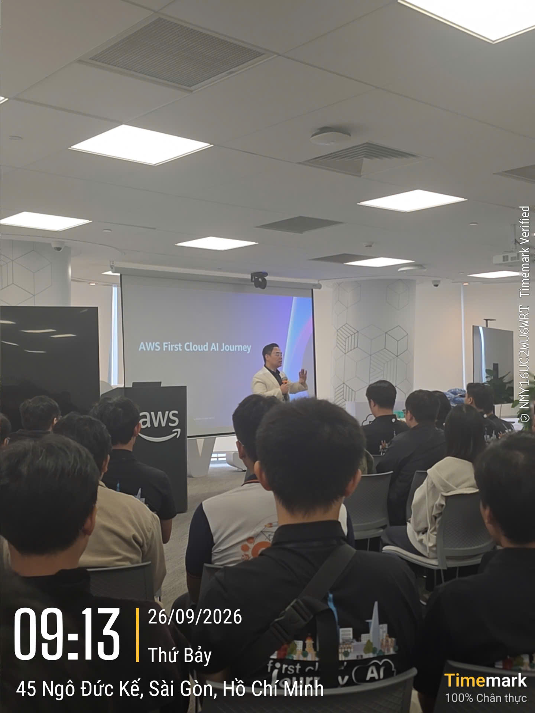
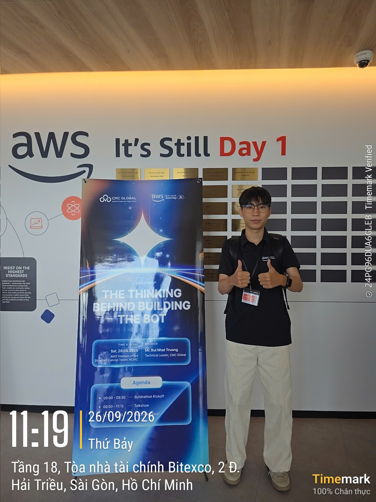
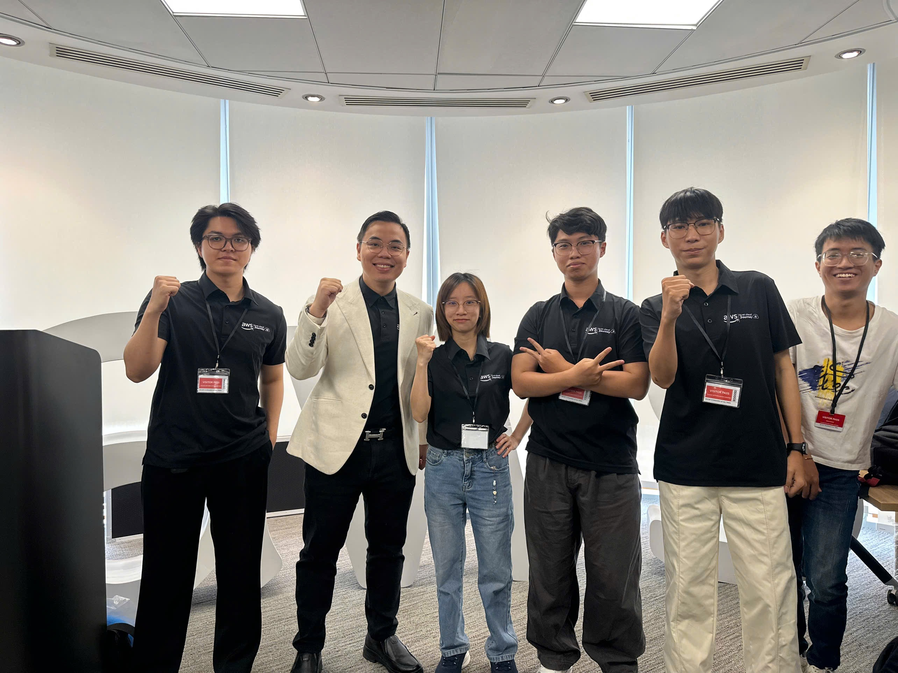

### Thông tin sự kiện

&emsp; **Tên sự kiện:** Buildrathon Kickoff: Code the Future with CMC Global

&emsp; **Thời gian:** 09:00, ngày 26/09/2026 (UTC+7)

&emsp; **Địa điểm:** Bitexco Financial Tower, Thành phố Hồ Chí Minh

&emsp; **Vai trò:** Người tham dự

&emsp; **Trang sự kiện:** [Buildrathon Kickoff trên Luma](https://luma.com/8fe9vvps)

### Mục tiêu sự kiện

- Giới thiệu chương trình Buildrathon, mục tiêu và định hướng dành cho người tham gia.
- Kết nối việc học AWS Cloud và AI với góc nhìn thực tế từ những người làm trong ngành.
- Chia sẻ tư duy xây dựng ứng dụng AI thông qua talkshow *The Thinking Behind Building the Bot*.
- Tạo cơ hội để sinh viên tiếp xúc với cộng đồng, nghe chia sẻ và tìm hướng phát triển trong lĩnh vực Cloud và AI.

### Diễn giả

| STT | Diễn giả | Chức vụ | Đóng góp tại sự kiện |
| --- | --- | --- | --- |
| 1 | [Hung Gia Nguyen](https://www.linkedin.com/in/jotaguy/) | Head of Solutions Architect, AWS Vietnam and Cambodia | Mở đầu chương trình, giới thiệu Buildrathon và định hướng cho người tham gia. |
| 2 | [Truong Nhat Bui](https://www.linkedin.com/in/dominicbui0000/) | Tech Lead, CMC Global | Chia sẻ nội dung kỹ thuật, giới thiệu ví dụ kiến trúc Slack bot có AI và giải đáp câu hỏi. |
| 3 | [Thien Lu](https://www.linkedin.com/in/thienluhoan/) | Program Manager, FCAJ | Tham gia với vai trò diễn giả, đại diện chương trình FCAJ. |

Phần giới thiệu giúp tôi hiểu bối cảnh của Buildrathon. Tiếp đó, phần chia sẻ kỹ thuật đưa nội dung về một ví dụ ứng dụng cụ thể, giúp tôi dễ liên hệ hơn với kiến thức đang học.

### Nội dung nổi bật

#### Giới thiệu chương trình và định hướng Buildrathon

- Anh Hung Gia Nguyen mở đầu chương trình và chia sẻ mục đích của Buildrathon.
- Nội dung định hướng giúp người tham dự hình dung việc học Cloud và AI gắn với quá trình xây dựng sản phẩm.
- Với tôi, phần này gợi ra một câu hỏi cần trả lời trước khi chọn đề tài thực tập, đó là sản phẩm sẽ giúp ai và giải quyết nhu cầu gì.

#### Talkshow The Thinking Behind Building the Bot

- Anh Truong Nhat Bui chia sẻ góc nhìn kỹ thuật và giới thiệu ví dụ kiến trúc một Slack bot có tích hợp AI.
- Ví dụ này giúp tôi có điểm tham chiếu cụ thể khi suy nghĩ về cách tổ chức một ứng dụng, từ tiếp nhận yêu cầu đến xử lý và trả kết quả.
- Tôi muốn tìm hiểu thêm trách nhiệm của từng thành phần và cách chúng phối hợp trước khi tự thử xây dựng một bot.

#### Trao đổi với diễn giả

- Phần giải đáp câu hỏi tạo cơ hội để người tham dự làm rõ các nội dung trong bài chia sẻ.
- Tôi tham gia với vai trò người nghe, theo dõi nội dung và liên hệ với quá trình học AWS của mình.
- Những điểm cần tìm hiểu sâu hơn sẽ là cơ sở để tôi đọc thêm tài liệu và chuẩn bị câu hỏi khi trao đổi với mentor.

### Bài học rút ra

#### Tư duy xây dựng sản phẩm

- Xác định người dùng và nhu cầu cụ thể trước khi lựa chọn công nghệ.
- Giới hạn phạm vi phù hợp với thời gian và khả năng thực hiện.
- Đặt ra đầu ra có thể kiểm tra để biết bài thực hành đã đáp ứng mục tiêu hay chưa.

#### Cách tiếp cận kiến trúc

- Chia hệ thống thành các thành phần có trách nhiệm rõ ràng.
- Theo dõi đường đi của dữ liệu để hiểu cách các thành phần phối hợp.
- Tập giải thích lý do lựa chọn và cách kiểm tra từng bước trong luồng xử lý.

#### Kỹ năng học tập

- Ghi lại nội dung quan tâm và các câu hỏi còn chưa rõ sau mỗi buổi chia sẻ.
- Kết hợp đọc tài liệu với một bài thực hành nhỏ, có mục tiêu cụ thể.
- Chủ động tham gia cộng đồng để tiếp xúc với nhiều góc nhìn về công việc và công nghệ.

### Áp dụng vào công việc

- **Chuẩn bị workshop cá nhân.** Tôi dự định chọn một bài toán nhỏ, mô tả người dùng và xác định chức năng chính.
- **Phác thảo kiến trúc.** Tôi sẽ làm rõ đầu vào, đầu ra và luồng xử lý trước khi cân nhắc dịch vụ AWS.
- **Tìm hiểu ứng dụng AI.** Tôi muốn nghiên cứu cách cung cấp ngữ cảnh và đánh giá câu trả lời của một bot.
- **Cập nhật worklog.** Tôi sẽ ghi lại quyết định kỹ thuật, kết quả thử nghiệm và những lỗi gặp phải trong quá trình tự học.

### Trải nghiệm tham gia sự kiện

Buổi kickoff là một trải nghiệm đáng nhớ trong thời gian đầu thực tập của tôi. Được nghe chia sẻ trực tiếp tại văn phòng AWS giúp tôi có thêm động lực tìm hiểu Cloud và AI, đồng thời suy nghĩ cụ thể hơn về hướng thực hành của bản thân.

#### Lắng nghe chia sẻ từ người làm trong ngành

- Tiếp cận định hướng chương trình từ đại diện AWS và FCAJ.
- Theo dõi phần chia sẻ kỹ thuật từ đại diện CMC Global.
- Liên hệ những nội dung được trình bày với việc lựa chọn đề tài và cách học trong kỳ thực tập.

#### Tham gia cùng cộng đồng

- Có mặt tại sự kiện với vai trò người tham dự và lưu lại ảnh check-in.
- Chụp ảnh lưu niệm cùng mọi người.
- Cảm nhận được môi trường học tập có sự kết nối giữa sinh viên, cộng đồng và người làm trong ngành.

Phần hands-on AI Agent Challenge có trong lịch giới thiệu đã không diễn ra trong buổi này. Hoạt động tham dự của tôi tập trung vào nghe chia sẻ và theo dõi nội dung trao đổi.

#### Một số hình ảnh tại sự kiện

*Hình 1. Không khí buổi khai mạc ngày 26/09/2026, với phần trình bày về AWS First Cloud AI Journey.*

*Hình 2. Ảnh check-in của tôi bên standee talkshow tại văn phòng AWS. Standee ghi tên chủ đề, diễn giả và ngày tổ chức.*

*Hình 3. Ảnh lưu niệm cùng mọi người tại sự kiện. Nguồn các ảnh trong bài là bộ ảnh tham dự cá nhân của tôi.*
