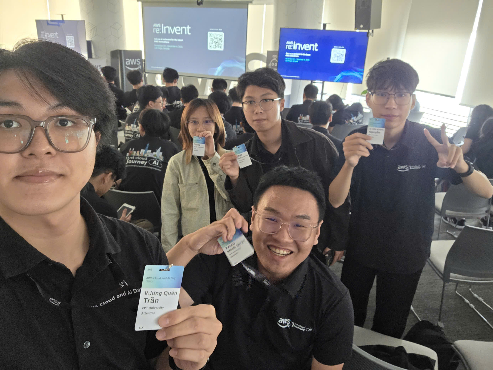
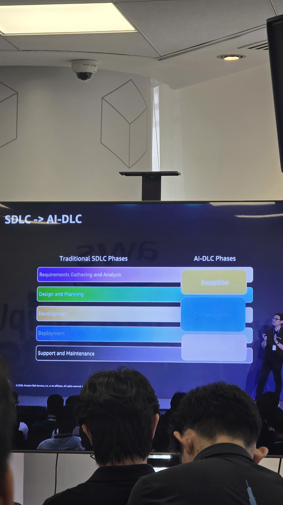
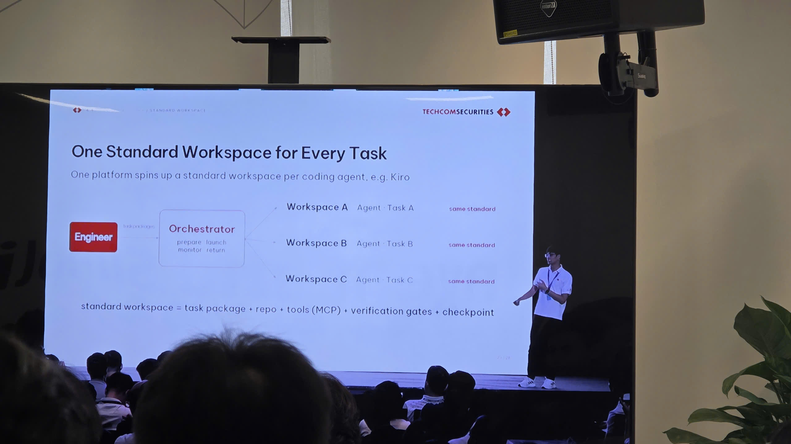
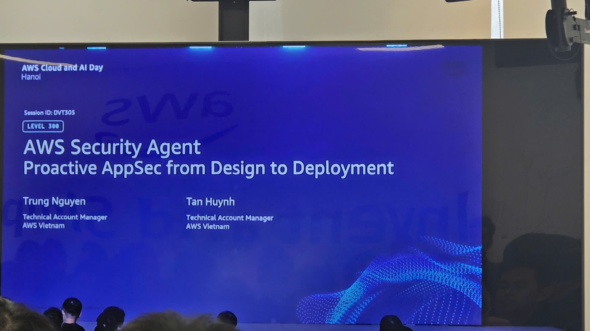
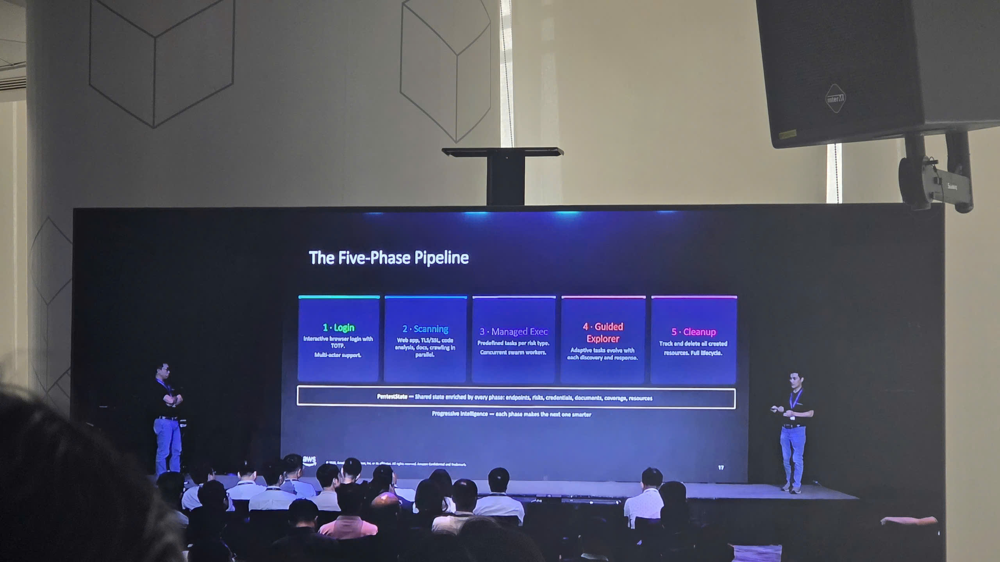
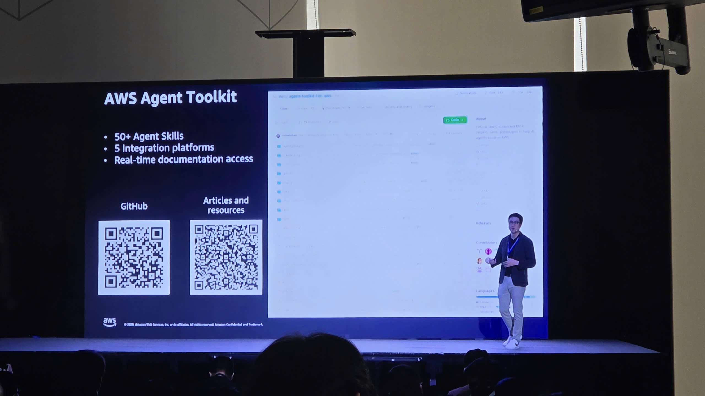

# Summary Report: “AWS Cloud & AI Day Hanoi - Watch Party”

### Event information

&emsp; **Event Name:** AWS Cloud & AI Day Hanoi - Watch Party

&emsp; **Date & Time:** 08:00 a.m. to 05:00 p.m., Tuesday, September 29, 2026 (UTC+7), according to the published schedule

&emsp; **Location:** AWS Vietnam office, Bitexco Financial Tower, 2 Hai Trieu Street, Ho Chi Minh City. Badge collection on the 26th floor, as stated in the invitation.

&emsp; **Attendance Format:** Watch party in Ho Chi Minh City, following sessions broadcast from the main event in Hanoi

&emsp; **Role:** Attendee

&emsp; **Event Page:** [AWS Cloud and AI Day Hanoi](https://aws.amazon.com/events/cloud-day-hanoi/)

On September 29, I attended the watch party at the AWS office in Ho Chi Minh City with my teammates. The main event took place in Hanoi, and we followed the keynote and technical sessions on screens at the office. The topics I wanted to keep from the day concerned using AI in software development, from preparing work for an agent to checking its results and securing an application.

### Event objectives

- Introduce Cloud and AI use cases through presentations from AWS and businesses.
- Share approaches to using agentic AI in software development, testing, and operations.
- Allow the community in Ho Chi Minh City to follow the keynote and selected Builders x AI sessions from Hanoi together.

My aim was to find approaches I could try on a small scale while studying and preparing my personal workshop.

### Speakers

The table records selected speakers from the keynote and security session broadcast from Hanoi.

| Order | Speaker | Position | Presentation topics |
| --- | --- | --- | --- |
| 1 | Eric Yeo | Country General Manager, Malaysia, Vietnam & Indochina, AWS | Cloud and AI adoption in Vietnam, with examples from businesses. |
| 2 | Werner Vogels | CTO, Amazon | Engineering decisions behind cloud services, including databases, compute infrastructure, and time synchronization. |
| 3 | Jens Lottner | CEO, Techcombank | Bringing AI into banking operations and preparing employees to work with it. |
| 4 | Mai Le | Director of Product Management, Katalon | Software validation during development with AI and human responsibility for the results. |
| 5 | Trung Nguyen | Technical Account Manager, AWS Vietnam | Joint presentation of AWS Security Agent: Proactive AppSec from Design to Deployment. |
| 6 | Tan Huynh | Technical Account Manager, AWS Vietnam | Joint presentation of AWS Security Agent and the security testing workflow. |
| 7 | Hoàng Minh | Deputy Minister of Science and Technology | Opening remarks at the event. |
| 8 | Jennifer Wicks | U.S. Ambassador to Vietnam | Technology cooperation, digital infrastructure, and workforce development. |

### Key highlights

#### Opening and AI adoption in Vietnam

Eric Yeo opened the program, introduced the guests and speakers, and thanked the event partners. Deputy Minister Hoàng Minh and Ambassador Jennifer Wicks then delivered their remarks. Jennifer Wicks discussed the role of cloud computing in business, technology cooperation between Vietnam and the United States, and the development of infrastructure and workforce skills.

Returning to the stage, Eric Yeo spoke about AWS's twentieth anniversary and the AWS Local Zone in Hanoi. He introduced examples from several industries: OmiGroup's research into chronic diseases with links to medical evidence, Vinasoy's monitoring of retail product displays, and Agris's use of data across agricultural operations. These examples helped me understand the specific problems each business wanted to address with Cloud and AI.

#### Techcombank: preparing the platform and people to use AI

Jens Lottner explained how Techcombank organizes AI adoption. Building on its existing data foundation and AWS services, the bank added a platform for coordinating agents, workflows, access permissions, and controls. Employees can use prepared agents or build workflows suited to their own tasks.

One example that caught my attention was AI Coach, which helps employees select models, write requests, and consider usage costs. The presentation also covered training at different skill levels so employees can use and operate these tools.

Three areas of application were introduced: software development, incident coordination, and support for staff working with customers. In the incident example, an agent coordinates information between operations and customer-facing teams so remediation and customer updates can proceed together. At the end of his presentation, Jens Lottner discussed cost, return on investment, talent, and risk management. These are questions I also need to consider when choosing a problem to explore with AI.

#### The FCAJ community and a greeting to Ho Chi Minh City

Eric Yeo continued with AWS training activities, First Cloud and AI Journey, and AWS Academy. He shared stories of people who started learning cloud, secured internships, and returned to support the community. This part related closely to my own internship, where learning needs practical work and opportunities to speak with more experienced people.

Before inviting Werner Vogels onto the stage, Eric Yeo greeted the community watching the livestream in Ho Chi Minh City. I wanted to record this moment because my team was attending at that location.

#### Werner Vogels: the engineering behind cloud services

Werner Vogels recalled a database incident during a peak shopping period at Amazon. By reviewing how applications accessed their data, the team found that many needs could be served by a key-value model. His example of retrieving a shopping cart by customer ID helped me understand why actual query patterns matter when choosing a database.

He then presented three stories about improvements behind the services:

- **AWS Nitro:** Moving much of the I/O work to dedicated hardware reduces the burden on the hypervisor and improves isolation. This example showed how an infrastructure change can affect both performance and security.
- **Lambda, Firecracker, and SnapStart:** Starting with the need to process a file uploaded to S3, the presentation explored running small functions with suitable isolation and cost. Firecracker was introduced through its microVM approach, while SnapStart was explained through saving initialized state to reduce startup time.
- **Time synchronization:** He described the difficulty of ordering events across multiple machines and how AWS provides accurate time with explicit error bounds. I want to study this further when learning about data and distributed systems.

These examples made the work behind familiar actions, such as creating a virtual machine or running a Lambda function, easier to understand. When studying a service, I need to understand the problem it solves and the conditions that affect its use.

#### Katalon: validating software as AI generates code faster

Mai Le began with a familiar coding-agent interaction: the user points out an error, and the agent agrees to correct it. She used this to introduce the gap between the speed of software creation and the capacity to validate it. When testing falls behind, errors can reach end users.

The presentation described connecting requirements, code changes, tests, execution results, defects, and production data to assess a release. Agents need this context to identify changes, select what to test, run the tests, and gather evidence. People remain responsible for setting risk boundaries, reviewing exceptions, and approving releases.

Mai Le also described the roles of Amazon EKS, RDS, S3, and Kinesis in Katalon's platform, alongside Amazon Bedrock and AgentCore Runtime for its AI capabilities. The point I want to apply to my own work is to keep actual verification results, such as logs, screenshots, and test outcomes, so I can explain why a feature meets its requirements.

To close the keynote, Werner Vogels returned to the validation work that can accumulate as more code is generated, and to engineers' professional responsibility. He spoke about work that users rarely see but that still requires care. I connected this with error handling, testing, and resource cleanup in my own workshop.

#### AI-DLC and how TCBS organizes work for agents

I kept photos of the comparison between traditional SDLC and AI-DLC, along with the workspace diagram from TCBS. In the diagram, an orchestrator prepares and monitors workspaces for individual agents and tasks. Each workspace includes a task package, source code, MCP tools, verification steps, and a checkpoint.

What I want to learn from this example is how to prepare a task before assigning it to AI. If the requirement and completion criteria are unclear, it is also difficult for me to judge the result. I can start by defining the inputs, outputs, and checks for each small feature in my workshop.

#### AWS Security Agent and security testing during development

Session DVT305, presented by Trung Nguyen and Tan Huynh, covered application security from design through deployment. One slide outlined a workflow involving login, scanning, execution of testing tasks, further exploration based on findings, and resource cleanup.

This made me pay closer attention to the scope of a test: which system is being tested, what permissions are needed, and which resources must be removed afterward. These are also details I need to explain clearly in an AWS workshop. The session gave me subjects to explore, while applying them will require reading the documentation and practicing each step.

#### Agent Toolkit for AWS and MCP

The Agent Toolkit for AWS slides introduced ways to give coding agents tools, knowledge, and controls. The getting started sequence covered installing a plugin, checking the connection to the AWS MCP Server, and trying a specific request. I also photographed the slide containing QR codes for the source repository and further reading.

I am interested in where an agent gets its information and which actions it can perform. When I try these tools after the event, I want to begin with a small task, read the changes it produces, and check the outcome before expanding the scope.

### Key takeaways

#### Prepare the requirement before using AI

- Divide work into tasks with clear outputs.
- Provide source code, documentation, and constraints relevant to the task.
- Decide how to check the result before starting.

#### Take responsibility for the result

- Read and understand changes proposed by AI before including them in my work.
- Test successful behavior and error cases.
- Keep practice results so I can explain my decisions.

#### Choose an approach based on the actual problem

- Understand how data will be read and written before choosing a database.
- When trying AI, consider usage costs, access permissions, and the time needed to check results.
- Make time to learn the tools and assess their output, as illustrated by the employee training in Techcombank's presentation.

#### Include security in the practice plan

- Review permissions and resource scope before running a tool.
- Include verification and cleanup steps in the workshop instructions.
- Learn the limits of tools, especially those able to act on an AWS environment.

### Applying to work

I plan to begin with my personal workshop. For each feature, I will write a short requirement, identify the expected outcome, and define a check before asking AI for help. I will then review the changes, run the exercise, and record the results in my worklog.

For MCP and Agent Toolkit for AWS, I want to try a task in a practice environment with a defined scope. I will record the setup, any problems encountered, and the checks I complete after trying it.

Following the keynote, I also want to add a short explanation of data access patterns and service choices to my workshop design. For each feature change, I will retain the original requirement, the changes made, and verification evidence to refer to when preparing my report or demo.

### Event experience

#### Following the program with my team in Ho Chi Minh City

The watch party let me follow the program with my teammates at the AWS office in Ho Chi Minh City. Our photo collection includes a group picture with attendance badges and photos of technical sessions on screen. Looking back through them helps me connect each point in this report to a specific presentation.

#### What I want to explore next

The TCBS workspace diagram is an example I want to revisit when dividing up project work. The testing and security sessions also reminded me to make time for checks after writing code. My next step is to choose a small part to try, record the results, and then decide whether it belongs in my workshop.

#### Some event photos

These images come from my team's and my own attendance photo collection in Ho Chi Minh City. The slides belong to their presenters and organizations and were photographed from screens showing the program from Hanoi.

*Figure 1. Our group photo at the AWS office in Ho Chi Minh City during the watch party.*

*Figure 2. A comparison of software development phases when AI is introduced into the workflow. Slide source: AWS.*

*Figure 3. TCBS explaining workspace preparation and task coordination for agents. Slide source: Techcom Securities.*

*Figure 4. Session DVT305 and its two speakers displayed on screen. Slide source: AWS.*

*Figure 5. The security testing workflow from login through resource cleanup. Slide source: AWS.*

*Figure 6. Resources for learning more about AWS Agent Toolkit. Slide source: AWS.*

### References

The resources below offer further reading about the main event in Hanoi and the watch party in Ho Chi Minh City.

#### Official event resources

1. **AWS:** [AWS Cloud and AI Day Hanoi](https://aws.amazon.com/events/cloud-day-hanoi/). Official event overview, main venue, topics, and featured speakers.
2. **AWS:** [Event agenda](https://aws.amazon.com/events/cloud-day-hanoi/agenda/). Session titles, tracks, and the published schedule.
3. **AWS Events:** [AWS Cloud & AI Day Hanoi 2026 | Keynote](https://www.youtube.com/watch?v=6lQLOOQdW9Y). Revisit [Techcombank at 20:52](https://www.youtube.com/watch?v=6lQLOOQdW9Y&t=1252s), [the greeting to Ho Chi Minh City at 35:57](https://www.youtube.com/watch?v=6lQLOOQdW9Y&t=2157s), [Werner Vogels at 37:48](https://www.youtube.com/watch?v=6lQLOOQdW9Y&t=2268s), and [Katalon at 1:09:54](https://www.youtube.com/watch?v=6lQLOOQdW9Y&t=4194s).

#### Event coverage and articles

4. **About Amazon, September 29, 2026:** [Vietnam is transforming its AI ambitions into business impact](https://www.aboutamazon.sg/news/aws/vietnam-is-transforming-its-ai-ambitions-into-business-impact). Amazon's article about the AI adoption study released at the event, with a TCBS example that complements the software development topics shown in my photos.
5. **Vietnam Ministry of Science and Technology, September 29, 2026:** [Vietnam's AI infrastructure and the challenge of creating practical value](https://mst.gov.vn/ai-viet-nam-tu-mo-rong-ha-tang-den-bai-toan-bien-cong-nghe-thanh-gia-tri-19726093007364899.htm) (Vietnamese). Coverage of Deputy Minister Hoàng Minh's remarks at the Hanoi event and the foundations needed for wider AI adoption.
6. **Vietnam Journal of Science and Technology, September 29, 2026:** [International technology cooperation and Vietnam's innovation ecosystem](https://vjst.vn/cac-tap-doan-cong-nghe-quoc-te-khong-chi-cung-cap-dich-vu-ma-cung-viet-nam-doi-moi-sang-tao-va-phat-trien-he-sinh-thai-103338.html) (Vietnamese). Reporting on the Hanoi event, with context on infrastructure, workforce development, and cooperation with technology companies.

#### Ho Chi Minh City watch party

7. **AWS Events:** [AWS Cloud & AI Day Hanoi - Watch Party registration](https://apj.awsevents.com/sites/aws-cloud-day-hanoi-watch-party-attendee).
