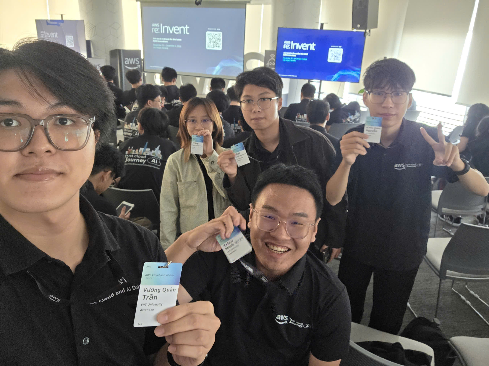
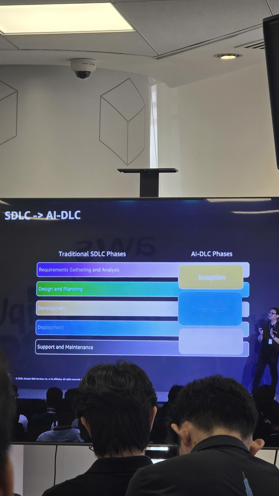
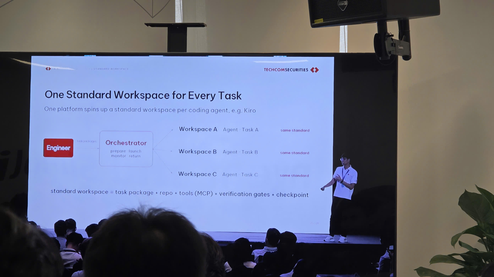
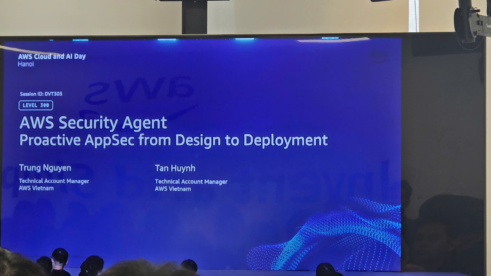
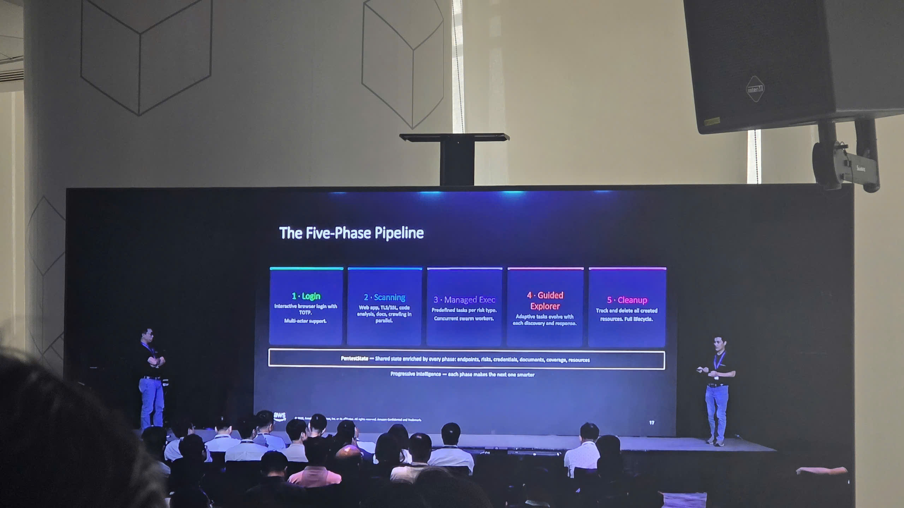
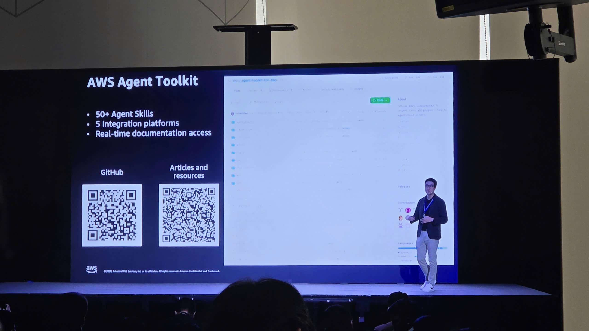

### Thông tin sự kiện

&emsp; **Tên sự kiện:** AWS Cloud & AI Day Hanoi - Watch Party

&emsp; **Thời gian:** 08:00 đến 17:00, thứ Ba, ngày 29/09/2026 (UTC+7), theo lịch chương trình

&emsp; **Địa điểm:** Văn phòng AWS Việt Nam, Bitexco Financial Tower, 2 Hải Triều, TP.HCM. Điểm nhận thẻ tại tầng 26 theo thư mời.

&emsp; **Hình thức:** Tham dự watch party tại TP.HCM, theo dõi các phiên được phát từ sự kiện chính ở Hà Nội

&emsp; **Vai trò:** Người tham dự

&emsp; **Trang sự kiện:** [AWS Cloud and AI Day Hanoi](https://aws.amazon.com/vi/events/cloud-day-hanoi/)

Ngày 29/09, tôi cùng các bạn trong nhóm tham dự watch party tại văn phòng AWS ở TP.HCM. Sự kiện chính diễn ra ở Hà Nội; chúng tôi theo dõi keynote và các phiên kỹ thuật qua màn hình tại văn phòng. Những nội dung tôi muốn ghi lại sau buổi này xoay quanh cách dùng AI trong phát triển phần mềm, từ chuẩn bị công việc cho agent đến kiểm tra kết quả và bảo mật ứng dụng.

### Mục tiêu sự kiện

- Giới thiệu các hướng ứng dụng Cloud và AI qua chia sẻ của AWS và doanh nghiệp.
- Cập nhật cách sử dụng agentic AI trong phát triển, kiểm thử và vận hành phần mềm.
- Tạo điều kiện để cộng đồng tại TP.HCM cùng theo dõi các phiên keynote và nội dung thuộc nhóm Builders x AI từ Hà Nội.

Với tôi, mục tiêu khi tham gia là tìm hiểu những cách làm có thể thử ở quy mô nhỏ trong quá trình học và chuẩn bị workshop cá nhân.

### Diễn giả

Bảng dưới đây ghi lại một số diễn giả trong keynote và phiên bảo mật được phát từ Hà Nội.

| STT | Diễn giả | Chức vụ | Nội dung chia sẻ |
| --- | --- | --- | --- |
| 1 | Eric Yeo | Country General Manager, Malaysia, Vietnam & Indochina, AWS | Bối cảnh ứng dụng Cloud và AI tại Việt Nam, cùng các ví dụ từ doanh nghiệp. |
| 2 | Werner Vogels | CTO, Amazon | Những lựa chọn kỹ thuật phía sau dịch vụ cloud, từ cơ sở dữ liệu đến hạ tầng tính toán và đồng bộ thời gian. |
| 3 | Jens Lottner | CEO, Techcombank | Cách đưa AI vào hoạt động ngân hàng và chuẩn bị năng lực cho đội ngũ. |
| 4 | Mai Le | Director of Product Management, Katalon | Kiểm chứng phần mềm trong quá trình phát triển có sử dụng AI và trách nhiệm của con người với kết quả. |
| 5 | Trung Nguyen | Technical Account Manager, AWS Vietnam | Đồng trình bày phiên AWS Security Agent: Proactive AppSec from Design to Deployment. |
| 6 | Tan Huynh | Technical Account Manager, AWS Vietnam | Đồng trình bày phiên AWS Security Agent và quy trình kiểm tra bảo mật. |
| 7 | Hoàng Minh | Thứ trưởng Bộ Khoa học và Công nghệ | Phát biểu trong phần khai mạc chương trình. |
| 8 | Jennifer Wicks | Đại sứ Hoa Kỳ tại Việt Nam | Chia sẻ về hợp tác công nghệ, hạ tầng số và phát triển nhân lực. |

### Nội dung nổi bật

#### Khai mạc và bối cảnh ứng dụng AI tại Việt Nam

Eric Yeo mở đầu chương trình, giới thiệu khách mời, diễn giả và cảm ơn các đơn vị đồng hành. Sau đó là phần phát biểu của Thứ trưởng Hoàng Minh và Đại sứ Jennifer Wicks. Trong phần chia sẻ của mình, bà Jennifer Wicks đề cập đến vai trò của cloud đối với doanh nghiệp, hợp tác công nghệ Việt Nam và Hoa Kỳ, cũng như việc phát triển hạ tầng và kỹ năng cho người lao động.

Trở lại sân khấu, Eric Yeo nhắc đến cột mốc 20 năm của AWS và AWS Local Zone tại Hà Nội. Ông đưa ra các ví dụ ứng dụng trong nhiều lĩnh vực: OmiGroup với hướng nghiên cứu bệnh mạn tính có liên kết tới bằng chứng y khoa, Vinasoy với việc theo dõi trưng bày hàng hóa và Agris với dữ liệu xuyên suốt chuỗi hoạt động nông nghiệp. Những ví dụ này giúp tôi hình dung rõ hơn bài toán mà từng doanh nghiệp muốn giải quyết bằng Cloud và AI.

#### Techcombank: chuẩn bị nền tảng và con người để sử dụng AI

Jens Lottner trình bày cách Techcombank tổ chức việc đưa AI vào hoạt động. Trên nền tảng dữ liệu và dịch vụ AWS đã có, ngân hàng xây dựng thêm lớp điều phối agent, quy trình làm việc, quyền truy cập và các giới hạn kiểm soát. Nhân viên có thể sử dụng agent được chuẩn bị sẵn hoặc xây dựng quy trình phù hợp với công việc của mình.

Một ví dụ tôi chú ý là AI Coach, công cụ hỗ trợ nhân viên chọn mô hình, viết yêu cầu và cân nhắc chi phí sử dụng. Phần trình bày cũng nói đến việc đào tạo nhân viên theo từng mức năng lực để họ có thể sử dụng và vận hành các công cụ này.

Ba nhóm ứng dụng được giới thiệu gồm phát triển phần mềm, phối hợp xử lý sự cố và hỗ trợ nhân viên làm việc với khách hàng. Ở ví dụ xử lý sự cố, agent phối hợp thông tin giữa bộ phận vận hành và bộ phận tiếp xúc khách hàng để việc khắc phục và cập nhật tình hình diễn ra cùng nhau. Cuối phần chia sẻ, ông nhắc đến chi phí, hiệu quả đầu tư, nhân lực và quản trị rủi ro. Tôi thấy đây là những câu hỏi cần đặt ra ngay khi chọn một bài toán để thử với AI.

#### Cộng đồng FCAJ và lời chào tới điểm cầu TP.HCM

Eric Yeo tiếp tục giới thiệu hoạt động đào tạo của AWS, chương trình First Cloud and AI Journey và AWS Academy. Ông kể về những người bắt đầu học cloud, đi thực tập rồi quay lại hỗ trợ cộng đồng. Phần này khá gần với bối cảnh thực tập của tôi, vì việc học cần có bài làm cụ thể và cơ hội trao đổi với người đi trước.

Trước khi mời Werner Vogels lên sân khấu, Eric Yeo gửi lời chào tới cộng đồng đang xem livestream tại TP.HCM. Đây là một chi tiết tôi muốn lưu lại trong bài vì nhóm tôi tham dự ở chính điểm cầu này.

#### Werner Vogels: những công việc kỹ thuật phía sau dịch vụ cloud

Werner Vogels kể lại một sự cố cơ sở dữ liệu trong giai đoạn cao điểm mua sắm của Amazon. Từ việc xem xét lại cách ứng dụng truy cập dữ liệu, đội ngũ nhận ra nhiều nhu cầu có thể phục vụ bằng mô hình key-value. Ví dụ giỏ hàng được lấy theo mã khách hàng giúp tôi dễ hiểu hơn vì sao cần nhìn vào cách truy vấn thực tế trước khi chọn cơ sở dữ liệu.

Tiếp đó, ông trình bày ba câu chuyện về những cải tiến phía sau dịch vụ:

- **AWS Nitro:** Chuyển nhiều công việc xử lý I/O sang phần cứng chuyên dụng, giảm gánh nặng cho hypervisor và cải thiện khả năng cách ly. Ví dụ này cho thấy một thay đổi ở tầng hạ tầng có thể tác động đến cả hiệu năng lẫn bảo mật.
- **Lambda, Firecracker và SnapStart:** Bắt đầu từ nhu cầu xử lý khi có tệp được tải lên S3, phần trình bày đi vào bài toán chạy các hàm nhỏ với khả năng cách ly và chi phí phù hợp. Firecracker được giới thiệu qua mô hình microVM; SnapStart qua việc lưu trạng thái đã khởi tạo để giảm thời gian khởi động.
- **Đồng bộ thời gian:** Ông giải thích khó khăn khi xác định thứ tự các sự kiện trên nhiều máy và giới thiệu cách AWS cung cấp thời gian chính xác cùng giới hạn sai số. Tôi muốn tìm hiểu thêm phần này khi học về dữ liệu và hệ thống phân tán.

Các ví dụ giúp tôi thấy rõ hơn công việc phía sau những thao tác quen thuộc như tạo máy ảo hay chạy một hàm Lambda. Khi học một dịch vụ, tôi cần hiểu cả vấn đề mà nó giải quyết và những điều kiện ảnh hưởng đến cách sử dụng.

#### Katalon: kiểm chứng phần mềm khi AI tạo mã nhanh hơn

Mai Le mở đầu bằng một tình huống quen thuộc khi dùng coding agent: người dùng chỉ ra lỗi và agent đồng ý sửa lại. Từ đó, chị đặt vấn đề về khoảng cách giữa tốc độ tạo phần mềm và khả năng kiểm chứng phần mềm. Khi việc kiểm tra không theo kịp, lỗi có thể đi tới người dùng cuối.

Phần trình bày mô tả cách kết nối yêu cầu, thay đổi mã nguồn, test, kết quả chạy, lỗi và dữ liệu vận hành để đánh giá một bản phát hành. Agent cần ngữ cảnh này để xác định phần đã thay đổi, chọn nội dung cần kiểm tra, thực hiện test và thu thập bằng chứng. Con người vẫn quyết định giới hạn rủi ro, xem xét ngoại lệ và phê duyệt phát hành.

Mai Le cũng giới thiệu vai trò của Amazon EKS, RDS, S3 và Kinesis trong nền tảng Katalon, cùng Amazon Bedrock và AgentCore Runtime cho phần AI. Điểm tôi muốn áp dụng vào bài làm là lưu kết quả kiểm tra thực tế, chẳng hạn log, ảnh chụp và kết quả test, để giải thích được vì sao một chức năng đã đáp ứng yêu cầu.

Kết thúc keynote, Werner Vogels quay lại vấn đề phần kiểm chứng chưa theo kịp lượng mã được tạo ra và trách nhiệm nghề nghiệp của kỹ sư. Ông nhắc tới những công việc người dùng ít nhìn thấy nhưng vẫn cần được làm cẩn thận. Tôi liên hệ điều này với các bước xử lý lỗi, kiểm thử và dọn dẹp tài nguyên trong workshop của mình.

#### AI-DLC và cách TCBS tổ chức công việc cho agent

Tôi lưu lại slide so sánh SDLC truyền thống với AI-DLC, cùng sơ đồ workspace trong phần trình bày của TCBS. Trong sơ đồ, một bộ phận điều phối chuẩn bị và theo dõi các workspace dành cho từng agent, từng nhiệm vụ. Mỗi workspace có gói công việc, mã nguồn, công cụ MCP, bước kiểm tra và điểm lưu trạng thái.

Điểm tôi muốn học từ ví dụ này là cách chuẩn bị một nhiệm vụ trước khi giao cho AI. Nếu yêu cầu và điều kiện hoàn thành chưa rõ, tôi cũng khó biết kết quả trả về đã đúng hay chưa. Tôi có thể bắt đầu bằng việc mô tả đầu vào, đầu ra và cách kiểm tra cho từng chức năng nhỏ của workshop.

#### AWS Security Agent và kiểm tra bảo mật trong quá trình phát triển

Phiên DVT305 do Trung Nguyen và Tan Huynh trình bày tập trung vào bảo mật ứng dụng từ thiết kế đến triển khai. Một slide mô tả quy trình gồm đăng nhập, quét, thực thi các tác vụ kiểm tra, tiếp tục khám phá theo kết quả và dọn dẹp tài nguyên.

Qua cách trình bày này, tôi chú ý hơn đến phạm vi của một lần kiểm tra: hệ thống nào được kiểm tra, cần quyền gì và tài nguyên nào phải được thu dọn sau đó. Đây cũng là những điều tôi cần mô tả rõ khi viết hướng dẫn thực hành AWS. Việc theo dõi phiên chia sẻ giúp tôi có thêm hướng tìm hiểu, còn để áp dụng tôi cần tự đọc tài liệu và thực hành từng bước.

#### Agent Toolkit for AWS và MCP

Các slide về Agent Toolkit for AWS giới thiệu cách bổ sung công cụ, kiến thức và các giới hạn kiểm soát cho coding agent. Phần hướng dẫn bắt đầu gồm cài plugin, kiểm tra kết nối với AWS MCP Server rồi thử một yêu cầu cụ thể. Tôi cũng chụp lại slide có mã QR dẫn đến mã nguồn và tài liệu để tiện xem lại.

Điều tôi quan tâm là agent có thể lấy thông tin từ đâu và được phép thực hiện những thao tác nào. Khi thử các công cụ này sau sự kiện, tôi muốn bắt đầu bằng một tác vụ nhỏ, đọc lại thay đổi được tạo ra và kiểm tra kết quả trước khi mở rộng phạm vi.

### Bài học rút ra

#### Chuẩn bị yêu cầu trước khi dùng AI

- Chia công việc thành những phần có đầu ra rõ ràng.
- Cung cấp mã nguồn, tài liệu và ràng buộc liên quan đến nhiệm vụ.
- Xác định cách kiểm tra kết quả ngay từ lúc bắt đầu.

#### Giữ trách nhiệm với kết quả

- Đọc và hiểu thay đổi do AI đề xuất trước khi đưa vào bài làm.
- Kiểm tra cả trường hợp chạy đúng và trường hợp xảy ra lỗi.
- Ghi lại kết quả thực hành để giải thích được quyết định của mình.

#### Chọn cách làm từ bài toán thực tế

- Xem dữ liệu sẽ được đọc và ghi như thế nào trước khi chọn cơ sở dữ liệu.
- Khi thử AI, cân nhắc cả chi phí sử dụng, quyền truy cập và thời gian kiểm tra kết quả.
- Dành thời gian học cách dùng công cụ và tự đánh giá kết quả, như phần đào tạo nhân viên được trình bày trong câu chuyện Techcombank.

#### Đưa bảo mật vào kế hoạch thực hành

- Xem xét quyền truy cập và phạm vi tài nguyên trước khi chạy công cụ.
- Chuẩn bị cách kiểm tra và thu dọn tài nguyên trong hướng dẫn workshop.
- Dành thời gian tìm hiểu các giới hạn của công cụ, nhất là khi công cụ có thể thao tác với môi trường AWS.

### Áp dụng vào công việc

Tôi dự định bắt đầu từ việc chuẩn bị workshop cá nhân. Với mỗi chức năng, tôi sẽ viết yêu cầu ngắn, xác định kết quả mong đợi và cách kiểm tra trước khi nhờ AI hỗ trợ. Sau đó, tôi sẽ đọc lại phần thay đổi, chạy thử và ghi kết quả vào worklog.

Với MCP và Agent Toolkit for AWS, tôi muốn thử một tác vụ trong môi trường thực hành có phạm vi rõ ràng. Sau khi thử, tôi sẽ ghi lại cách thiết lập, những lỗi gặp phải và các bước kiểm tra đã thực hiện.

Từ phần keynote, tôi muốn bổ sung vào bản thiết kế workshop một mô tả ngắn về cách truy cập dữ liệu và lý do chọn dịch vụ. Với mỗi lần thay đổi chức năng, tôi sẽ giữ lại yêu cầu ban đầu, phần đã sửa và bằng chứng kiểm tra để tiện đối chiếu khi viết báo cáo hoặc làm demo.

### Trải nghiệm tham gia sự kiện

#### Theo dõi chương trình cùng nhóm tại TP.HCM

Tham dự watch party giúp tôi theo dõi chương trình cùng các bạn ngay tại văn phòng AWS ở TP.HCM. Bộ ảnh của nhóm có cả ảnh lưu niệm với thẻ tham dự và ảnh chụp màn hình những phiên kỹ thuật. Khi xem lại, tôi có thể nối từng ý trong bài với một nội dung cụ thể đã được trình bày.

#### Những nội dung muốn tìm hiểu tiếp

Sơ đồ workspace của TCBS là một ví dụ tôi muốn xem lại khi chia việc cho dự án. Phần kiểm thử và bảo mật cũng nhắc tôi dành thời gian cho các bước kiểm tra sau khi viết mã. Sau sự kiện, hướng học tiếp của tôi là chọn một phần nhỏ để thử, ghi lại kết quả rồi mới quyết định có đưa vào workshop hay không.

#### Một số hình ảnh tại sự kiện

Các ảnh dưới đây thuộc bộ ảnh tham dự của tôi và nhóm tại TP.HCM. Nội dung slide là của các diễn giả và đơn vị trình bày, được chụp lại từ màn hình phát chương trình ở Hà Nội.

*Hình 1. Ảnh lưu niệm của nhóm tại văn phòng AWS ở TP.HCM trong ngày tham dự watch party.*

*Hình 2. Nội dung so sánh các giai đoạn phát triển phần mềm khi đưa AI vào quy trình. Nguồn slide: AWS.*

*Hình 3. TCBS giới thiệu cách chuẩn bị workspace và điều phối công việc cho từng agent. Nguồn slide: Techcom Securities.*

*Hình 4. Tên phiên DVT305 cùng thông tin hai diễn giả được hiển thị trên màn hình. Nguồn slide: AWS.*

*Hình 5. Quy trình kiểm tra bảo mật từ đăng nhập đến dọn dẹp tài nguyên. Nguồn slide: AWS.*

*Hình 6. Phần giới thiệu tài nguyên để tìm hiểu thêm về AWS Agent Toolkit. Nguồn slide: AWS.*

### Tài liệu tham khảo

Các tài liệu dưới đây giúp tìm hiểu thêm về sự kiện chính tại Hà Nội và watch party tại TP.HCM.

#### Tài liệu chính thức của sự kiện

1. **AWS:** [AWS Cloud and AI Day Hanoi](https://aws.amazon.com/vi/events/cloud-day-hanoi/). Trang giới thiệu chính thức về sự kiện, địa điểm tổ chức chính, các chủ đề và diễn giả tiêu biểu.
2. **AWS:** [Lịch trình sự kiện](https://aws.amazon.com/events/cloud-day-hanoi/agenda/). Thông tin các phiên chia sẻ, nhóm chủ đề và thời gian diễn ra.
3. **AWS Events:** [AWS Cloud & AI Day Hanoi 2026 | Keynote](https://www.youtube.com/watch?v=6lQLOOQdW9Y). Có thể xem lại phần [Techcombank từ 20:52](https://www.youtube.com/watch?v=6lQLOOQdW9Y&t=1252s), [lời chào tới TP.HCM từ 35:57](https://www.youtube.com/watch?v=6lQLOOQdW9Y&t=2157s), [Werner Vogels từ 37:48](https://www.youtube.com/watch?v=6lQLOOQdW9Y&t=2268s) và [Katalon từ 1:09:54](https://www.youtube.com/watch?v=6lQLOOQdW9Y&t=4194s).

#### Bài báo và bài viết về sự kiện

4. **About Amazon, ngày 29/09/2026:** [Vietnam is transforming its AI ambitions into business impact](https://www.aboutamazon.sg/news/aws/vietnam-is-transforming-its-ai-ambitions-into-business-impact). Bài viết của Amazon về nghiên cứu ứng dụng AI được công bố tại sự kiện, có ví dụ TCBS để đọc thêm bên cạnh nội dung phát triển phần mềm xuất hiện trong ảnh tôi chụp.
5. **Bộ Khoa học và Công nghệ, ngày 29/09/2026:** [Hạ tầng AI Việt Nam và bài toán tạo giá trị thực tế](https://mst.gov.vn/ai-viet-nam-tu-mo-rong-ha-tang-den-bai-toan-bien-cong-nghe-thanh-gia-tri-19726093007364899.htm). Bài đưa tin về phát biểu của Thứ trưởng Hoàng Minh tại sự kiện ở Hà Nội và các nền tảng cần thiết để mở rộng ứng dụng AI.
6. **Tạp chí Khoa học và Công nghệ Việt Nam, ngày 29/09/2026:** [Hợp tác công nghệ quốc tế và hệ sinh thái đổi mới sáng tạo Việt Nam](https://vjst.vn/cac-tap-doan-cong-nghe-quoc-te-khong-chi-cung-cap-dich-vu-ma-cung-viet-nam-doi-moi-sang-tao-va-phat-trien-he-sinh-thai-103338.html). Bài đưa tin về sự kiện tại Hà Nội, bổ sung góc nhìn về hạ tầng, đào tạo nhân lực và hợp tác với doanh nghiệp công nghệ.

#### Thông tin watch party tại TP.HCM

7. **AWS Events:** [Đăng ký AWS Cloud & AI Day Hanoi - Watch Party](https://apj.awsevents.com/sites/aws-cloud-day-hanoi-watch-party-attendee).
