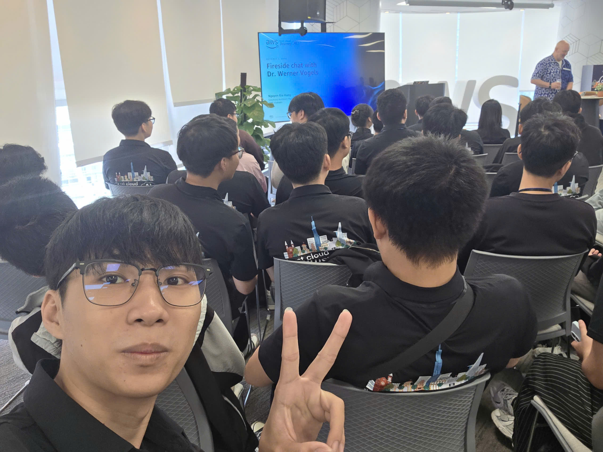
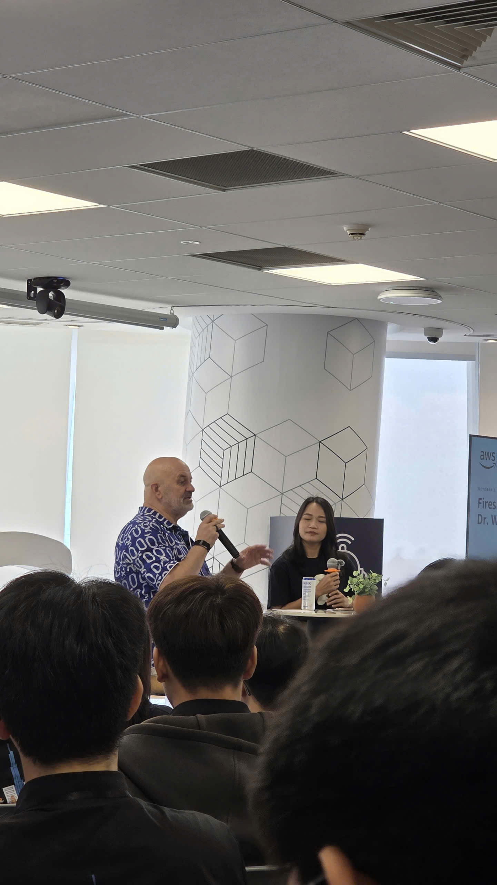

### Event information

&emsp; **Event Name:** Fireside Chat with Dr. Werner Vogels

&emsp; **Date & Time:** 08:30 a.m. to 12:00 p.m., Friday, October 2, 2026 (UTC+7)

&emsp; **Location:** AWS Vietnam office, Bitexco Financial Tower, Ho Chi Minh City

&emsp; **Attendance Format:** In person

&emsp; **Role:** Attendee

Just a few days earlier, I had watched Dr. Werner Vogels' keynote on a screen at the AWS Cloud & AI Day Hanoi watch party. On October 2, I had the opportunity to hear him in person at the AWS office in Ho Chi Minh City. As someone studying Cloud and starting an internship, meeting Amazon's CTO was an honor and a memorable experience.

### Attendance objectives

- Hear Dr. Werner Vogels' experience of building and operating systems at scale.
- Explore perspectives on Cloud, AI, and the skills needed in engineering.
- Connect what I learned with preparing my workshop and studying during the internship.
- Attend a community conversation in person with other AWS learners and practitioners in Ho Chi Minh City.

### Speakers

| Order | Speaker | Position |
| --- | --- | --- |
| 1 | Dr. Werner Vogels | VP and Chief Technology Officer, Amazon |
| 2 | [Hung Gia Nguyen](https://www.linkedin.com/in/jotaguy/) | Head of Solutions Architect, AWS Vietnam and Cambodia |
| 3 | My Nguyen | Solutions Architect, AWS Vietnam |

### Topics and reflections after the event

#### Hearing directly from an experienced practitioner

The Fireside Chat centered on Cloud, AI, technology innovation, and experience building systems at scale. I attended as a learner, hoping to understand how someone with extensive experience approaches problems I am only beginning to explore.

What I wanted to take away was a clearer direction for my studies. Alongside learning how to use AWS services, I need to explain why I choose a service, which need it serves, and what could happen when something fails. These questions give me a starting point for further reading and practice.

#### Seeing a feature as part of a system

I want to understand how the parts of an application depend on one another. A change to data storage or request processing can affect other parts of the system, so I need to consider those connections when making a design decision.

For my personal workshop, I want to trace a request from start to finish. Where does the data arrive, how is it processed, where is it stored, and how is the result returned? If one step fails, how does it affect the others? Drawing this flow will help me understand my work and explain it more clearly.

#### Taking responsibility when using AI

I am responsible for the code I use, including code suggested by AI. I can ask a tool for an approach or an explanation of an error, but I need to review and check its output before including it in my own work.

I want to develop the habit of explaining the code I use. When I do not understand a piece of logic, I will study it further, run it, and check error cases. This should also help me recognize gaps in my knowledge.

#### Developing depth and communicating with others

At this stage of my internship, I need to spend time on AWS fundamentals while learning how applications, data, and security fit together. I also need to practice explaining my work so that others can understand my choices and give useful feedback.

When working with my team or speaking with a mentor, I want to describe a problem in a way that is easy to follow: the goal, what I tried, the result, and where I am stuck. Preparing that information should make the discussion more specific and useful.

### Key takeaways

- **Understand before choosing:** Start with the need and workflow, then choose the technology.
- **Check error cases:** Once a feature works, examine how it responds to missing data or a failed processing step.
- **Take responsibility for my work:** Review, test, and explain the parts developed with AI assistance.
- **Keep learning regularly:** Choose something I do not yet understand, practice it, and record the result.
- **Communicate clearly:** Describe the goal, completed work, and help needed when working with others.

### Applying to work

While preparing my workshop, I plan to draw the data flow and briefly explain why I chose each AWS service. For every feature, I will prepare a successful case and an error case to test.

When using AI assistance, I will keep the original requirement, review the changes, and run them before adding them to the instructions. I will record technical decisions, errors, and solutions in my worklog so I can revisit them.

I also want to practice explaining my work to teammates. If I struggle to explain a component or a choice, that will identify an area to study before completing the demo.

### Event experience

#### A memorable opportunity during my internship

Meeting Dr. Werner Vogels in person made this event particularly meaningful to me. As an attendee, I had the opportunity to hear from someone with many years of experience in Cloud and large distributed systems. It gave me more motivation to continue studying this field.

I appreciate the time he took to visit the AWS office and share his experience with the community. For me, a practical way to respond to that opportunity is to take my studies and project work seriously, starting with small tasks that I can understand, test, and explain myself.

#### Some event photos

*Figure 1. My photo in the audience at the Fireside Chat on October 2, 2026.*

*Figure 2. The conversation at the AWS office in Ho Chi Minh City. Both images come from my personal event photo collection.*

### References

1. **Le Vu Xuan An, AWS Builder Center, October 3, 2026:** [The Invariable Lessons of Tech and Humanity: Key Takeaways from Amazon CTO Werner Vogels](https://builder.aws.com/content/3KBSLeKsdkk6uMUPq7d9Xxa5jbS/the-invariable-lessons-of-tech-and-humanity-key-takeaways-from-amazon-cto-werner-vogels).
