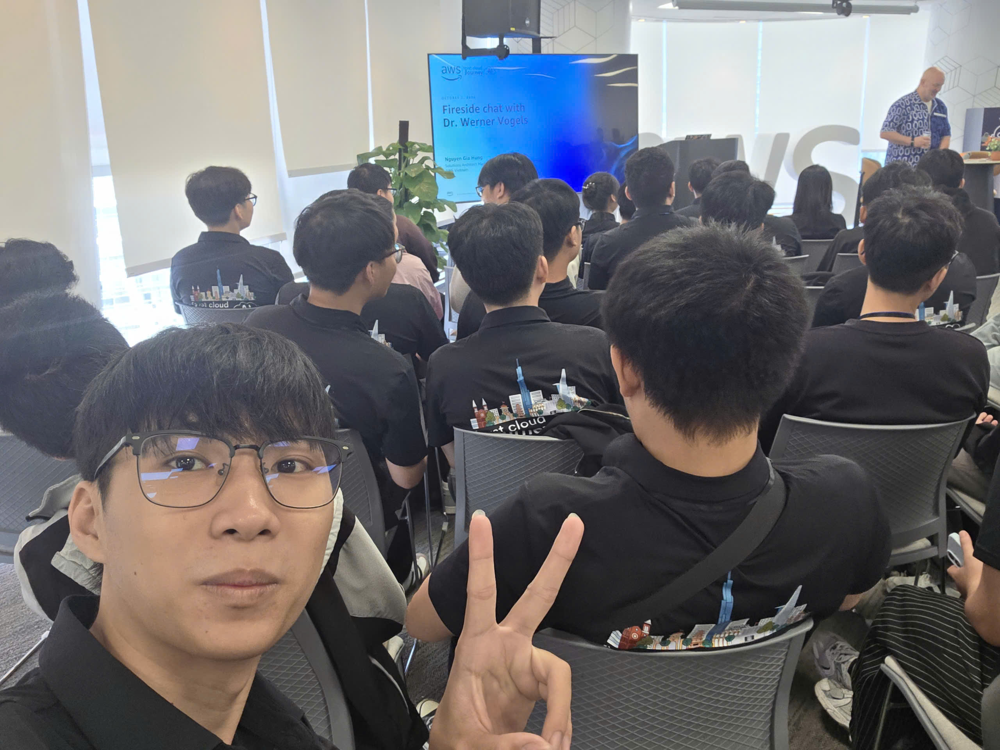
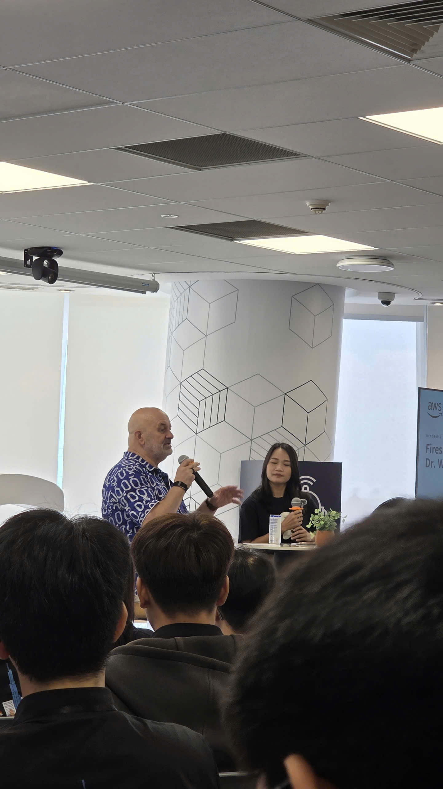

### Thông tin sự kiện

&emsp; **Tên sự kiện:** Fireside Chat with Dr. Werner Vogels

&emsp; **Thời gian:** 08:30 đến 12:00, thứ Sáu, ngày 02/10/2026 (UTC+7)

&emsp; **Địa điểm:** Văn phòng AWS Việt Nam, Bitexco Financial Tower, TP.HCM

&emsp; **Hình thức:** Tham dự trực tiếp

&emsp; **Vai trò:** Người tham dự

Chỉ vài ngày trước, tôi còn theo dõi phần keynote của Dr. Werner Vogels qua màn hình tại watch party AWS Cloud & AI Day Hanoi. Đến ngày 02/10, tôi có cơ hội trực tiếp lắng nghe ông trong buổi Fireside Chat tại văn phòng AWS ở TP.HCM. Với một người đang học Cloud và bắt đầu kỳ thực tập như tôi, được gặp CTO của Amazon là một niềm vinh dự và một kỷ niệm rất đáng nhớ.

### Mục tiêu tham dự

- Lắng nghe kinh nghiệm của Dr. Werner Vogels về xây dựng và vận hành hệ thống ở quy mô lớn.
- Tìm hiểu góc nhìn về Cloud, AI và những kỹ năng cần thiết cho người làm kỹ thuật.
- Liên hệ những điều học được với việc chuẩn bị workshop và cách tự học trong kỳ thực tập.
- Tham gia một buổi trò chuyện trực tiếp cùng cộng đồng AWS tại TP.HCM.

### Diễn giả

| STT | Diễn giả | Chức vụ |
| --- | --- | --- |
| 1 | Dr. Werner Vogels | VP and Chief Technology Officer, Amazon |
| 2 | [Hung Gia Nguyen](https://www.linkedin.com/in/jotaguy/) | Head of Solutions Architect, AWS Vietnam and Cambodia |
| 3 | My Nguyen | Solutions Architect, AWS Vietnam |

### Nội dung và suy ngẫm sau sự kiện

#### Trực tiếp lắng nghe kinh nghiệm từ người làm trong ngành

Buổi Fireside Chat xoay quanh Cloud, AI, đổi mới công nghệ và kinh nghiệm xây dựng hệ thống ở quy mô lớn. Tôi tham gia với tâm thế của một người học, muốn hiểu cách người có nhiều kinh nghiệm nhìn nhận các vấn đề mà mình mới bắt đầu tiếp cận.

Điều tôi muốn mang về từ buổi này là một hướng học cụ thể hơn: ngoài việc biết thao tác với dịch vụ AWS, tôi cần tập giải thích vì sao chọn dịch vụ đó, nó phục vụ nhu cầu nào và điều gì có thể xảy ra khi hệ thống gặp lỗi. Những câu hỏi này giúp tôi có cơ sở để đọc tiếp và thực hành sau sự kiện.

#### Nhìn một chức năng trong toàn bộ hệ thống

Tôi muốn hiểu các thành phần trong một ứng dụng phụ thuộc vào nhau như thế nào. Một thay đổi ở cách lưu dữ liệu hoặc xử lý yêu cầu có thể ảnh hưởng đến những phần khác, nên tôi cần xem xét các mối liên hệ đó khi đưa ra quyết định thiết kế.

Với workshop cá nhân, tôi muốn tập nhìn đường đi của một yêu cầu từ đầu đến cuối. Dữ liệu được nhận ở đâu, xử lý như thế nào, lưu ở đâu và kết quả được trả lại ra sao? Nếu một bước thất bại, những bước còn lại bị ảnh hưởng thế nào? Vẽ được luồng này sẽ giúp tôi hiểu bài làm và trình bày với người khác rõ hơn.

#### Dùng AI với trách nhiệm của người thực hiện

Tôi chịu trách nhiệm với phần mã mình sử dụng, kể cả khi có AI hỗ trợ. Tôi có thể nhờ công cụ gợi ý cách làm hoặc giải thích một lỗi, nhưng trước khi đưa kết quả vào bài của mình, tôi cần đọc lại và kiểm tra xem nó có phù hợp hay không.

Tôi muốn rèn thói quen tự giải thích được phần mã mình sử dụng. Khi chưa hiểu một đoạn xử lý, tôi sẽ tìm hiểu tiếp, chạy thử và kiểm tra trường hợp lỗi. Việc này cũng giúp tôi nhận ra chỗ kiến thức còn thiếu để bổ sung.

#### Học sâu một lĩnh vực và biết trao đổi với người khác

Ở giai đoạn thực tập hiện tại, tôi cần dành thời gian cho kiến thức AWS nền tảng, đồng thời hiểu thêm cách ứng dụng, dữ liệu và bảo mật liên quan với nhau. Tôi cũng cần tập giải thích bài làm để người khác hiểu được lựa chọn của mình và góp ý cụ thể.

Khi làm việc cùng nhóm hoặc trao đổi với mentor, tôi muốn trình bày vấn đề theo một cách dễ theo dõi: mục tiêu là gì, tôi đã thử cách nào, kết quả ra sao và còn vướng ở đâu. Chuẩn bị được những thông tin đó sẽ giúp cuộc trao đổi cụ thể và có ích hơn.

### Bài học rút ra

- **Hiểu trước khi lựa chọn:** Bắt đầu từ nhu cầu và luồng xử lý của bài toán, sau đó mới chọn công nghệ.
- **Kiểm tra cả tình huống lỗi:** Khi một chức năng chạy được, tiếp tục xem nó phản ứng thế nào với dữ liệu thiếu hoặc một bước xử lý thất bại.
- **Chịu trách nhiệm với bài làm:** Đọc lại, kiểm tra và giải thích được phần có sử dụng sự hỗ trợ của AI.
- **Giữ việc học đều đặn:** Chọn một nội dung còn chưa rõ để thực hành và ghi lại kết quả, thay vì chỉ dừng ở việc nghe giới thiệu.
- **Trao đổi rõ ràng:** Mô tả mục tiêu, những gì đã làm và vấn đề cần hỗ trợ khi làm việc cùng người khác.

### Áp dụng vào công việc

Trong quá trình chuẩn bị workshop, tôi dự định vẽ sơ đồ luồng dữ liệu và ghi ngắn gọn lý do chọn từng dịch vụ AWS. Với mỗi chức năng, tôi sẽ chuẩn bị một trường hợp chạy đúng và một trường hợp lỗi để kiểm tra.

Khi dùng AI hỗ trợ, tôi sẽ giữ lại yêu cầu ban đầu, đọc phần thay đổi và chạy thử trước khi đưa vào bài hướng dẫn. Những quyết định kỹ thuật, lỗi gặp phải và cách xử lý sẽ được ghi vào worklog để tiện xem lại.

Tôi cũng muốn tập trình bày bài làm cho các bạn trong nhóm. Nếu còn khó giải thích một thành phần hoặc một lựa chọn, đó sẽ là phần tôi cần học thêm trước khi hoàn thiện demo.

### Trải nghiệm tham gia sự kiện

#### Một cơ hội đáng nhớ trong kỳ thực tập

Được trực tiếp gặp Dr. Werner Vogels là điều khiến buổi này có ý nghĩa đặc biệt với tôi. Từ vị trí người tham dự, tôi có cơ hội lắng nghe kinh nghiệm của một người đã gắn bó lâu năm với Cloud và các hệ thống quy mô lớn. Trải nghiệm đó giúp tôi có thêm động lực theo đuổi lĩnh vực đang học.

Tôi trân trọng việc ông dành thời gian đến văn phòng AWS và chia sẻ với cộng đồng. Với tôi, lời cảm ơn thiết thực nhất là tiếp tục học và làm bài nghiêm túc, bắt đầu từ những phần nhỏ mình có thể hiểu, kiểm tra và tự giải thích.

#### Một số hình ảnh tại sự kiện

*Hình 1. Ảnh của tôi tại hội trường trong buổi Fireside Chat ngày 02/10/2026.*

*Hình 2. Không khí buổi trò chuyện tại văn phòng AWS ở TP.HCM. Hai ảnh trong bài thuộc bộ ảnh tham dự cá nhân của tôi.*

### Tài liệu tham khảo

1. **Le Vu Xuan An, AWS Builder Center, ngày 03/10/2026:** [The Invariable Lessons of Tech and Humanity: Key Takeaways from Amazon CTO Werner Vogels](https://builder.aws.com/content/3KBSLeKsdkk6uMUPq7d9Xxa5jbS/the-invariable-lessons-of-tech-and-humanity-key-takeaways-from-amazon-cto-werner-vogels).
