# Summary Report: “FCAJ Community Day”

### Event information

&emsp; **Event Name:** FCAJ Community Day

&emsp; **Date & Time:** 09:00 a.m. to 12:00 p.m., Saturday, October 31, 2026 (UTC+7)

&emsp; **Location:** AWS Vietnam office, Bitexco Financial Tower, 2 Hai Trieu Street, Ho Chi Minh City

&emsp; **Attendance Format:** In person

&emsp; **Role:** Attendee

&emsp; **Event Page:** [FCAJ Community Day on Luma](https://luma.com/1izeyind)

FCAJ Community Day was a sharing session for the First Cloud AI Journey community, with six short talks over one morning. The topics ranged from AI-assisted software development and an AWS learning path for students to serverless architecture, asynchronous processing, a three-month internship story, and open source contribution. At the time I was in week 7 of my internship, so many of the sessions were closely related to what I was studying.

### Event Objectives

- Hear practical experience from people who have built and operated systems on AWS.
- Learn more about serverless services and asynchronous system design before starting my personal workshop.
- Learn from interns who had already completed the program.
- Meet and talk with other members of the FCAJ community.

### Speakers

| Time | Session | Speaker |
| --- | --- | --- |
| 09:00 – 09:25 | Lessons Learned from Building Software Factories | Henry (Duc) Bui, Head of Engineering at CloudThinker |
| 09:30 – 09:55 | New to AWS? Where should you start? | Tuan Tran (Tran Minh Tuan), Backend Developer, FPT University – FCAJ |
| 10:00 – 10:25 | AWS Lambda Web Functions: Rethinking Serverless Web Architecture | Thinh Nguyen, DevSecOps/Cloud Engineer at STYL Solutions, First Cloud AI Journey |
| 10:30 – 11:00 | Amazon SQS: Building Asynchronous Systems | Dao Luong, FCAJ |
| 11:00 – 11:25 | My 3-Month AWS Internship Journey | Khang Duong, FCAJ |
| 11:30 – 12:00 | Start & Maintain Consistency with Open Source Contributing | Hung Tran, NAB |

The agenda comes from the event page on Luma. Speaker names and organizations come from the organizers' speaker graphic and the title slide of each session.

### Key Highlights

#### 1. Lessons from building “software factories”

The opening session shared how the CloudThinker team organizes development with many AI agent sessions running in parallel. The title slide showed the number of merges into the develop branch each month, rising from 39 in December 2024 to about 2,900 in the last month on the chart. A volume of changes like this is only manageable when checks are fast and reliable.

Two ideas I noted:

- **One shared control folder:** every session starts in a `control` folder that holds notes, skills, and machine guides. From there, the agent reaches the app, infrastructure, and docs repositories, team machines, and the dev and prod clusters as needed.
- **A shared test cache:** test results are stored by test and by a hash of the files the test uses. If the code is unchanged, the result is reused; if it changed, the test runs once and the result is saved for every session, while 2% of tests are re-run at random to verify the cache. A shared check runner also keeps 10 copies of the app ready and picks, from 65 checks (type checks, lint, migrations, secret scan, dependency audit, and tests), only those related to what changed. According to the slide, this reuses up to 72% of tests in a day and cuts the wait for checks by 76%.

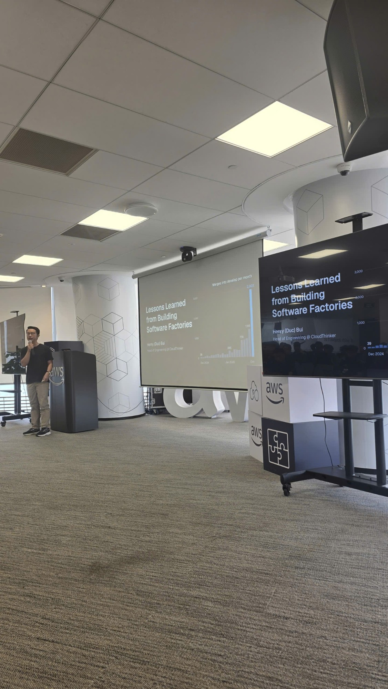

*Figure 1. The session Lessons Learned from Building Software Factories by Henry (Duc) Bui.*

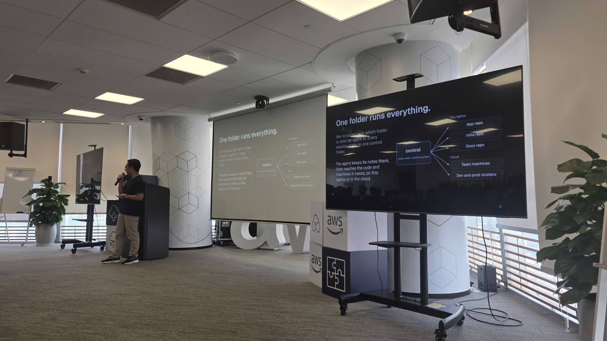

*Figure 2. Every agent session starts in one shared control folder.*

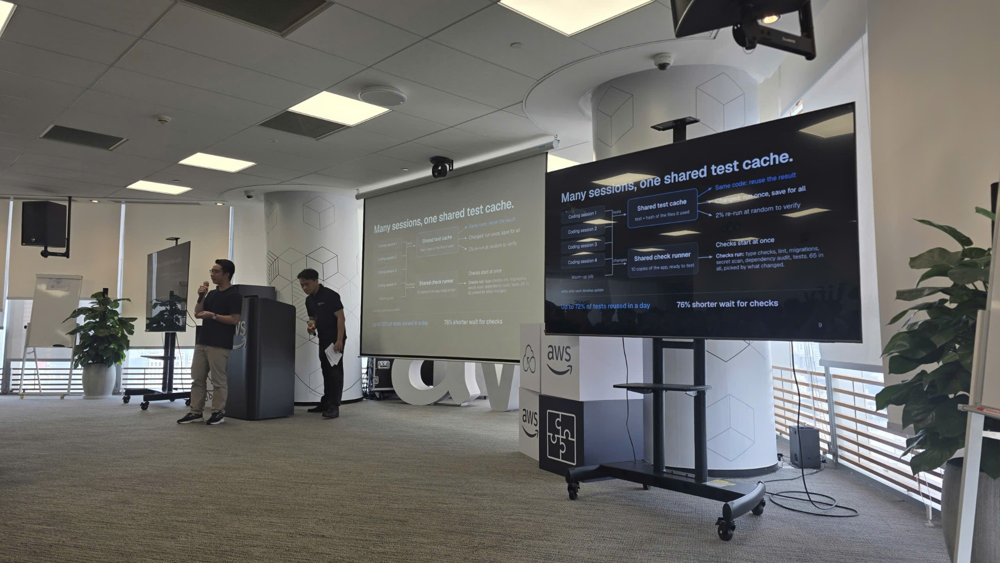

*Figure 3. A test cache and check runner shared by many sessions.*

#### 2. New to AWS? Where should you start?

The session *New to AWS? Where should you start?* (listed as Education in the agenda) was aimed at students who are new to AWS and covered three things: three learning websites, a clear learning path, and AWS credit opportunities. The speaker stressed that no single website covers every learning need, so the three should be used together:

| Website | Purpose | Main content |
| --- | --- | --- |
| [AWS Study Group](https://cloudjourney.awsfcaj.com/) | Hands-on practice | Step-by-step workshops with instructions in Vietnamese |
| [AWS Skill Builder](https://skillbuilder.aws/) | Structured learning | Digital courses, exam preparation, labs, and topic-based resources |
| [AWS Builder Center](https://builder.aws.com/) | Community and rewards | Articles, workshops, student verification, and badges |

During the session, AWS Builder Center was opened live on screen to show its Spotlight section, events, and community activities. I realized that I had used many AWS Study Group lab sites but had not yet made use of Skill Builder or Builder Center.

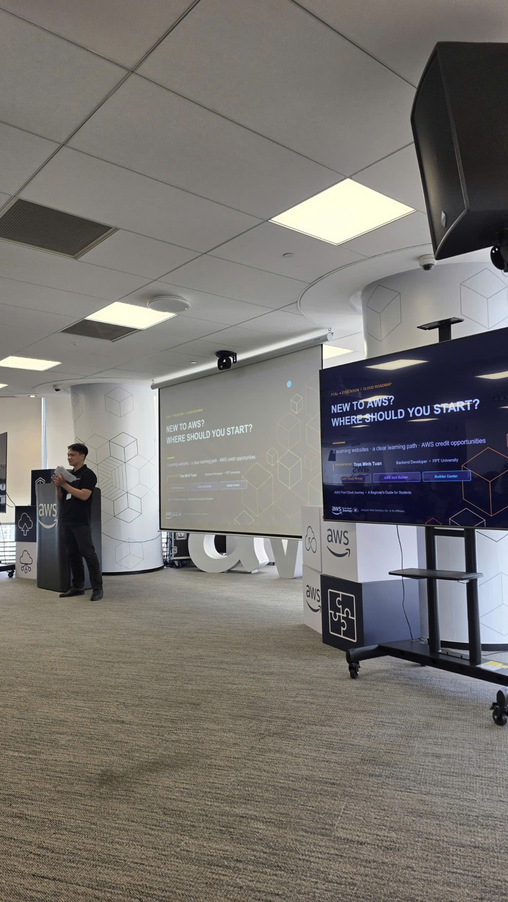

*Figure 4. Tuan Tran's session for students who are starting with AWS.*

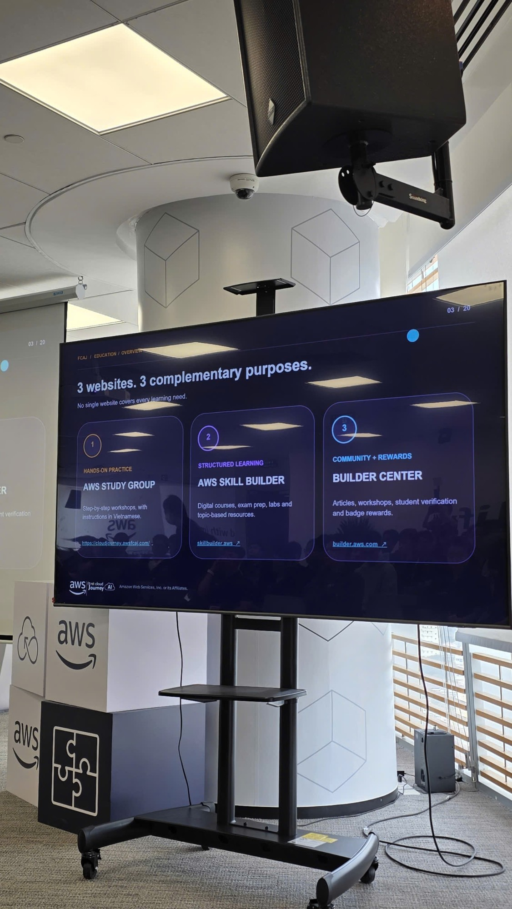

*Figure 5. Three learning websites that complement each other.*

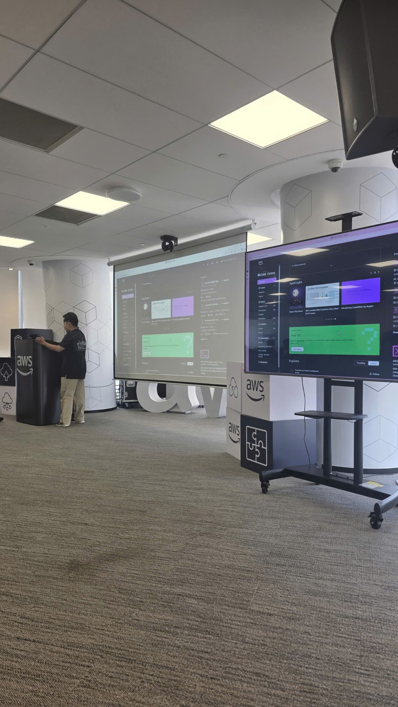

*Figure 6. A live walkthrough of AWS Builder Center.*

#### 3. AWS Lambda Web Functions

This session presented a new way to think about serverless web architecture with AWS Lambda Web Functions. According to the agenda and the AWS announcement, the main points were native HTTP support that lets a function run a standard HTTP server, up to 128 concurrent requests per execution environment, removing the adapter layer, Active CPU Billing, which meters only the CPU time the code actually uses so that waiting on a database or an external API costs little, and live benchmarks comparing it with running Docker on EC2/ECS.

In Lab22, I used Lambda to stop and start EC2 instances automatically with the traditional model, where each execution environment handles one event at a time. This session showed me that Lambda can also act as a real web server, and that the billing model is another factor to compare when choosing between serverless and containers.

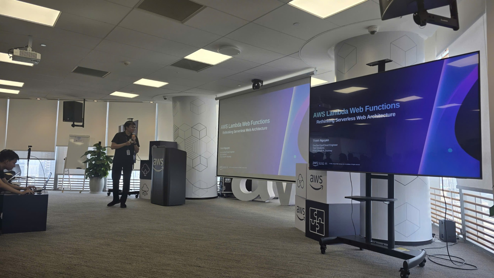

*Figure 7. The AWS Lambda Web Functions session by Thinh Nguyen.*

#### 4. Building asynchronous systems with Amazon SQS

Dao Luong's SQS session started from a simple example: a user asks for content to be generated, and an API service calls an AI service that uses Amazon Bedrock and then waits for the response. With synchronous processing, each step must finish before the next can continue. If the AI service is slow or unavailable, the request hangs or times out, and the user is forced to wait.

The solution is to put requests into an Amazon SQS queue to decouple the components: the API accepts the request and responds right away, while the heavy work runs in the background and scales independently. The session also covered design patterns and practical tips for implementation. I had not used SQS in my labs before, and I want to consider it for long-running tasks in my workshop.

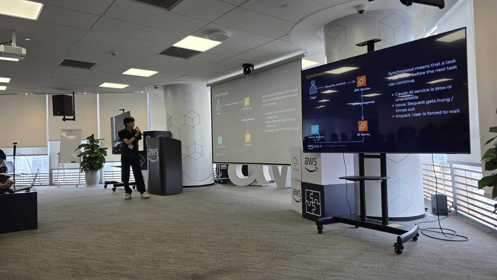

*Figure 8. Dao Luong explaining the problem with synchronous processing when a downstream service is slow or unavailable.*

#### 5. A three-month AWS internship journey

Khang Duong shared the architecture of a real project after three months of internship: a multiplayer game built with Amplify, an HTTP API and a WebSocket API, Lambda functions that handle matches, SQS (including a delayed queue to handle timeouts), a schedule that rebuilds the ranking, DynamoDB for data, and Cognito for user authentication. The architecture spans two AWS accounts connected through AssumeRole, with an IAM role, Secrets Manager, a KMS key, CloudWatch, and X-Ray.

What stood out to me was that this architecture reuses many services I studied in Modules 05 to 07 (IAM, KMS, Lambda, DynamoDB), but combines them to solve a specific problem with proper monitoring and security. This is the level of completeness I want to aim for in my own workshop.

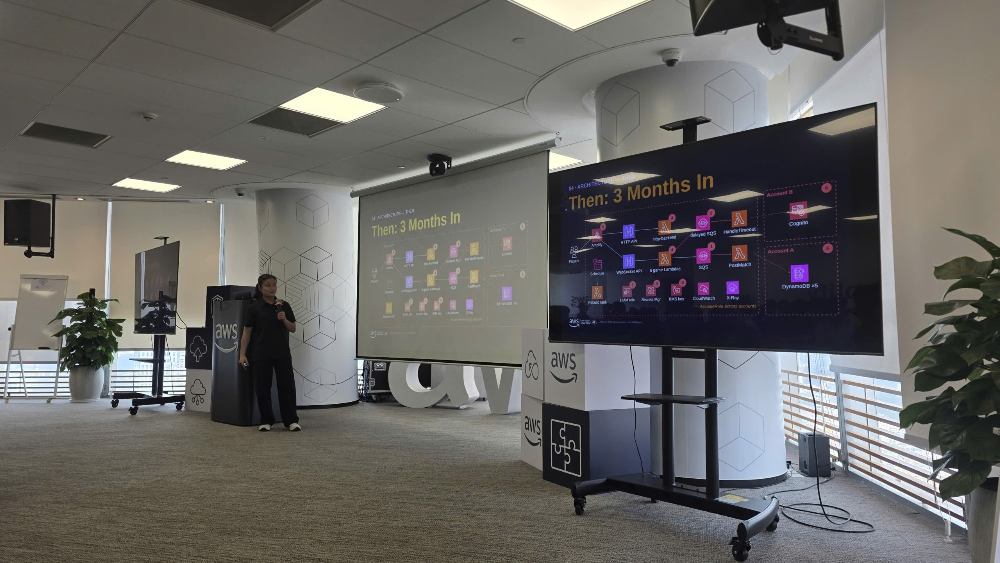

*Figure 9. Khang Duong presenting the project architecture after three months of internship.*

#### 6. Starting and keeping up open source contributions

The final session, by Hung Tran from NAB, explained how to find a starting point for open source contributions. The easiest way is to pick clear and simple issues, which are usually labeled *good first issue*, *triaged*, or *ready to implement*. The speaker's favorite type of contribution is a batch change or refactor: a large change that already has a clear template, so newcomers can take on small parts of it. The two examples were migrating the Kubelet codebase to contextual logging ([kubernetes#130069](https://github.com/kubernetes/kubernetes/issues/130069)) and converting `net.IP` to `netip.Addr` in Cilium ([cilium#24246](https://github.com/cilium/cilium/issues/24246)).

The rest of the session covered building a steady contribution habit and how it benefits skills and career growth.

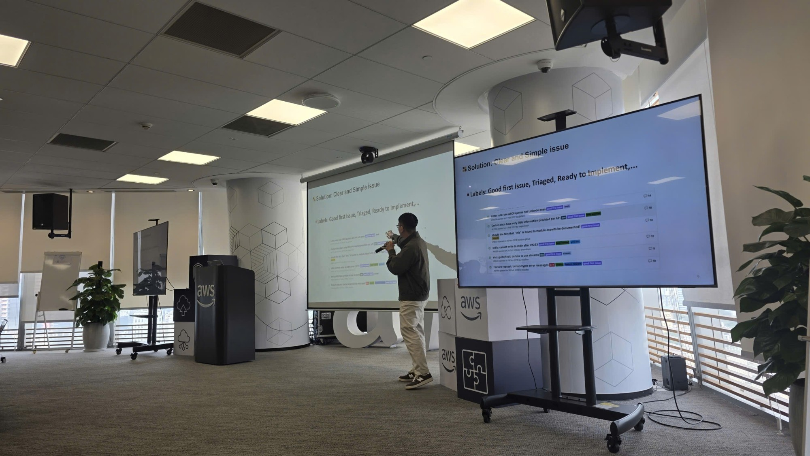

*Figure 10. Hung Tran recommending clear and simple issues as a starting point.*

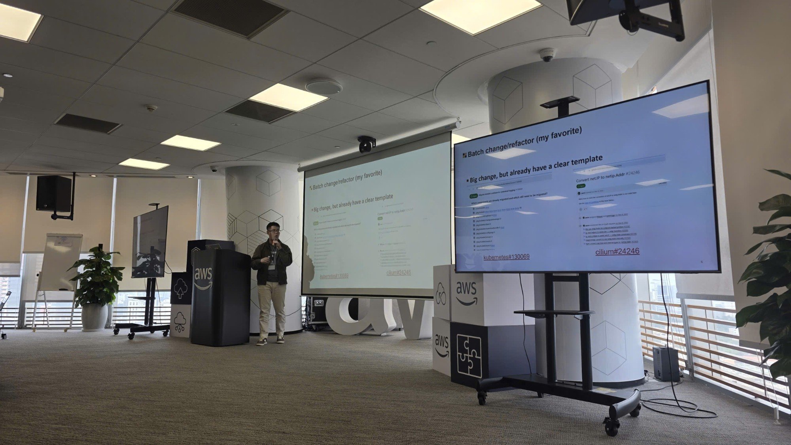

*Figure 11. Batch changes with a clear template are a good entry point for newcomers.*

### Key Takeaways

- **Automate checks before speeding up changes:** Moving faster only helps when each change can still be verified, and the checks themselves need to be optimized so they do not slow the team down.
- **Do not make every call synchronous:** For slow or failure-prone tasks, a queue such as SQS keeps the system responsive and more fault tolerant.
- **Compare costs when choosing an architecture:** Serverless and containers differ in both performance and billing, so the choice needs actual measurements and estimates.
- **Combine learning sources:** Use AWS Study Group for practice, Skill Builder for structured learning, and Builder Center to connect with the community.
- **Start small and stay consistent:** This applies both to open source contributions and to self-study during the internship.

### Applying to Work

When designing my personal workshop, I will identify the processing steps that may be slow or fail and consider decoupling them with Amazon SQS instead of calling them directly. When choosing between Lambda and containers, I will record the reasons and estimate the cost of each option in the COST section.

I plan to create accounts on AWS Skill Builder and AWS Builder Center to fill gaps in my knowledge and follow community articles. I also want to look for a *good first issue* in a cloud-related open source project to get familiar with the contribution process.

### Event Experience

The morning moved quickly with six sessions in a row, but each one offered a different perspective: engineering leaders and engineers working in industry, and members of the FCAJ community sharing their learning and projects. The session on the three-month internship journey gave me extra motivation, since that is exactly the path I am on now.

I attended with my FCAJ teammates and we had time to talk and take photos together after the sessions.

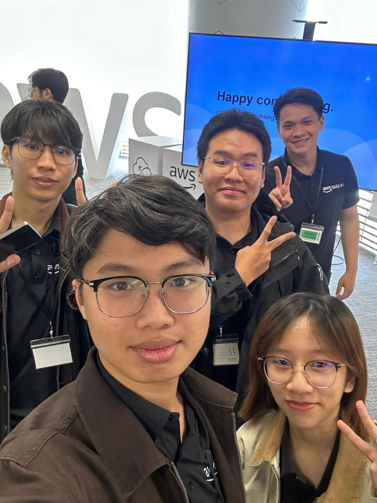

*Figure 12. My check-in photo with members of the FCAJ community at the event on October 31, 2026. All images in this report come from my personal event photo collection.*

### References

1. **FCAJ Community Day, Luma:** [Event page and agenda](https://luma.com/1izeyind).
2. **AWS Study Group:** [The First Cloud Journey](https://cloudjourney.awsfcaj.com/).
3. **AWS:** [AWS Skill Builder](https://skillbuilder.aws/) and [AWS Builder Center](https://builder.aws.com/).
4. **AWS News Blog:** [Announcing AWS Lambda Web Functions](https://aws.amazon.com/blogs/aws/announcing-aws-lambda-web-functions-for-fast-consistent-web-app-performance-anywhere/).
5. **AWS Documentation:** [What is Amazon Simple Queue Service?](https://docs.aws.amazon.com/AWSSimpleQueueService/latest/SQSDeveloperGuide/welcome.html)
6. **GitHub:** [Migrate Kubelet codebase to contextual logging (kubernetes#130069)](https://github.com/kubernetes/kubernetes/issues/130069) and [Convert net.IP to netip.Addr (cilium#24246)](https://github.com/cilium/cilium/issues/24246).
