# Bài thu hoạch “FCAJ Community Day”

### Thông tin sự kiện

&emsp; **Tên sự kiện:** FCAJ Community Day

&emsp; **Thời gian:** 09:00 đến 12:00, thứ Bảy, ngày 31/10/2026 (UTC+7)

&emsp; **Địa điểm:** Văn phòng AWS Việt Nam, Bitexco Financial Tower, 2 Hải Triều, TP.HCM

&emsp; **Hình thức:** Tham dự trực tiếp

&emsp; **Vai trò:** Người tham dự

&emsp; **Trang sự kiện:** [FCAJ Community Day trên Luma](https://luma.com/1izeyind)

FCAJ Community Day là buổi chia sẻ dành cho cộng đồng First Cloud AI Journey, gồm sáu phiên ngắn trong một buổi sáng. Các chủ đề trải rộng từ quy trình phát triển phần mềm có AI hỗ trợ, lộ trình học AWS cho sinh viên, kiến trúc serverless và xử lý bất đồng bộ, đến trải nghiệm thực tập ba tháng và đóng góp mã nguồn mở. Thời điểm diễn ra sự kiện, tôi đang ở tuần thứ 7 của kỳ thực tập nên nhiều phiên rất sát với những gì tôi đang học.

### Mục tiêu tham dự

- Nghe kinh nghiệm thực tế của những người đã xây dựng và vận hành hệ thống trên AWS.
- Tìm hiểu thêm các dịch vụ serverless và cách thiết kế hệ thống bất đồng bộ trước khi bắt đầu workshop cá nhân.
- Học hỏi từ trải nghiệm của các bạn đã đi trước trong chương trình thực tập.
- Gặp gỡ và trao đổi với các bạn trong cộng đồng FCAJ.

### Chương trình và diễn giả

| Thời gian | Phiên | Diễn giả |
| --- | --- | --- |
| 09:00 – 09:25 | Lessons Learned from Building Software Factories | Henry (Duc) Bui, Head of Engineering tại CloudThinker |
| 09:30 – 09:55 | New to AWS? Where should you start? | Tuan Tran (Tran Minh Tuan), Backend Developer, FPT University – FCAJ |
| 10:00 – 10:25 | AWS Lambda Web Functions: Rethinking Serverless Web Architecture | Thinh Nguyen, DevSecOps/Cloud Engineer tại STYL Solutions, First Cloud AI Journey |
| 10:30 – 11:00 | Amazon SQS: Building Asynchronous Systems | Dao Luong, FCAJ |
| 11:00 – 11:25 | My 3-Month AWS Internship Journey | Khang Duong, FCAJ |
| 11:30 – 12:00 | Start & Maintain Consistency with Open Source Contributing | Hung Tran, NAB |

Lịch chương trình lấy từ trang sự kiện trên Luma; tên và đơn vị của diễn giả lấy từ ảnh giới thiệu diễn giả của ban tổ chức và slide mở đầu của từng phiên.

### Nội dung nổi bật

#### 1. Bài học từ việc xây dựng “software factory”

Phiên mở đầu chia sẻ kinh nghiệm của đội CloudThinker khi tổ chức quy trình phát triển với nhiều phiên làm việc của AI agent chạy song song. Slide mở đầu là biểu đồ số lượt merge vào nhánh develop mỗi tháng, tăng từ 39 lượt vào tháng 12/2024 lên khoảng 2.900 lượt ở tháng cuối cùng trên biểu đồ. Lượng thay đổi lớn như vậy chỉ kiểm soát được khi quy trình kiểm tra đủ nhanh và đáng tin cậy.

Hai ý tôi ghi lại:

- **Một thư mục điều khiển chung:** mọi phiên làm việc đều bắt đầu từ một thư mục `control` chứa ghi chú, skill và hướng dẫn về máy. Từ đó agent truy cập đến repo ứng dụng, repo hạ tầng, repo tài liệu, máy của nhóm và các cụm dev/prod khi cần.
- **Cache kết quả test dùng chung:** kết quả test được lưu theo test và mã băm của các file mà test đó sử dụng. Nếu code không đổi thì dùng lại kết quả, nếu đổi thì chạy một lần rồi lưu cho mọi phiên; 2% số test được chạy lại ngẫu nhiên để kiểm chứng cache. Bên cạnh đó, một bộ chạy kiểm tra dùng chung giữ sẵn 10 bản sao của ứng dụng và chỉ chọn trong 65 loại kiểm tra (type check, lint, migration, quét secret, audit dependency, test) những loại liên quan đến phần thay đổi. Theo slide, cách làm này giúp dùng lại đến 72% số test trong một ngày và rút ngắn 76% thời gian chờ kiểm tra.

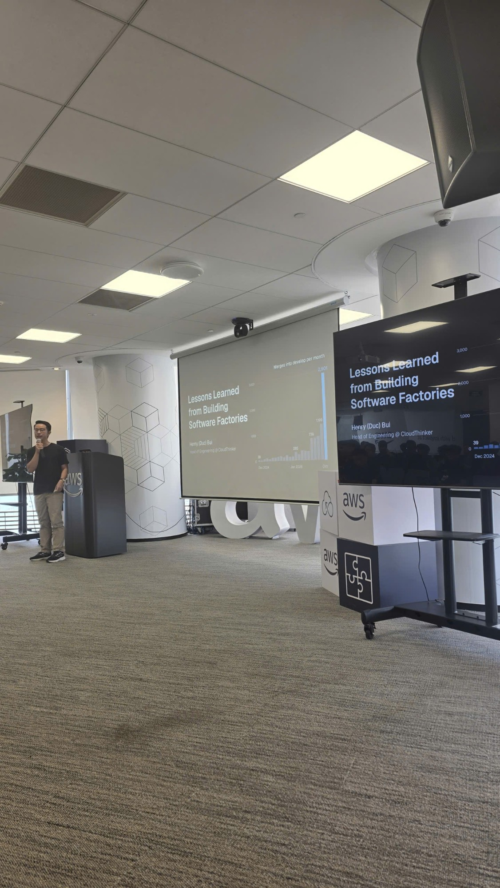

*Hình 1. Phiên Lessons Learned from Building Software Factories của diễn giả Henry (Duc) Bui.*

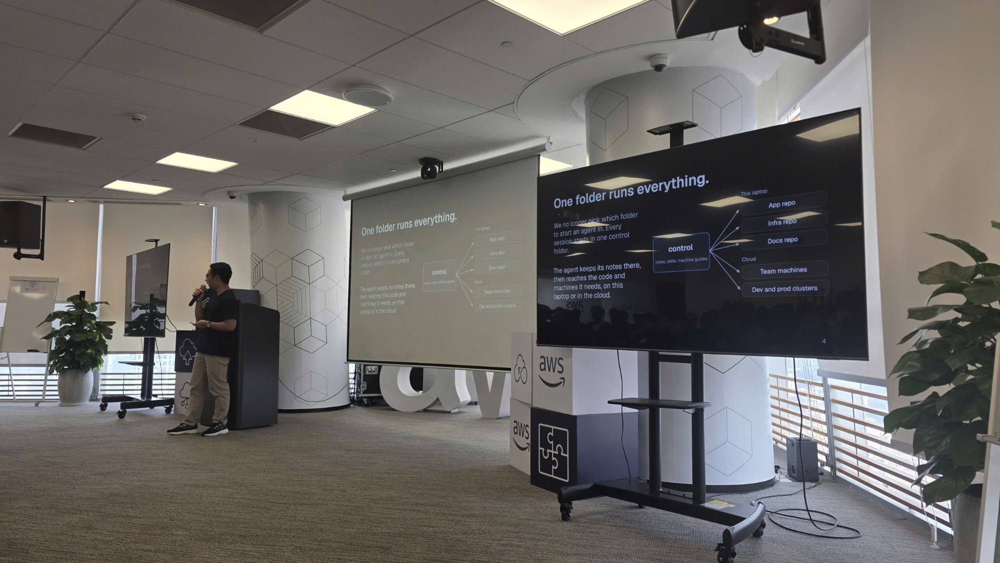

*Hình 2. Mọi phiên làm việc của agent bắt đầu từ một thư mục điều khiển chung.*

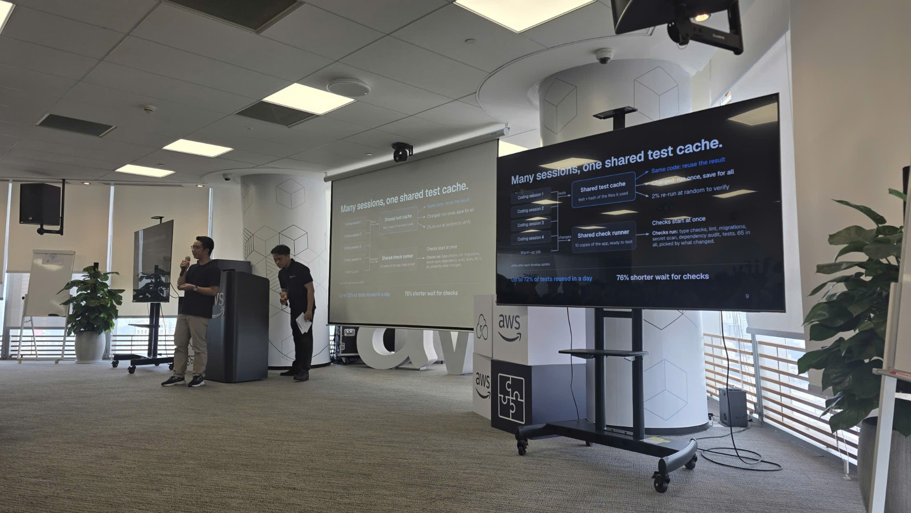

*Hình 3. Cache test và bộ chạy kiểm tra dùng chung cho nhiều phiên làm việc.*

#### 2. New to AWS? Where should you start?

Phiên *New to AWS? Where should you start?* (mục Education trong lịch chương trình) hướng đến sinh viên mới tiếp cận AWS, với ba nội dung: ba website học tập, một lộ trình học rõ ràng và các cơ hội nhận AWS credit. Diễn giả nhấn mạnh rằng không có website nào đáp ứng mọi nhu cầu học, nên cần kết hợp cả ba:

| Website | Mục đích | Nội dung chính |
| --- | --- | --- |
| [AWS Study Group](https://cloudjourney.awsfcaj.com/) | Thực hành | Workshop từng bước, hướng dẫn bằng tiếng Việt |
| [AWS Skill Builder](https://skillbuilder.aws/) | Học có cấu trúc | Khóa học online, ôn thi chứng chỉ, lab và tài liệu theo chủ đề |
| [AWS Builder Center](https://builder.aws.com/) | Cộng đồng và phần thưởng | Bài viết, workshop, xác minh sinh viên và huy hiệu |

Trong phiên, trang AWS Builder Center được mở trực tiếp trên màn hình để giới thiệu mục Spotlight, sự kiện và hoạt động cộng đồng. Tôi nhận ra mình đã dùng khá nhiều trang lab của AWS Study Group nhưng chưa khai thác Skill Builder và Builder Center.

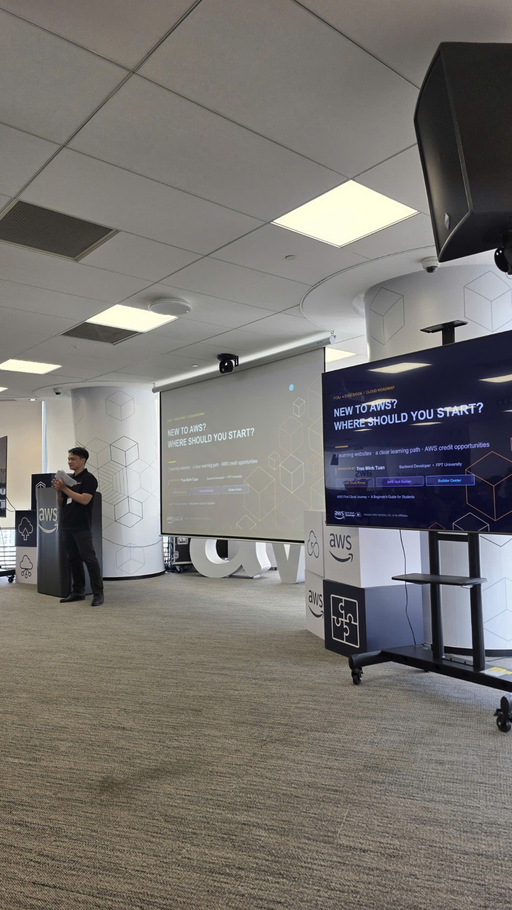

*Hình 4. Phiên chia sẻ của diễn giả Tuan Tran dành cho sinh viên mới bắt đầu với AWS.*

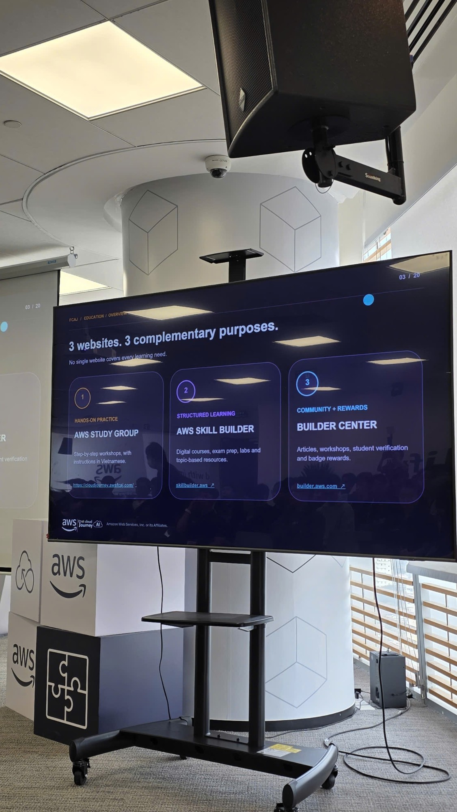

*Hình 5. Ba website học tập bổ trợ cho nhau.*

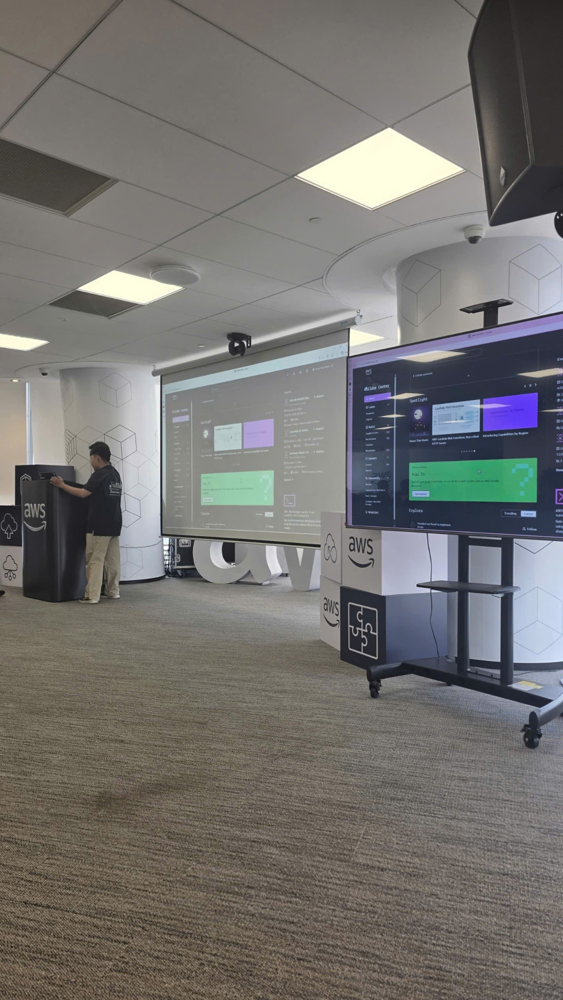

*Hình 6. Phần giới thiệu trực tiếp AWS Builder Center.*

#### 3. AWS Lambda Web Functions

Phiên này giới thiệu cách nhìn mới về kiến trúc web serverless với AWS Lambda Web Functions. Theo nội dung chương trình và bài công bố của AWS, các điểm chính gồm: hỗ trợ HTTP gốc, cho phép chạy một HTTP server thông thường, và xử lý đồng thời tối đa 128 request trên mỗi môi trường thực thi; bỏ được lớp adapter trung gian; tận dụng cơ chế tính phí theo thời gian CPU thực sự hoạt động (Active CPU Billing), nên thời gian chờ database hay API bên ngoài gần như không tốn phí CPU; và so sánh hiệu năng với cách chạy Docker trên EC2/ECS qua benchmark trực tiếp.

Ở Lab22 tôi đã dùng Lambda để tự động dừng và khởi động EC2 theo mô hình thông thường, trong đó mỗi môi trường thực thi chỉ xử lý một sự kiện tại một thời điểm. Phiên này cho tôi thấy Lambda có thể được dùng như một máy chủ web thực thụ, và cách tính phí cũng là một yếu tố cần so sánh khi chọn giữa serverless và container.

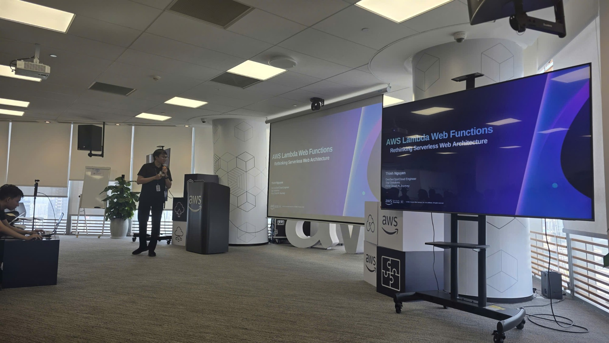

*Hình 7. Phiên AWS Lambda Web Functions của diễn giả Thinh Nguyen.*

#### 4. Xây dựng hệ thống bất đồng bộ với Amazon SQS

Phiên SQS của diễn giả Dao Luong bắt đầu từ một ví dụ dễ hiểu: người dùng yêu cầu tạo nội dung, API service gọi sang AI service dùng Amazon Bedrock rồi chờ phản hồi. Với cách xử lý đồng bộ, bước sau phải chờ bước trước hoàn thành. Nếu AI service chậm hoặc không phản hồi, request bị treo hoặc hết thời gian chờ và người dùng buộc phải chờ theo.

Giải pháp là đưa yêu cầu vào hàng đợi Amazon SQS để tách rời các thành phần: API nhận yêu cầu và trả lời ngay, phần xử lý nặng chạy phía sau và có thể mở rộng độc lập. Phiên cũng chia sẻ các mẫu thiết kế và lưu ý khi triển khai. Đây là dịch vụ tôi chưa thực hành trong các lab trước đó, và tôi muốn cân nhắc dùng nó cho các tác vụ tốn thời gian trong workshop.

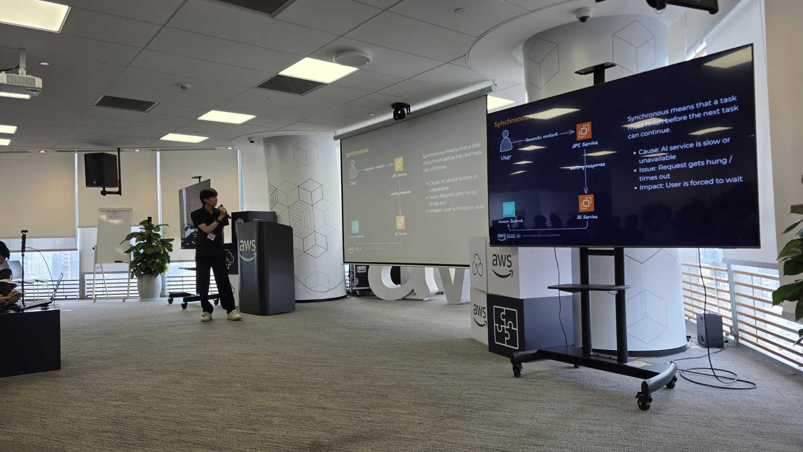

*Hình 8. Diễn giả Dao Luong trình bày vấn đề của xử lý đồng bộ khi dịch vụ phía sau chậm hoặc không phản hồi.*

#### 5. Hành trình ba tháng thực tập AWS

Diễn giả Khang Duong chia sẻ kiến trúc dự án thực tế sau ba tháng thực tập: một ứng dụng game nhiều người chơi chạy trên Amplify, HTTP API và WebSocket API, các Lambda function xử lý trận đấu, SQS (gồm hàng đợi trễ để xử lý timeout), lịch chạy định kỳ để cập nhật bảng xếp hạng, DynamoDB lưu dữ liệu và Cognito xác thực người dùng. Kiến trúc chia thành hai tài khoản AWS kết nối bằng AssumeRole, đi kèm IAM role, Secrets Manager, KMS key, CloudWatch và X-Ray.

Điều tôi chú ý là kiến trúc này dùng lại nhiều dịch vụ tôi đã học ở Module 05 đến 07 (IAM, KMS, Lambda, DynamoDB), nhưng kết hợp lại để giải quyết một bài toán cụ thể, có giám sát và bảo mật đầy đủ. Đây là mức hoàn thiện tôi muốn hướng tới cho workshop của mình.

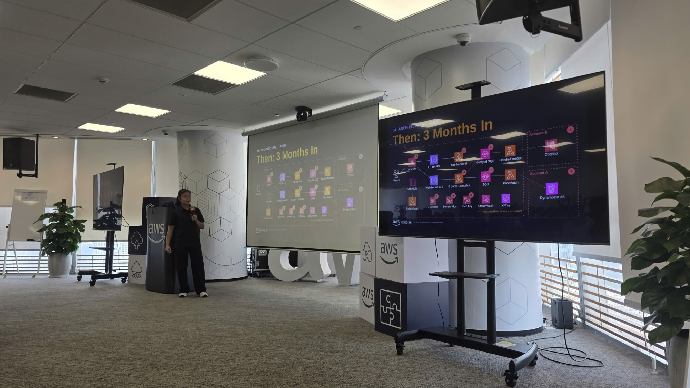

*Hình 9. Diễn giả Khang Duong giới thiệu kiến trúc dự án sau ba tháng thực tập.*

#### 6. Bắt đầu và duy trì đóng góp mã nguồn mở

Phiên cuối của diễn giả Hung Tran (NAB) hướng dẫn cách tìm điểm bắt đầu khi đóng góp mã nguồn mở. Cách dễ nhất là chọn các issue rõ ràng và đơn giản, thường được gắn nhãn như *good first issue*, *triaged* hoặc *ready to implement*. Kiểu đóng góp diễn giả yêu thích là các thay đổi hàng loạt hoặc refactor: thay đổi lớn nhưng đã có mẫu rõ ràng, nên người mới có thể nhận từng phần nhỏ. Hai ví dụ được nêu là việc chuyển codebase Kubelet sang contextual logging ([kubernetes#130069](https://github.com/kubernetes/kubernetes/issues/130069)) và việc chuyển `net.IP` sang `netip.Addr` trong Cilium ([cilium#24246](https://github.com/cilium/cilium/issues/24246)).

Phần còn lại của phiên nói về việc giữ thói quen đóng góp đều đặn và giá trị của việc này với kỹ năng và sự nghiệp.

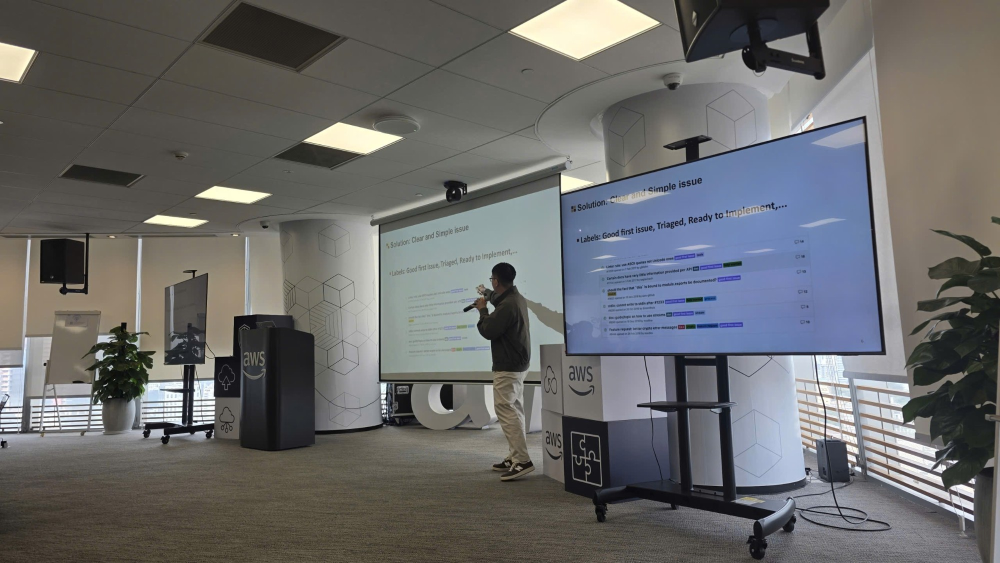

*Hình 10. Diễn giả Hung Tran gợi ý chọn issue rõ ràng và đơn giản để bắt đầu đóng góp.*

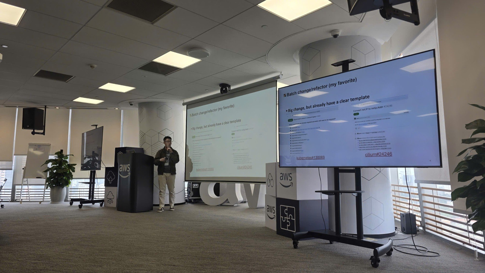

*Hình 11. Thay đổi hàng loạt có mẫu rõ ràng là điểm vào phù hợp cho người mới.*

### Bài học rút ra

- **Tự động hóa kiểm tra trước khi tăng tốc độ thay đổi:** Làm nhanh hơn chỉ có ý nghĩa khi vẫn kiểm chứng được mỗi thay đổi, và kiểm tra cũng cần được tối ưu để không làm chậm cả nhóm.
- **Không gọi đồng bộ cho mọi thứ:** Với tác vụ chậm hoặc dễ lỗi, hàng đợi như SQS giúp hệ thống phản hồi nhanh và chịu lỗi tốt hơn.
- **So sánh chi phí khi chọn kiến trúc:** Serverless và container khác nhau cả về hiệu năng lẫn cách tính phí, nên cần đo và tính toán cụ thể.
- **Kết hợp nhiều nguồn học:** Dùng AWS Study Group để thực hành, Skill Builder để học có hệ thống và Builder Center để kết nối với cộng đồng.
- **Bắt đầu từ việc nhỏ và giữ đều đặn:** Điều này đúng cả với đóng góp mã nguồn mở lẫn việc tự học trong kỳ thực tập.

### Áp dụng vào công việc

Khi thiết kế workshop cá nhân, tôi sẽ xác định những bước xử lý có thể chậm hoặc lỗi và cân nhắc tách chúng ra bằng Amazon SQS thay vì gọi trực tiếp. Khi chọn giữa Lambda và container, tôi sẽ ghi lại lý do và ước tính chi phí của từng phương án trong phần COST.

Tôi dự định tạo tài khoản trên AWS Skill Builder và AWS Builder Center để học thêm các nội dung còn thiếu và theo dõi bài viết từ cộng đồng. Ngoài ra, tôi muốn thử tìm một issue có nhãn *good first issue* trong một dự án mã nguồn mở liên quan đến cloud để làm quen với quy trình đóng góp.

### Trải nghiệm tham gia sự kiện

Buổi sáng có nhịp độ khá nhanh với sáu phiên liên tiếp, nhưng mỗi phiên đều mang đến một góc nhìn riêng: từ người dẫn dắt kỹ thuật và các kỹ sư đang làm việc tại doanh nghiệp, đến các thành viên cộng đồng FCAJ chia sẻ việc học và dự án của mình. Phiên chia sẻ về hành trình ba tháng thực tập khiến tôi có thêm động lực, vì đó cũng chính là chặng đường tôi đang đi.

Tôi tham dự cùng các bạn trong nhóm FCAJ và có dịp trò chuyện, chụp ảnh cùng nhau sau các phiên chia sẻ.

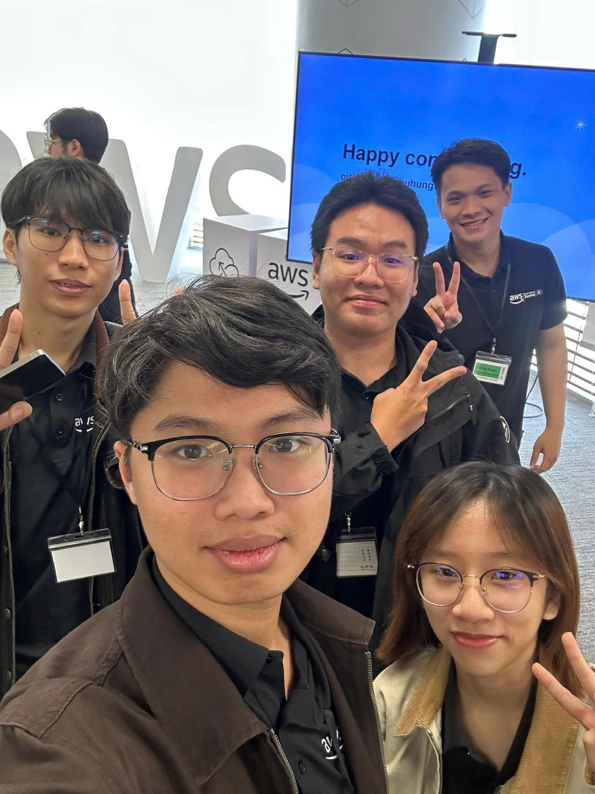

*Hình 12. Ảnh check-in của tôi cùng các bạn trong cộng đồng FCAJ tại sự kiện ngày 31/10/2026. Các ảnh trong bài thuộc bộ ảnh tham dự cá nhân của tôi.*

### Tài liệu tham khảo

1. **FCAJ Community Day, Luma:** [Trang sự kiện và lịch chương trình](https://luma.com/1izeyind).
2. **AWS Study Group:** [The First Cloud Journey](https://cloudjourney.awsfcaj.com/).
3. **AWS:** [AWS Skill Builder](https://skillbuilder.aws/) và [AWS Builder Center](https://builder.aws.com/).
4. **AWS News Blog:** [Announcing AWS Lambda Web Functions](https://aws.amazon.com/blogs/aws/announcing-aws-lambda-web-functions-for-fast-consistent-web-app-performance-anywhere/).
5. **AWS Documentation:** [What is Amazon Simple Queue Service?](https://docs.aws.amazon.com/AWSSimpleQueueService/latest/SQSDeveloperGuide/welcome.html)
6. **GitHub:** [Migrate Kubelet codebase to contextual logging (kubernetes#130069)](https://github.com/kubernetes/kubernetes/issues/130069) và [Convert net.IP to netip.Addr (cilium#24246)](https://github.com/cilium/cilium/issues/24246).
