# Summary Report: “AWSxFPTU Cloud Mastery 1”

### Event information

&emsp; **Event Name:** AWSxFPTU Cloud Mastery 1

&emsp; **Date:** Saturday, November 14, 2026

&emsp; **Location:** AWS Vietnam office, Bitexco Financial Tower, Ho Chi Minh City

&emsp; **Attendance Format:** In person

&emsp; **Role:** Attendee

AWSxFPTU Cloud Mastery 1 was a workshop for FPT University students built around one question: how do you take an AI application from a prototype to an enterprise production environment that is secure, reliable, and scalable? The content moved from general principles to Amazon Bedrock AgentCore and ended with a demo of a real architecture. The event took place at the end of week 9, right after I had started narrowing down my workshop topic and sketching its architecture, so it was a good chance to check my direction.

### Event Objectives

- Understand the gap between an AI prototype and an AI system that runs reliably in an enterprise.
- Learn about Amazon Bedrock AgentCore and the components that help bring AI agents to production.
- See how security, monitoring, and cost control fit into a real architecture.
- Take away points to consider for my personal workshop architecture.

### Speakers

| Part | Topic | Speaker |
| --- | --- | --- |
| 1 | From Prototype to Production: Secure, Reliable, Scalable Enterprise AI on the Cloud | Khang Duong, FCAJ member |
| 2 | AI in Enterprise: Enterprise Challenges and Amazon Bedrock AgentCore | Nguyen Lam Anh, AI Engineer, FCAJ |
| 3 | Amazon Bedrock AgentCore components: Identity, Gateway, Memory, and Observability | |
| 4 | Demo: agent orchestration with Strands Agents, observability with Langfuse, and the deployment architecture on AWS | |

### Key Highlights

#### 1. From Prototype to Production

Khang Duong's opening part covered four sections: the gap between a prototype and production (The Gap), the four pillars of an enterprise AI system (The Four Pillars), how AWS addresses them (The AWS Answer), and what comes next (The Road Ahead).

The whole part was told through the story of a restaurant: a prototype is a home kitchen, enterprise AI is a restaurant chain, and the cloud is the central kitchen that serves the chain. In an enterprise, data is the ingredients, the AI model is the chef, the feature is the dish, and users are the customers. AI rarely stands alone; it is a feature inside the product, such as recommendations, a support chatbot, or fraud detection.

The two pillars I noted most clearly:

- **Security:** AWS KMS keeps the “recipes” and customer information secret, IAM controls who enters the storeroom and who cooks, and Guardrails handle AI-specific risks, such as users trying to trick the “chef” into mistakes.
- **Elastic scalability:** Lambda clones itself as load grows, Auto Scaling adds or removes instances, and a load balancer shares the load.

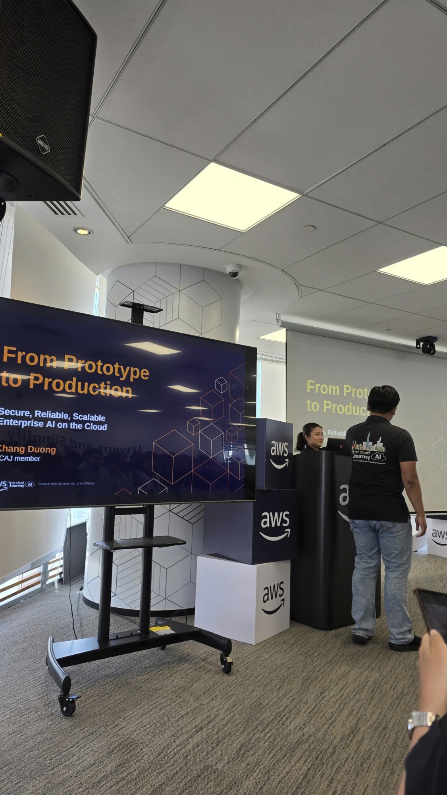

*Figure 1. The title slide of Khang Duong's talk, FCAJ member.*

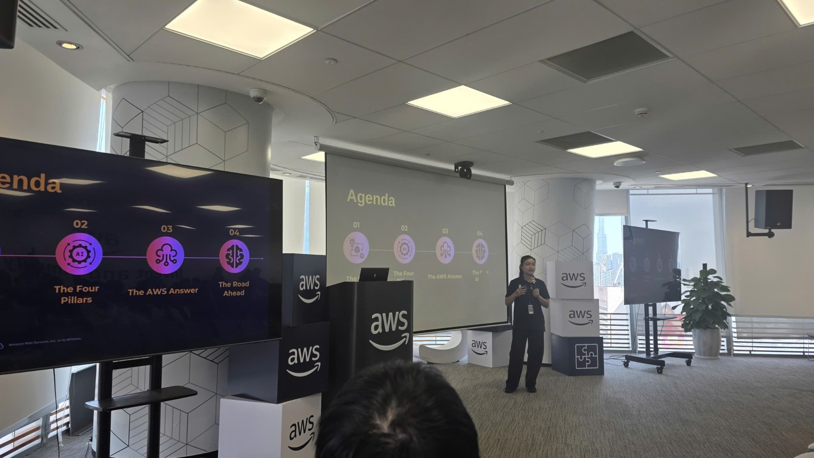

*Figure 2. The agenda of From Prototype to Production by Khang Duong.*

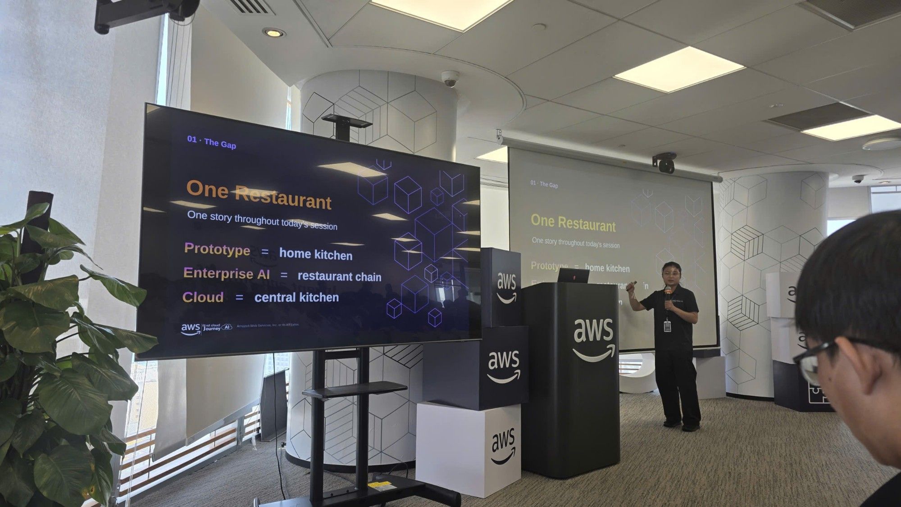

*Figure 3. The restaurant story used throughout the talk.*

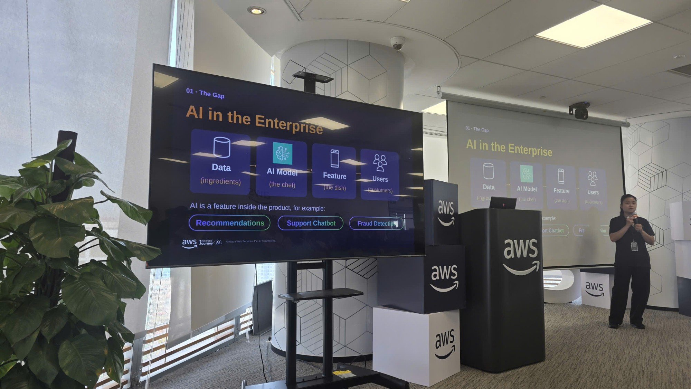

*Figure 4. AI as a feature inside an enterprise product.*

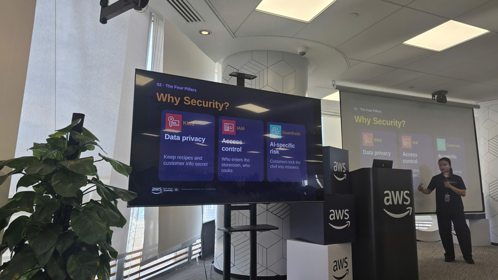

*Figure 5. The security pillar: KMS, IAM, and Guardrails.*

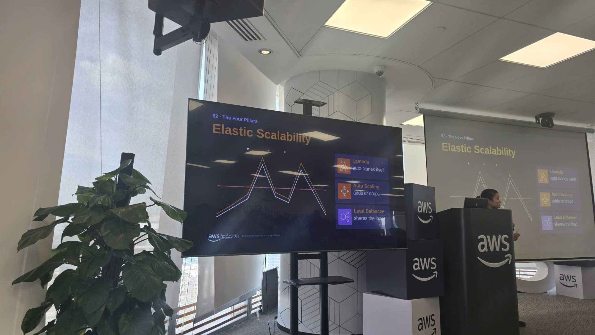

*Figure 6. The elastic scalability pillar: Lambda, Auto Scaling, and a load balancer.*

#### 2. AI in Enterprise and Amazon Bedrock AgentCore

In the second part, Nguyen Lam Anh presented three challenges of bringing AI agents into an enterprise:

- **Security & Scalability:** what can the agent touch, and how much load can it take?
- **Integration & Context:** can the agent work with real systems and keep context?
- **Observability & Evaluation:** do we know what the agent is doing, and is it right?

The speaker then placed AgentCore in the overall picture: the model understands and responds, the agent application coordinates the model with tools (such as an order system), and Amazon Bedrock AgentCore provides managed capabilities for agents.

The most practical example for me was a hybrid design connected to Mobileye services: the ticket system runs on premises and cannot be reached from AWS. A local orchestrator pulls tickets and posts replies. The support agent runs on AgentCore Runtime, gets credentials from Secrets Manager so they are never exposed, and calls internal services through MCP for live status, logs, and errors. AgentCore Observability traces the full path from the request through the MCP tool calls to the reply. As a result, there is no inbound path into the on-premises network, yet the agent still has live data at inference time.

The part closed with the idea that agents do not throw errors like traditional software, so every run needs to be observed and graded. Each step (inputs, outputs, latency, tokens) is traced, and results are evaluated with code checks, LLM-as-a-judge, and red teaming.

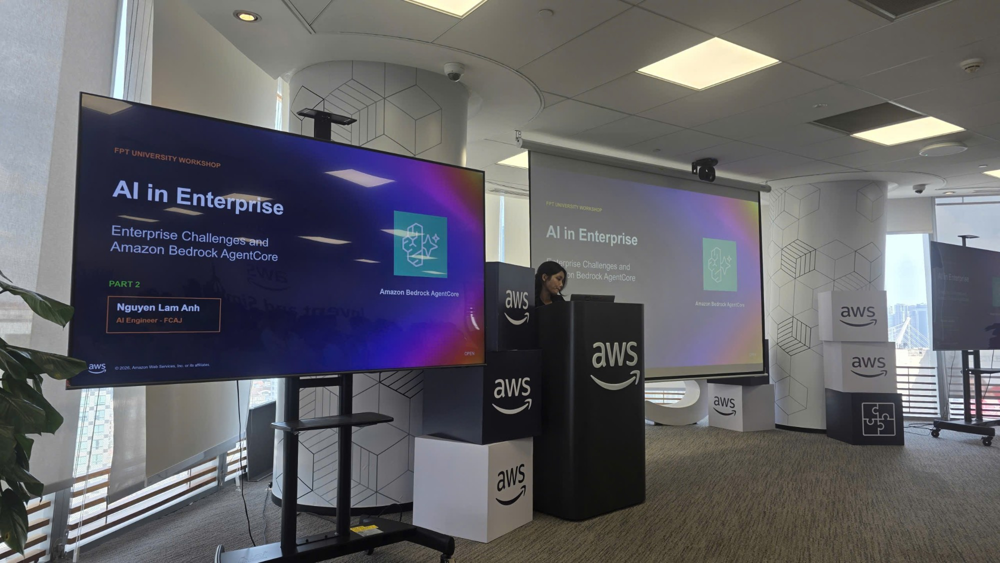

*Figure 7. Part 2 by Nguyen Lam Anh, AI Engineer at FCAJ.*

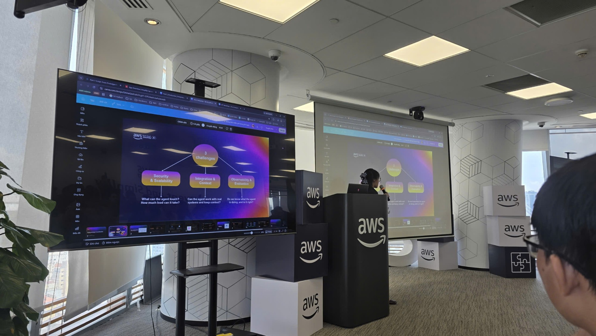

*Figure 8. Three challenges of bringing AI agents into an enterprise.*

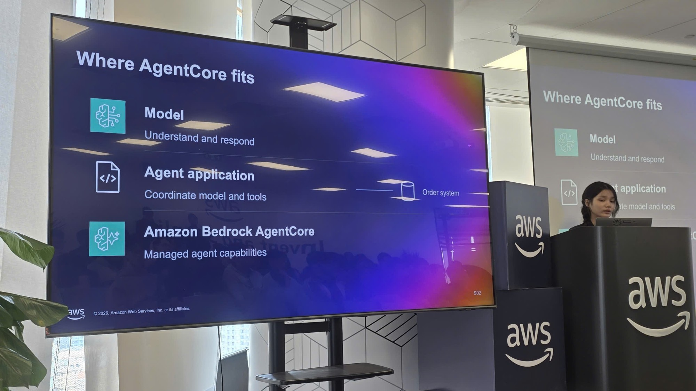

*Figure 9. Where AgentCore sits relative to the model and the agent application.*

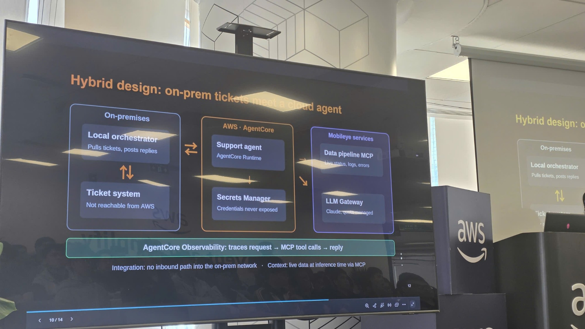

*Figure 10. A hybrid design that connects on-premises tickets to a cloud agent.*

#### 3. AgentCore components

The third part went through each component in detail:

- **Identity:** AgentCore separates inbound and outbound authentication, described as “two different doors, two different locks.” Inbound answers who the user is and whether they may call the agent; outbound answers whether the agent is who it claims to be and whether it may access a resource on behalf of the user. At run time, the agent holds a workload access token tied to both the agent and the user.
- **Gateway:** a shared connection point between many agents (customer support, shopping, pricing) and APIs, tools, and resources, with MCP support, tool creation and search, fine-grained access control, private connectivity, and tool filtering. The authorization flow starts with an inbound OAuth token (for example, authenticated through Amazon Cognito), after which the Gateway exchanges a workload access token for an outbound OAuth token to call the API. AgentCore Identity acts as the secure token vault.
- **Memory:** among the parts of the context window (system prompt, RAG documents, tools, instructions, message history), memory is often overlooked, yet without it agents miss learning and personalization. AgentCore Memory has short-term memory that stores raw interactions and long-term memory that stores extracted insights in a vector store. It is serverless, integrated with CloudWatch, lets short-term events expire after up to 365 days, supports namespaces, and encrypts data at rest and in transit. The agent writes messages and state to short-term memory synchronously, while an automatic extraction module runs asynchronously to move information into long-term memory using strategies such as semantic, user preferences, summarization, episodic, or a custom strategy.
- **Observability:** “you cannot fix what you cannot see.” Observability supports compliance, traceability, cost visibility, root-cause analysis in non-deterministic flows, latency tracking, and continuous evaluation. AgentCore collects OpenTelemetry data from the agent and from services such as Memory, Identity, and Gateway, then shows it on dashboards or sends it to third-party observability tools.

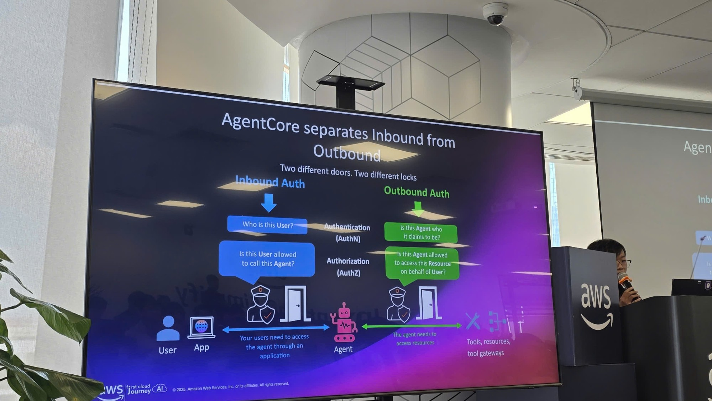

*Figure 11. AgentCore Identity separates inbound and outbound authentication.*

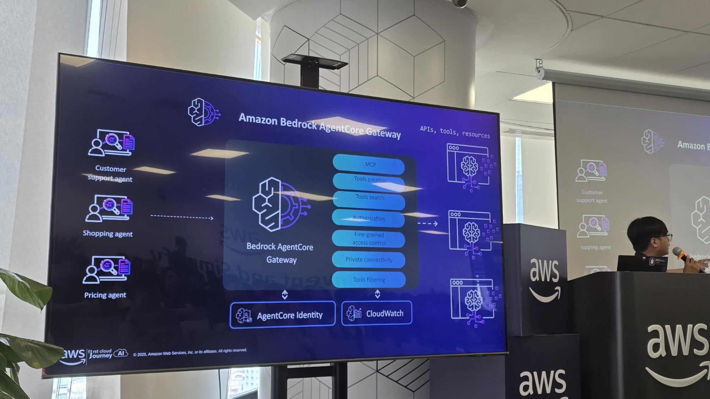

*Figure 12. AgentCore Gateway as a shared connection point between agents and tools.*

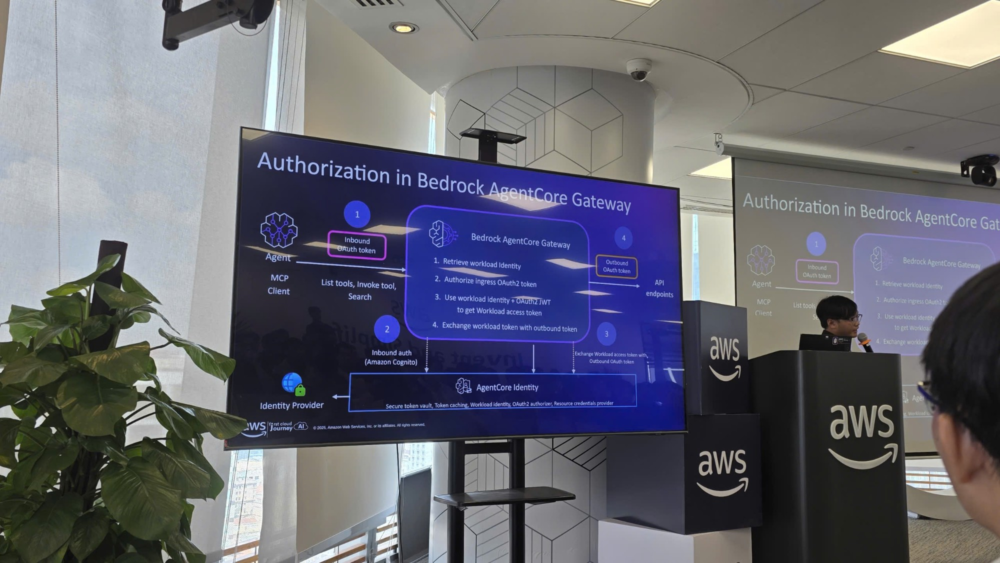

*Figure 13. The authorization flow in AgentCore Gateway.*

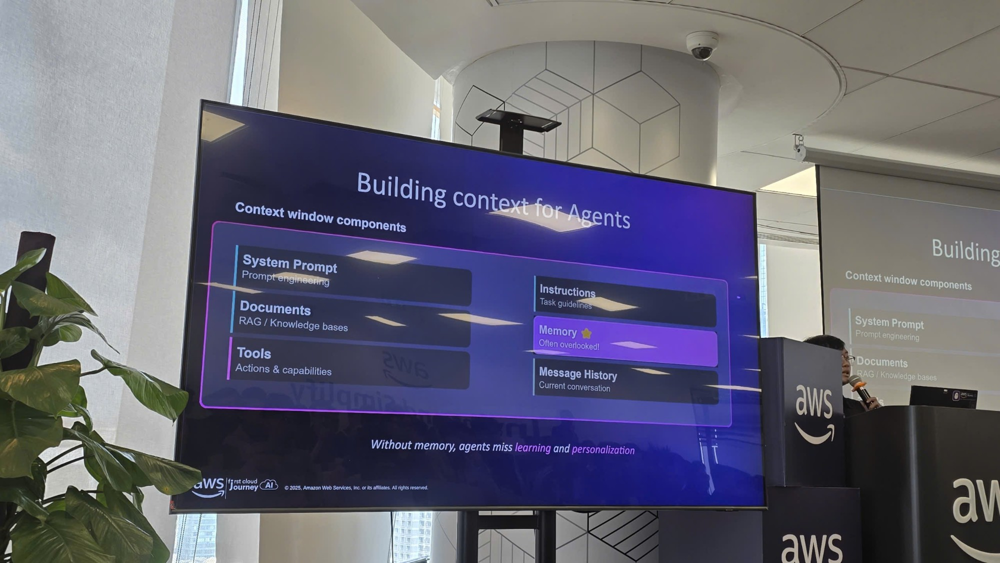

*Figure 14. Memory is often overlooked when building context for agents.*

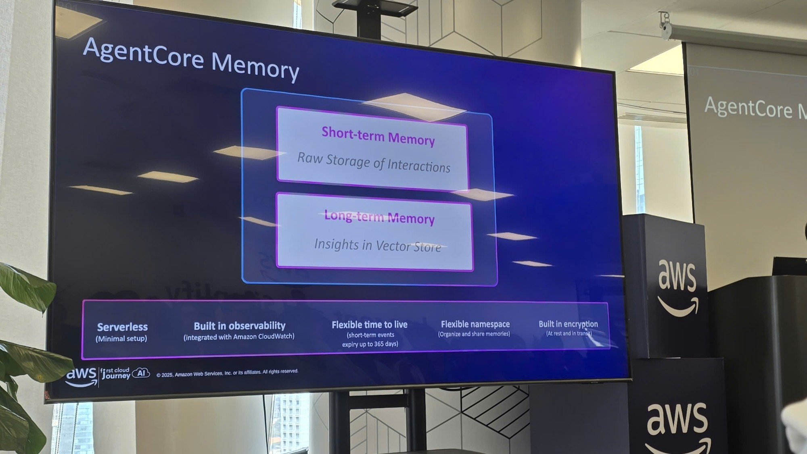

*Figure 15. Short-term and long-term memory in AgentCore Memory.*

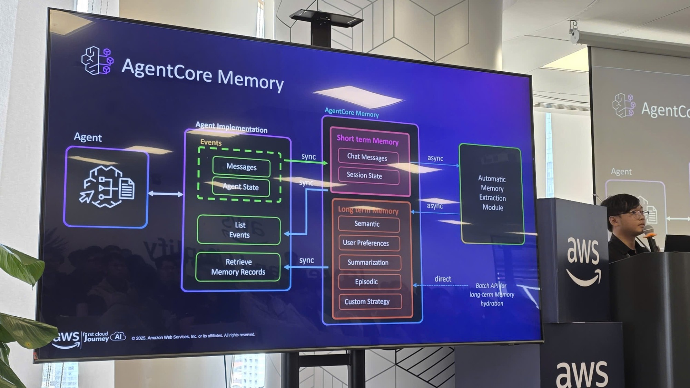

*Figure 16. How the agent writes to and retrieves from short-term and long-term memory.*

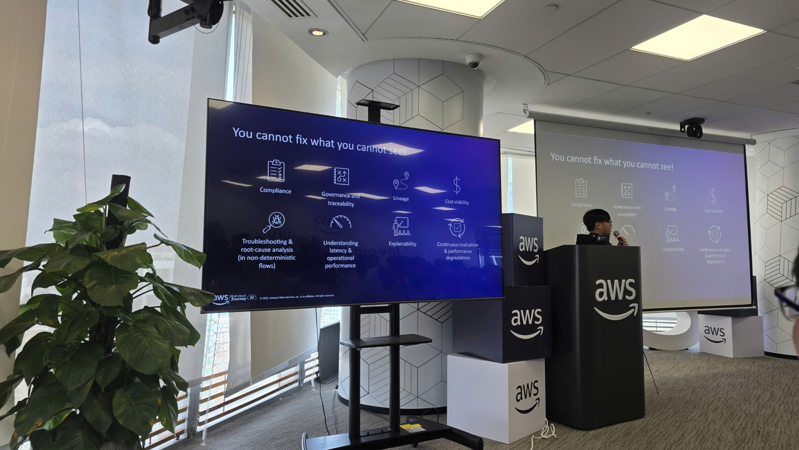

*Figure 17. Why AI agents need observability.*

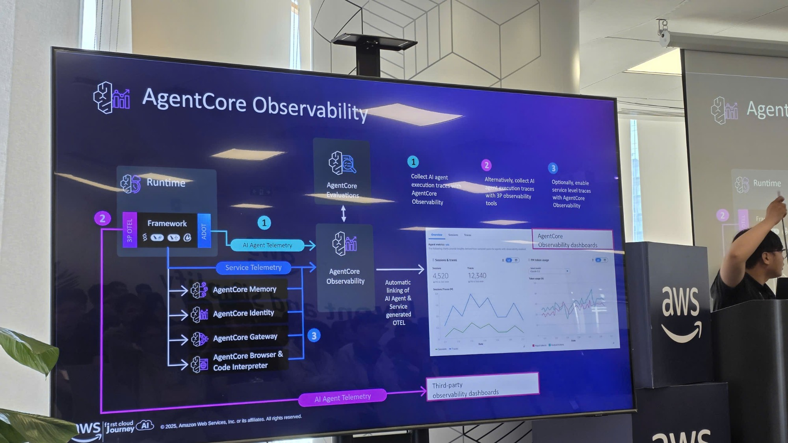

*Figure 18. AgentCore Observability collects telemetry from the agent and AgentCore services.*

#### 4. Demo: from agent to deployment architecture

The final part demonstrated a complete agent system. Strands Agents handled controlled orchestration: a request goes through FastAPI, a router sends it to the right agent (such as a Q&A agent, a ticket agent, or a research agent), and important actions pass an approval step before the result is returned. Langfuse was used to trace workflows and tool calls, investigate latency and failures, and observe model usage.

The deployment architecture on AWS included images stored in Amazon ECR, agents running on Amazon ECS with Fargate in private subnets across two Availability Zones, an Application Load Balancer for incoming requests, NAT gateways for outbound connections, Amazon Bedrock for models, Amazon DynamoDB for data, and Amazon CloudWatch for monitoring. Security relied on IAM and Secrets Manager, and cost optimization used Cost Explorer and AWS Budgets.

This architecture reuses many components I have practiced: a two-tier public/private VPC with a NAT gateway (Lab03), IAM and KMS (Module 05), DynamoDB (Lab60, Lab39), and AWS Budgets (Lab07). The difference is that everything is combined around a specific AI problem, with monitoring and cost control built into the design.

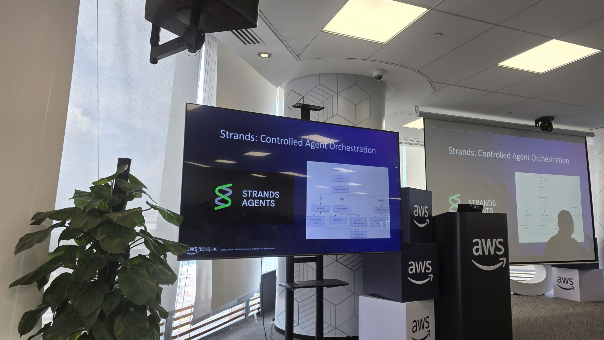

*Figure 19. Controlled agent orchestration with Strands Agents.*

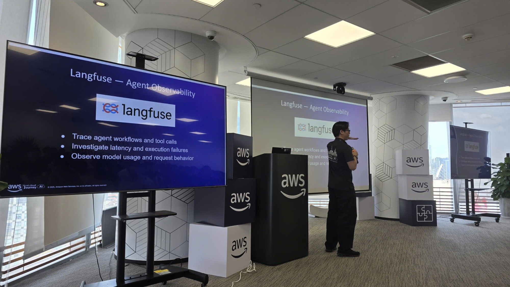

*Figure 20. Using Langfuse to observe the agent during the demo.*

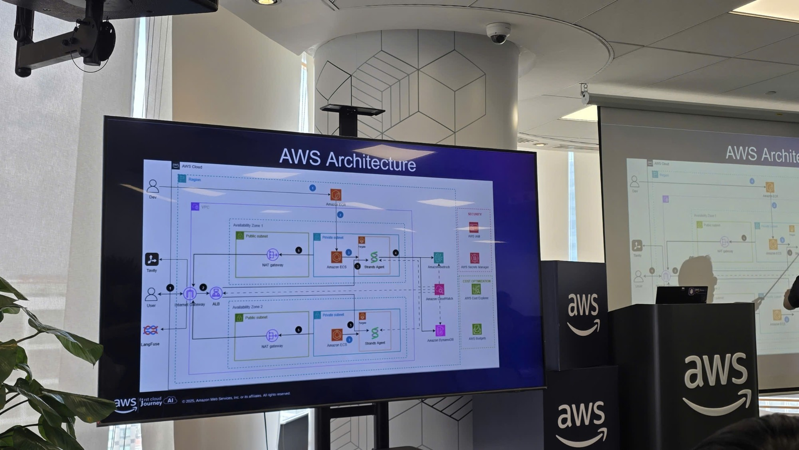

*Figure 21. The deployment architecture of the agent system on AWS from the demo.*

### Key Takeaways

- **A working prototype is not a product yet:** An enterprise AI system needs security, scalability, integration, and monitoring from the start, not as an afterthought.
- **Security for AI goes beyond IAM:** Besides encryption and permissions, AI-specific risks such as prompt injection must be considered, and the user's permissions must be kept separate from the agent's.
- **Do not hide credentials in code:** Use Secrets Manager or a token vault so the agent fetches credentials when needed.
- **Agents need to be observed and graded:** An agent can give a wrong answer without raising an error, so every step should be traced and results evaluated regularly.
- **Memory is part of the design:** Separate what needs to be remembered within a session from what must be kept long term, with retention periods and encryption.

### Applying to Work

For my personal workshop, I will use the four questions from this event to review my architecture: how the data is protected, how the system scales as load grows, how the components integrate, and how I know the system is working correctly. Secrets will be managed with Secrets Manager instead of being written in code or environment variables.

The testing and monitoring section of my workshop will go beyond CloudWatch logs and metrics and include test cases that check the output. If my workshop uses AI, I will record each processing step so that unexpected results can be traced.

### Event Experience

The workshop covered a lot of content that was new to me, especially the AgentCore components. The restaurant story in the first part helped me follow fairly abstract concepts, and the demo showed how the services come together into an architecture that actually runs. Many of the talks were given by members of the FCAJ community, which gave me a clearer idea of what I can achieve after my internship.

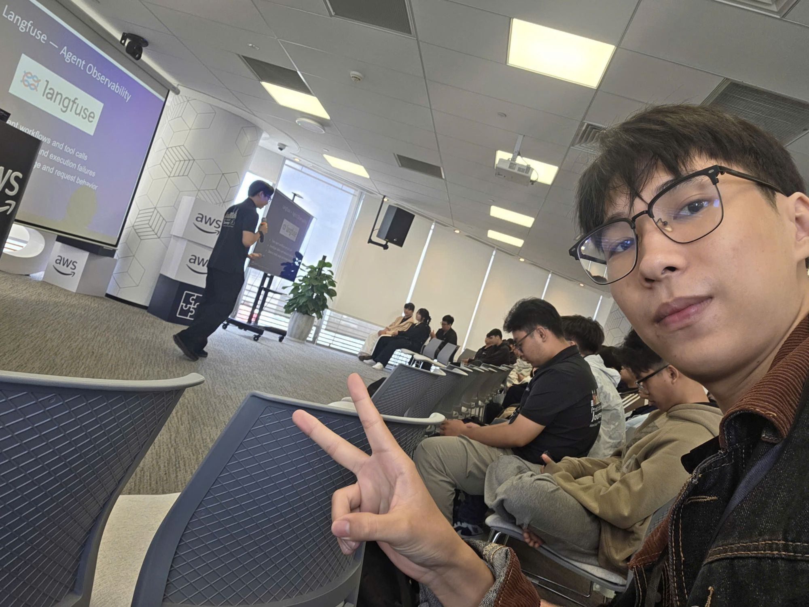

*Figure 22. My check-in photo during the demo at the event on November 14, 2026.*

### References

1. **AWS Documentation:** [Amazon Bedrock AgentCore – Overview](https://docs.aws.amazon.com/bedrock-agentcore/latest/devguide/what-is-bedrock-agentcore.html).
2. **AWS Documentation:** [AgentCore Identity](https://docs.aws.amazon.com/bedrock-agentcore/latest/devguide/identity.html), [AgentCore Gateway](https://docs.aws.amazon.com/bedrock-agentcore/latest/devguide/gateway.html), [AgentCore Memory](https://docs.aws.amazon.com/bedrock-agentcore/latest/devguide/memory.html), and [AgentCore Observability](https://docs.aws.amazon.com/bedrock-agentcore/latest/devguide/observability.html).
3. **Strands Agents:** [Strands Agents project website](https://strandsagents.com/).
4. **Langfuse:** [Langfuse website](https://langfuse.com/).
