# Bài thu hoạch “AWSxFPTU Cloud Mastery 1”

### Thông tin sự kiện

&emsp; **Tên sự kiện:** AWSxFPTU Cloud Mastery 1

&emsp; **Thời gian:** Thứ Bảy, ngày 14/11/2026

&emsp; **Địa điểm:** Văn phòng AWS Việt Nam, Bitexco Financial Tower, TP.HCM

&emsp; **Hình thức:** Tham dự trực tiếp

&emsp; **Vai trò:** Người tham dự

AWSxFPTU Cloud Mastery 1 là buổi workshop dành cho sinh viên Đại học FPT, xoay quanh câu hỏi: làm thế nào để đưa một ứng dụng AI từ bản prototype lên môi trường production của doanh nghiệp một cách an toàn, ổn định và mở rộng được. Nội dung đi từ các nguyên tắc chung đến Amazon Bedrock AgentCore và kết thúc bằng phần demo kiến trúc thực tế. Sự kiện diễn ra vào cuối tuần 9, ngay sau khi tôi bắt đầu thu hẹp đề tài và phác thảo kiến trúc workshop cá nhân, nên đây là dịp tốt để đối chiếu hướng đi của mình.

### Mục tiêu tham dự

- Hiểu khoảng cách giữa một bản prototype AI và một hệ thống AI chạy ổn định trong doanh nghiệp.
- Tìm hiểu Amazon Bedrock AgentCore và các thành phần hỗ trợ đưa AI agent lên production.
- Xem cách bảo mật, giám sát và kiểm soát chi phí được đưa vào một kiến trúc thực tế.
- Rút ra những điểm cần lưu ý cho kiến trúc workshop cá nhân.

### Chương trình và diễn giả

| Phần | Nội dung | Diễn giả |
| --- | --- | --- |
| 1 | From Prototype to Production: Secure, Reliable, Scalable Enterprise AI on the Cloud | Khang Duong, thành viên FCAJ |
| 2 | AI in Enterprise: Enterprise Challenges and Amazon Bedrock AgentCore | Nguyen Lam Anh, AI Engineer, FCAJ |
| 3 | Các thành phần của Amazon Bedrock AgentCore: Identity, Gateway, Memory và Observability | Chờ cập nhật |
| 4 | Demo: điều phối agent với Strands Agents, quan sát bằng Langfuse và kiến trúc triển khai trên AWS | Chờ cập nhật |

Sự kiện không có trang giới thiệu công khai. Tên phiên và diễn giả lấy từ slide được chiếu tại sự kiện.

### Nội dung nổi bật

#### 1. From Prototype to Production

Phần mở đầu của diễn giả Khang Duong đi qua bốn mục: khoảng cách giữa prototype và production (The Gap), bốn trụ cột của một hệ thống AI doanh nghiệp (The Four Pillars), cách AWS đáp ứng (The AWS Answer) và hướng phát triển tiếp theo (The Road Ahead).

Cả phần được kể qua câu chuyện một nhà hàng: prototype giống căn bếp ở nhà, AI doanh nghiệp giống một chuỗi nhà hàng, còn cloud là bếp trung tâm phục vụ cả chuỗi. Trong doanh nghiệp, dữ liệu là nguyên liệu, mô hình AI là đầu bếp, tính năng là món ăn và người dùng là thực khách. AI thường không đứng riêng mà là một tính năng nằm trong sản phẩm, ví dụ gợi ý sản phẩm, chatbot hỗ trợ khách hàng hay phát hiện gian lận.

Hai trụ cột tôi ghi lại rõ nhất:

- **Bảo mật:** AWS KMS giữ bí mật “công thức” và thông tin khách hàng; IAM kiểm soát ai được vào kho, ai được nấu; Guardrails chặn các rủi ro riêng của AI, như khi người dùng cố tình lừa “đầu bếp” làm sai.
- **Khả năng mở rộng linh hoạt:** Lambda tự nhân bản khi tải tăng, Auto Scaling thêm hoặc bớt máy, Load Balancer chia đều tải.

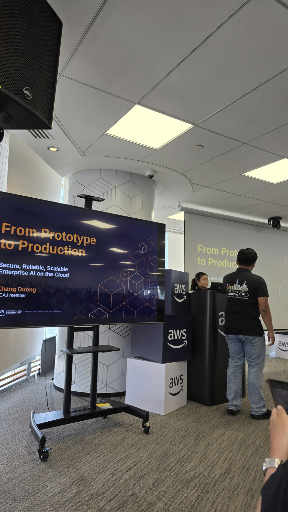

*Hình 1. Slide mở đầu phần chia sẻ của diễn giả Khang Duong, thành viên FCAJ.*

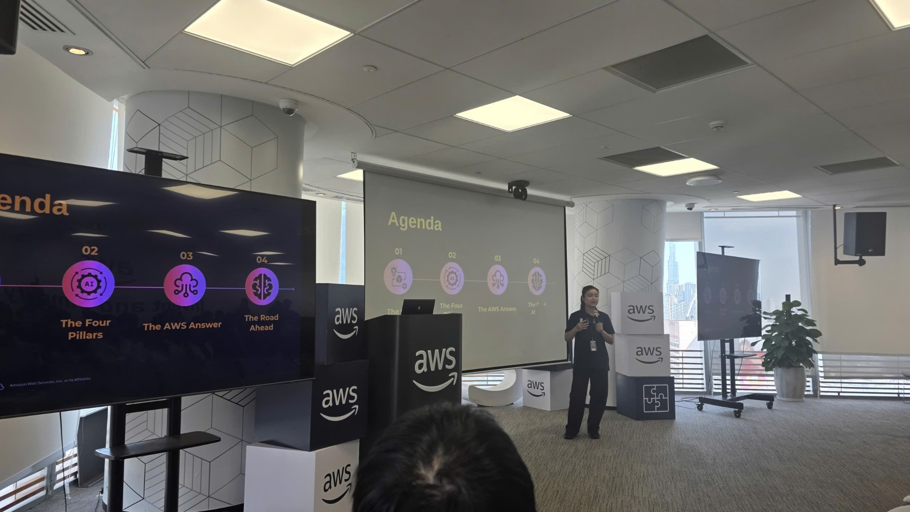

*Hình 2. Agenda phần From Prototype to Production của diễn giả Khang Duong.*

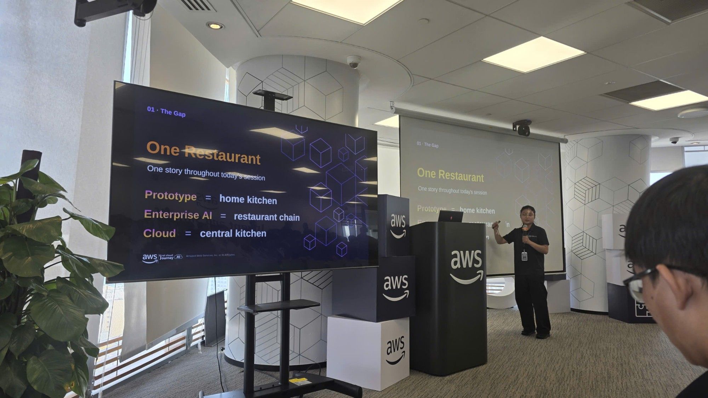

*Hình 3. Câu chuyện nhà hàng được dùng xuyên suốt phần chia sẻ.*

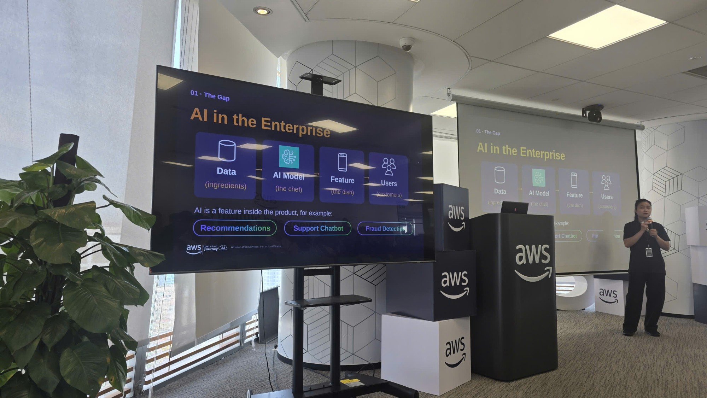

*Hình 4. AI là một tính năng nằm trong sản phẩm của doanh nghiệp.*

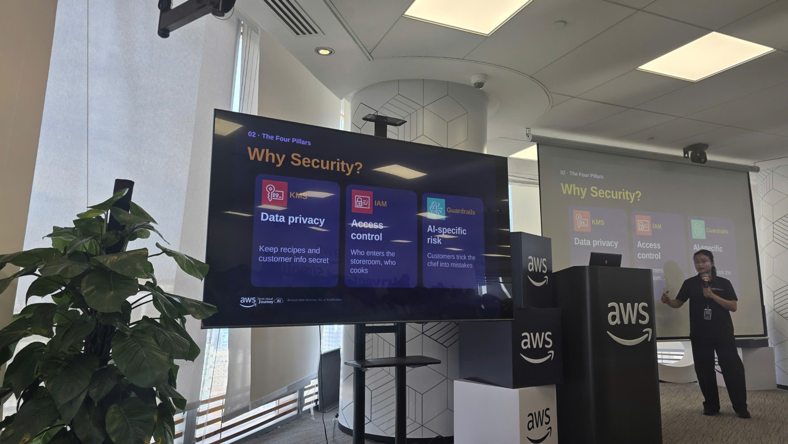

*Hình 5. Trụ cột bảo mật: KMS, IAM và Guardrails.*

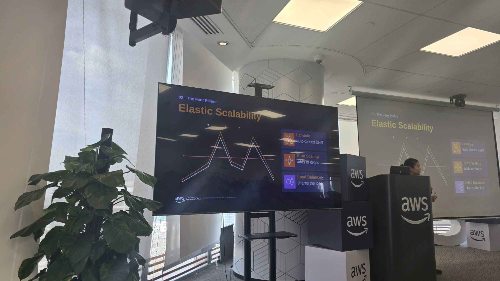

*Hình 6. Trụ cột mở rộng linh hoạt: Lambda, Auto Scaling và Load Balancer.*

#### 2. AI in Enterprise và Amazon Bedrock AgentCore

Phần thứ hai của diễn giả Nguyen Lam Anh nêu ba thách thức khi đưa AI agent vào doanh nghiệp:

- **Security & Scalability:** agent được phép chạm vào những gì và chịu được bao nhiêu tải?
- **Integration & Context:** agent có làm việc được với hệ thống thật và giữ được ngữ cảnh không?
- **Observability & Evaluation:** có biết agent đang làm gì và làm có đúng không?

Diễn giả đặt AgentCore vào bức tranh chung: mô hình hiểu và phản hồi, ứng dụng agent điều phối mô hình với các công cụ (ví dụ hệ thống đặt hàng), còn Amazon Bedrock AgentCore cung cấp sẵn các năng lực được quản lý cho agent.

Ví dụ tôi thấy thực tế nhất là một thiết kế hybrid kết nối với các dịch vụ của Mobileye: hệ thống ticket nằm on-premises và AWS không truy cập vào được. Một orchestrator chạy tại chỗ sẽ kéo ticket về rồi gửi câu trả lời lên. Support agent chạy trên AgentCore Runtime, lấy thông tin xác thực từ Secrets Manager để không lộ credential, và gọi các dịch vụ nội bộ qua MCP để lấy trạng thái, log và lỗi theo thời gian thực. AgentCore Observability ghi lại toàn bộ đường đi từ request, các lần gọi tool qua MCP đến câu trả lời. Nhờ vậy không cần mở đường vào mạng on-premises mà agent vẫn có dữ liệu mới nhất khi suy luận.

Phần này kết thúc bằng ý: agent không ném lỗi như phần mềm thông thường, nên cần quan sát và chấm điểm từng lượt chạy. Mỗi bước (input, output, độ trễ, token) đều được trace; kết quả được đánh giá bằng kiểm tra bằng code, LLM-as-a-judge và red teaming.

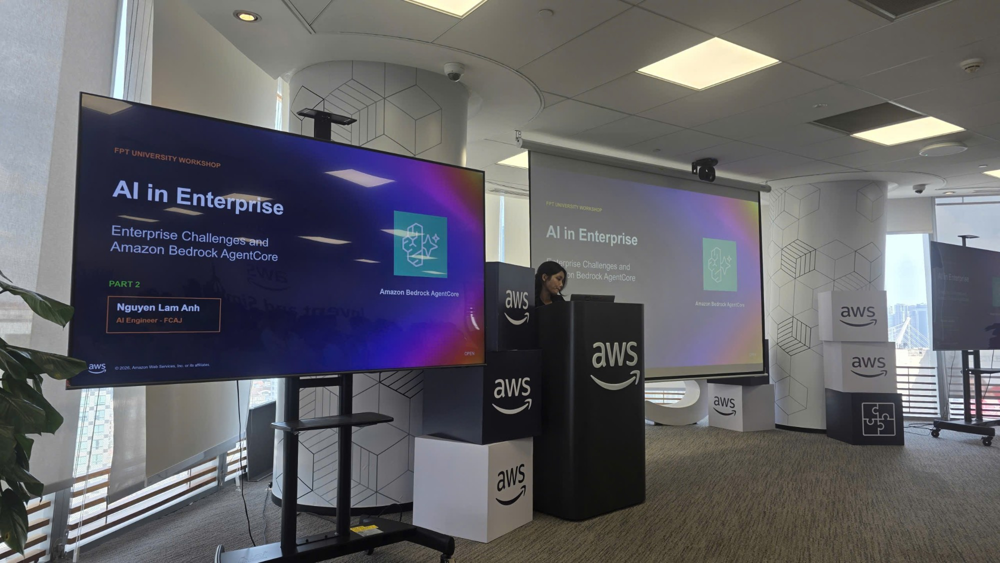

*Hình 7. Phần 2 của diễn giả Nguyen Lam Anh, AI Engineer tại FCAJ.*

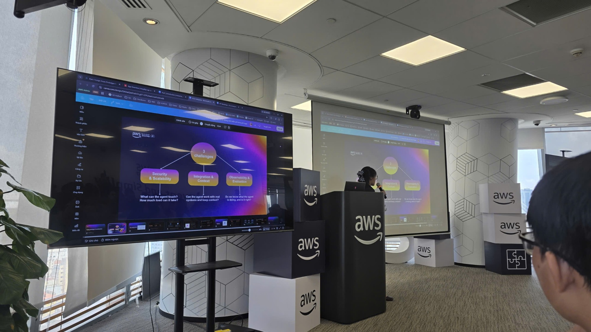

*Hình 8. Ba thách thức khi đưa AI agent vào doanh nghiệp.*

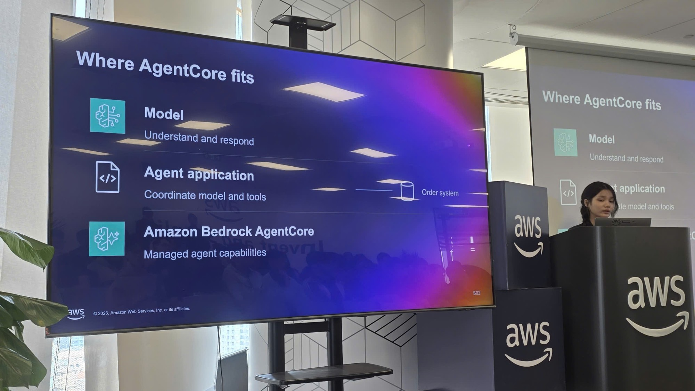

*Hình 9. Vị trí của AgentCore so với mô hình và ứng dụng agent.*

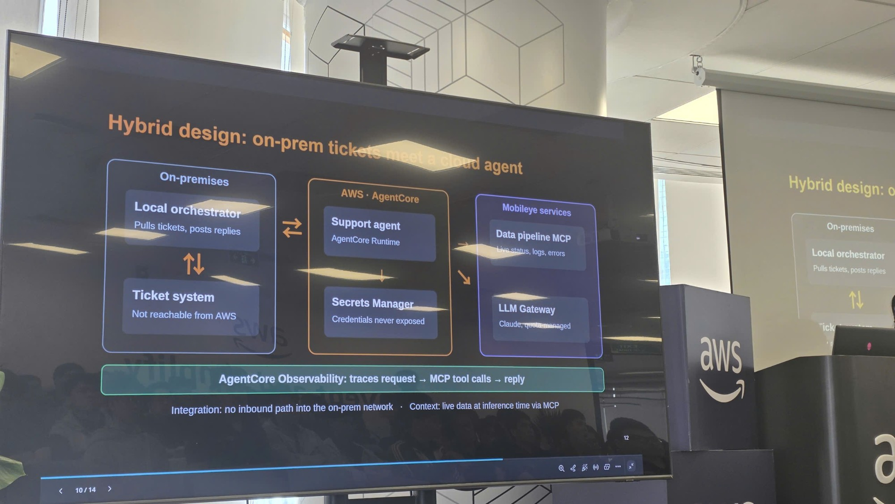

*Hình 10. Thiết kế hybrid: ticket on-premises kết nối với agent trên cloud.*

#### 3. Các thành phần của AgentCore

Phần thứ ba đi sâu vào từng thành phần:

- **Identity:** AgentCore tách xác thực chiều vào và chiều ra như “hai cánh cửa, hai ổ khóa”. Chiều vào trả lời câu hỏi người dùng là ai và có được gọi agent không; chiều ra trả lời agent có đúng là agent đó không và có được truy cập tài nguyên thay mặt người dùng không. Khi chạy, agent giữ một workload access token gắn với cả agent lẫn người dùng.
- **Gateway:** là điểm kết nối chung giữa nhiều agent (hỗ trợ khách hàng, mua sắm, định giá) với API, công cụ và tài nguyên, hỗ trợ MCP, tạo và tìm kiếm tool, phân quyền chi tiết, kết nối riêng tư và lọc tool. Luồng phân quyền gồm token OAuth chiều vào (ví dụ xác thực qua Amazon Cognito), sau đó Gateway đổi workload access token lấy token OAuth chiều ra để gọi API. AgentCore Identity đóng vai trò kho lưu token an toàn.
- **Memory:** trong các thành phần của context window (system prompt, tài liệu RAG, tool, hướng dẫn, lịch sử hội thoại), memory là phần hay bị bỏ qua, nhưng thiếu nó thì agent không học được và không cá nhân hóa được. AgentCore Memory gồm bộ nhớ ngắn hạn lưu nguyên các tương tác và bộ nhớ dài hạn lưu các thông tin rút ra vào vector store; dịch vụ là serverless, tích hợp CloudWatch, cho phép đặt thời gian lưu sự kiện ngắn hạn tối đa 365 ngày, chia namespace và mã hóa dữ liệu khi lưu trữ lẫn khi truyền. Agent ghi tin nhắn và trạng thái vào bộ nhớ ngắn hạn theo kiểu đồng bộ; một module trích xuất tự động chạy bất đồng bộ để chuyển thông tin sang bộ nhớ dài hạn theo các chiến lược như semantic, sở thích người dùng, tóm tắt, episodic hoặc chiến lược tùy chỉnh.
- **Observability:** “không sửa được thứ mình không nhìn thấy”. Observability phục vụ tuân thủ, truy vết, phân tích chi phí, tìm nguyên nhân lỗi trong các luồng không xác định trước, theo dõi độ trễ và đánh giá liên tục. AgentCore thu telemetry theo chuẩn OpenTelemetry từ agent và từ các dịch vụ như Memory, Identity, Gateway, rồi hiển thị trên dashboard hoặc gửi sang công cụ observability bên thứ ba.

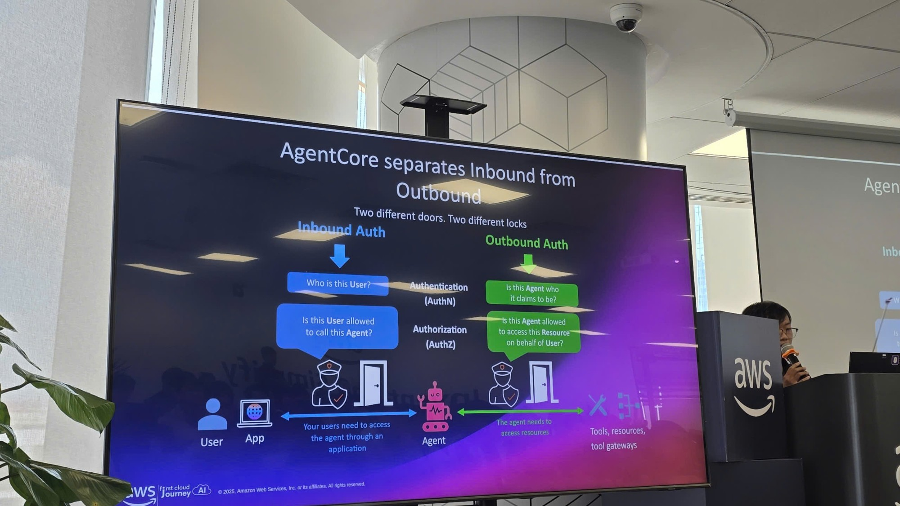

*Hình 11. AgentCore Identity tách xác thực chiều vào và chiều ra.*

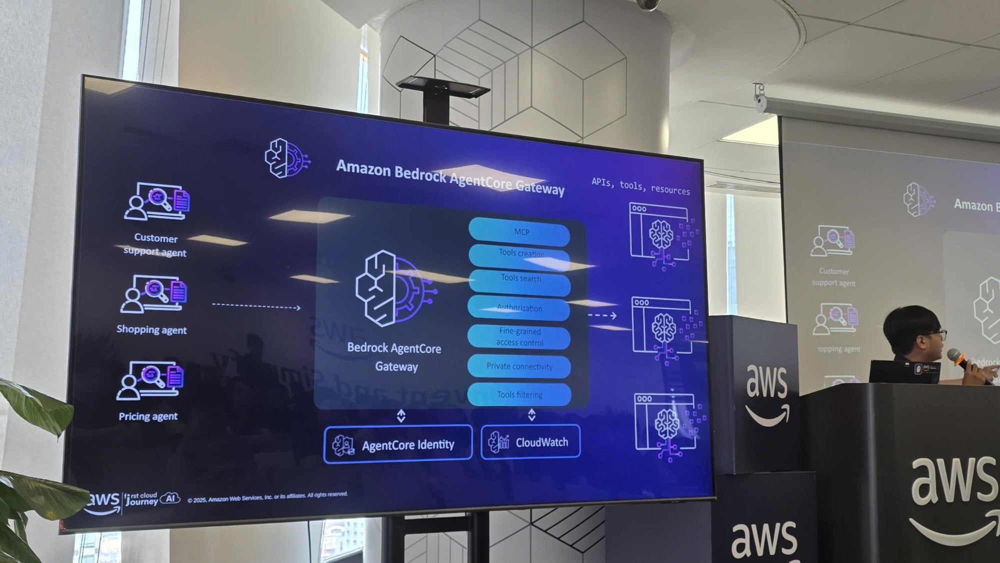

*Hình 12. AgentCore Gateway là điểm kết nối chung giữa agent và công cụ.*

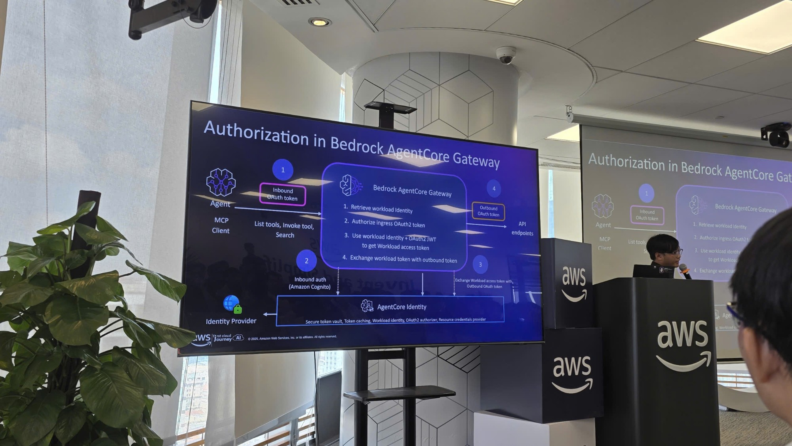

*Hình 13. Luồng phân quyền trong AgentCore Gateway.*

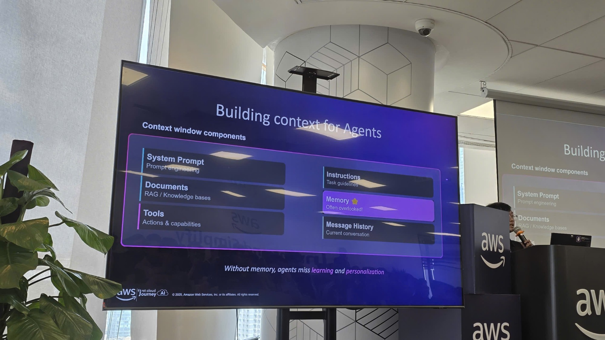

*Hình 14. Memory là thành phần hay bị bỏ qua khi xây dựng ngữ cảnh cho agent.*

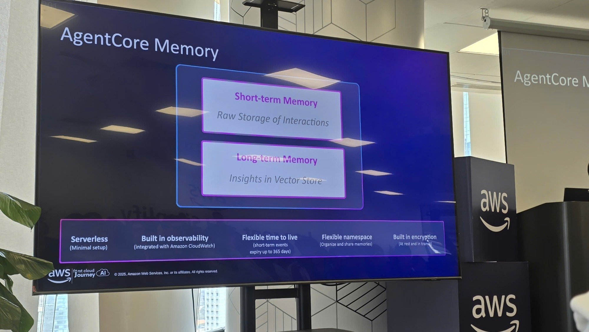

*Hình 15. Bộ nhớ ngắn hạn và dài hạn của AgentCore Memory.*

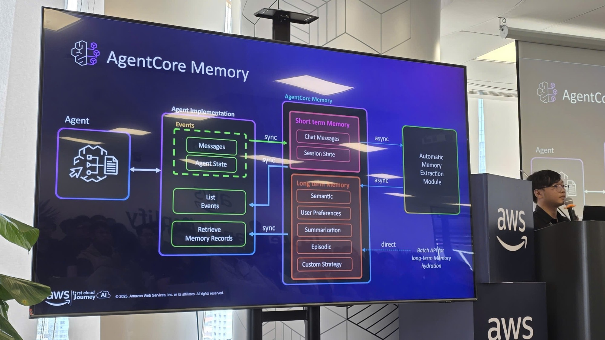

*Hình 16. Luồng ghi và truy xuất giữa agent với bộ nhớ ngắn hạn, dài hạn.*

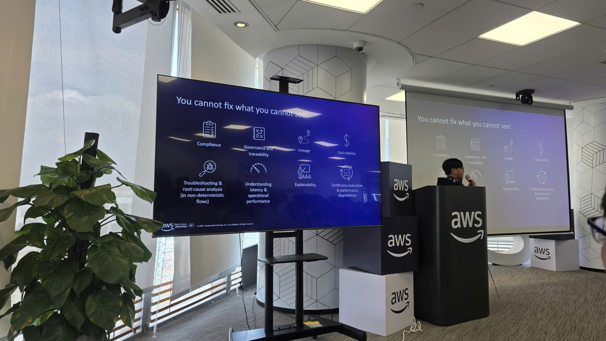

*Hình 17. Những lý do cần observability cho AI agent.*

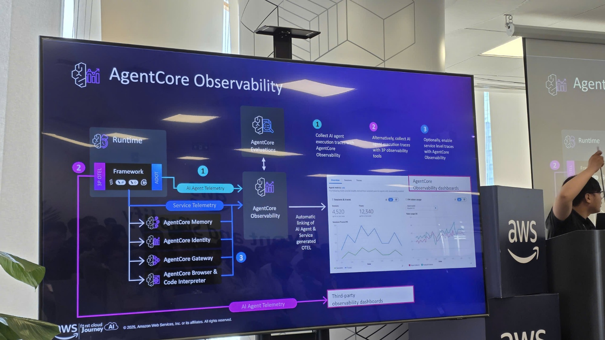

*Hình 18. AgentCore Observability thu telemetry từ agent và các dịch vụ AgentCore.*

#### 4. Demo: từ agent đến kiến trúc triển khai

Phần cuối là demo một hệ thống agent hoàn chỉnh. Strands Agents được dùng để điều phối có kiểm soát: request đi qua FastAPI, một router chuyển đến agent phù hợp (ví dụ agent hỏi đáp, agent tạo ticket, agent nghiên cứu), và các thao tác quan trọng đi qua bước phê duyệt trước khi trả kết quả. Langfuse được dùng để trace luồng làm việc và các lần gọi tool, điều tra độ trễ và lỗi, theo dõi lượng sử dụng mô hình.

Kiến trúc triển khai trên AWS gồm: image lưu trên Amazon ECR, agent chạy trên Amazon ECS với Fargate trong private subnet ở hai Availability Zone, Application Load Balancer nhận request, NAT gateway cho kết nối ra ngoài, Amazon Bedrock cho mô hình, Amazon DynamoDB lưu dữ liệu và Amazon CloudWatch để giám sát. Phần bảo mật dùng IAM và Secrets Manager; phần tối ưu chi phí dùng Cost Explorer và AWS Budgets.

Kiến trúc này dùng lại nhiều thành phần tôi đã thực hành: VPC hai tầng public/private với NAT gateway (Lab03), IAM và KMS (Module 05), DynamoDB (Lab60, Lab39) và AWS Budgets (Lab07). Điều khác biệt là tất cả được ghép lại quanh một bài toán AI cụ thể, có giám sát và kiểm soát chi phí ngay từ thiết kế.

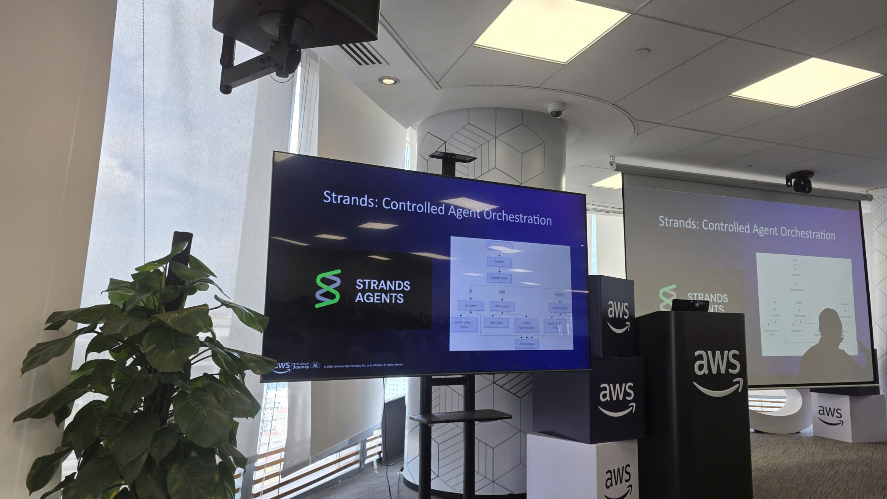

*Hình 19. Điều phối agent có kiểm soát với Strands Agents.*

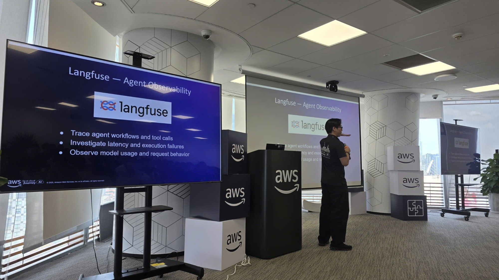

*Hình 20. Dùng Langfuse để quan sát agent trong phần demo.*

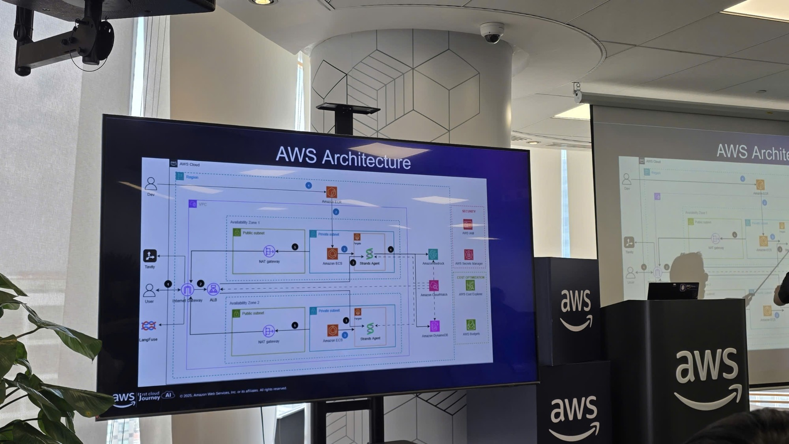

*Hình 21. Kiến trúc triển khai hệ thống agent trên AWS trong phần demo.*

### Bài học rút ra

- **Prototype chạy được chưa phải là sản phẩm:** Một hệ thống AI cho doanh nghiệp cần bảo mật, mở rộng, tích hợp và giám sát ngay từ đầu, không phải làm thêm ở cuối.
- **Bảo mật cho AI rộng hơn IAM:** Ngoài mã hóa và phân quyền, cần tính đến rủi ro riêng như prompt injection, và tách rõ quyền của người dùng với quyền của agent.
- **Không giấu credential trong code:** Dùng Secrets Manager hoặc token vault để agent lấy thông tin xác thực khi cần.
- **Agent cần được quan sát và chấm điểm:** Agent có thể trả lời sai mà không báo lỗi, nên phải trace từng bước và đánh giá kết quả thường xuyên.
- **Memory là một phần của thiết kế:** Phân biệt rõ dữ liệu cần nhớ trong phiên và dữ liệu cần giữ lâu dài, kèm thời gian lưu và mã hóa.

### Áp dụng vào công việc

Với workshop cá nhân, tôi sẽ dùng bốn câu hỏi của buổi chia sẻ để rà soát kiến trúc: dữ liệu được bảo vệ thế nào, hệ thống mở rộng ra sao khi tải tăng, các thành phần tích hợp với nhau thế nào và làm sao biết hệ thống đang chạy đúng. Thông tin bí mật sẽ được quản lý bằng Secrets Manager thay vì ghi trong code hoặc biến môi trường.

Phần kiểm thử và giám sát của workshop sẽ không chỉ dừng ở log và metric CloudWatch, mà có cả các trường hợp kiểm tra kết quả đầu ra. Nếu workshop có dùng AI, tôi sẽ ghi lại từng bước xử lý để có thể truy vết khi kết quả không như mong đợi.

### Trải nghiệm tham gia sự kiện

Buổi workshop có nhiều nội dung mới với tôi, nhất là các thành phần của AgentCore. Cách phần đầu dùng câu chuyện nhà hàng giúp tôi theo kịp những khái niệm khá trừu tượng, còn phần demo cho thấy các dịch vụ được ghép lại thành một kiến trúc chạy được. Nhiều phần chia sẻ do các thành viên cộng đồng FCAJ trình bày, nên tôi cũng thấy rõ hơn những gì mình có thể đạt được sau kỳ thực tập.

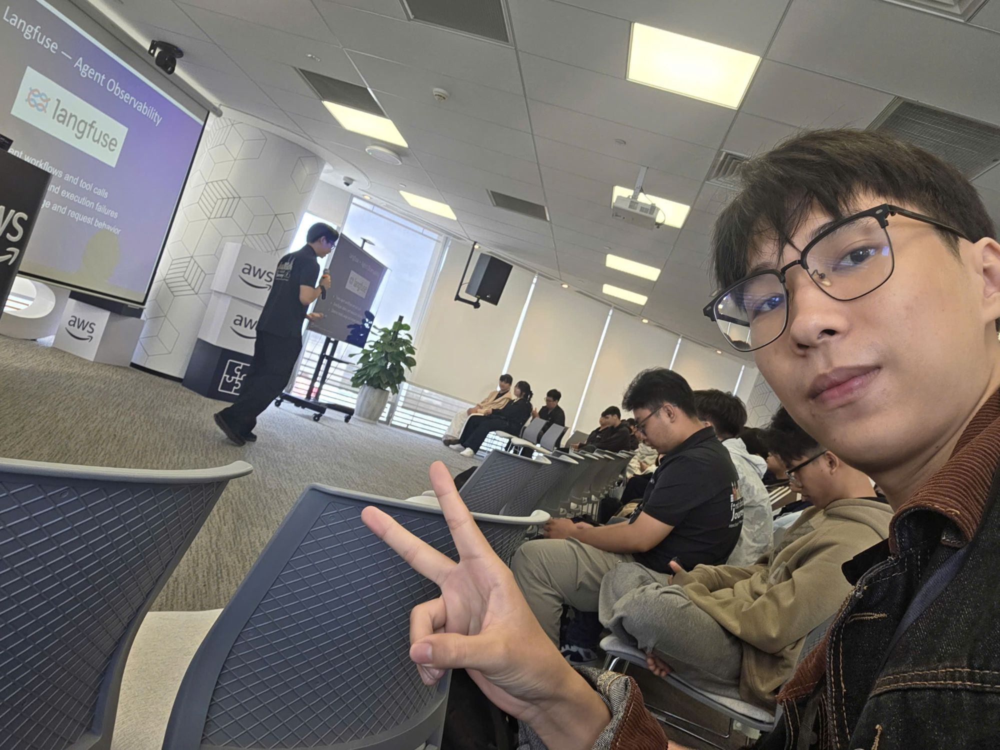

*Hình 22. Ảnh check-in của tôi trong phần demo tại sự kiện ngày 14/11/2026. Các ảnh trong bài thuộc bộ ảnh tham dự cá nhân của tôi.*

### Tài liệu tham khảo

1. **AWS Documentation:** [Amazon Bedrock AgentCore – Overview](https://docs.aws.amazon.com/bedrock-agentcore/latest/devguide/what-is-bedrock-agentcore.html).
2. **AWS Documentation:** [AgentCore Identity](https://docs.aws.amazon.com/bedrock-agentcore/latest/devguide/identity.html), [AgentCore Gateway](https://docs.aws.amazon.com/bedrock-agentcore/latest/devguide/gateway.html), [AgentCore Memory](https://docs.aws.amazon.com/bedrock-agentcore/latest/devguide/memory.html) và [AgentCore Observability](https://docs.aws.amazon.com/bedrock-agentcore/latest/devguide/observability.html).
3. **Strands Agents:** [Trang chủ dự án Strands Agents](https://strandsagents.com/).
4. **Langfuse:** [Trang chủ Langfuse](https://langfuse.com/).
